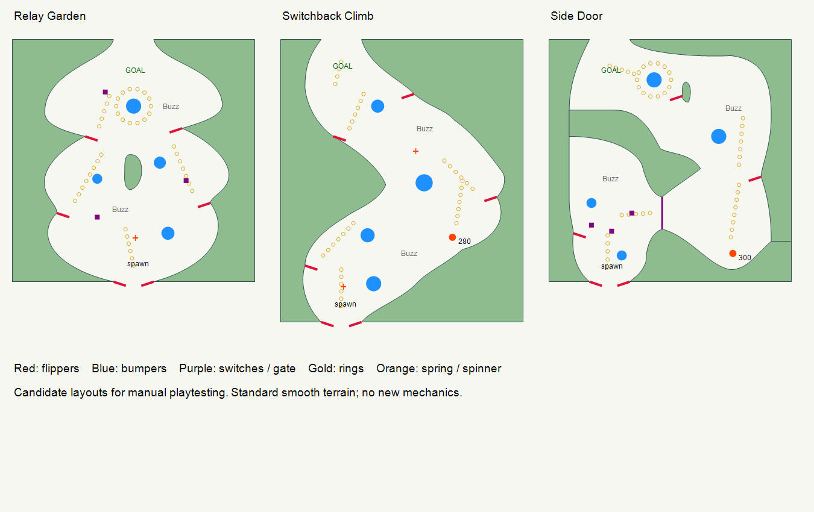

# Authored-style Act candidates

Three hand-authored trial Acts live in `data/acts/Candidates/`. They are outside `Authored`, so they do not enter Prototype's production pool. The five source Acts, engine physics, scoring, themes and bake workflows are unchanged. These are complete editable Act resources, not a new procedural generator.

## What the current Acts do

This assessment uses the current saved geometry, transformed object positions, resolved properties, ring patterns and Bank links. Design strengths and risks below are layout readings, not new playtest verdicts.

| Source Act | Flippers | Enemies | Physical rings, including rails | Main layout role | Playtest question |
|---|---:|---:|---:|---|---|
| First Try Smooth Decor | 8 | 2 | 20 | Broad curved court, multiple wall catches, central island with outward-facing paddles, short diagonal ring guides. Bumpers supply the scoring and redirection. | Do side catches reliably offer the next upward shot, or do repeated misses funnel back to the bottom? |
| RampMania | 5 | 1 | 82 | Two stacked chambers with a narrow middle, two rails, two spinners and a five-switch exit Bank. Circular racks reward revisiting bumpers. | Scoring can finish before the route does. Watch time spent finding the final shot after enough points. |
| Reverse C Spring | 5 | 1 | 25 | An asymmetric curved climb. Small Springs redirect between courts; mixed-size bumpers and isolated upper paddles create a relay. Three switches form a scoring-only Bank. | Is the sideways Spring handoff readable and repeatable? Missed upper shots have a substantial return trip. |
| Secret Entry | 5 | 2 | 44 | Lower switch court, side doorway, curved right ascent, upper reward pockets and a rail across the dividing terrain. Seven switches open a gate. | The gate gives a clear objective, but a missed last switch may prolong the lower court. |
| SpringUp | 6 | 2 | 34 | Shorter vertical relay around a central island. Five ordinary ring trails point between paddles; one Spring assists the final climb. Four switches form a scoring-only Bank. | Does each elevated paddle catch enough falling traffic to make the route feel connected? |

### Shared authoring language and values

- Cells are 50 px; four source Acts are 600x600 px, RampMania is 600x800. New trials use 600x600 or 600x700.
- Bottom paddles align with a two-cell entry opening: pivots 100 px apart, 32.5 px paddle length, approximately 30 px clear tip gap at rest. Extra paddles sit at curved wall/ledge catches, not arbitrary open-field positions.
- Every source flipper uses approximately 18.3 degrees left / 161.7 degrees right. The trials retain those rest angles and shared physics profiles.
- Authored ring patterns use 20 px spacing. Straight/diagonal trails guide shots; compact ellipses are the deliberate 500-point Bonus Racks. Ordinary rings are not accidental racks.
- Source Springs: Reverse C 180/200/300 px/s, Secret Entry 220/315, SpringUp 300; RampMania 300/500/500, with the faster pair beside rail-entry routes. Source widths are 20 or 40 px. Candidate widths are 30 px, with speeds 280/300; Relay Garden needs no Spring.
- Source bumper scale spans 1.0-2.5; trials use 1.0-1.7. No bumper response or flipper launch overrides are stored in the trial Acts.
- Switches pay 25; Banks pay 500 and default to no timed reset. Spinners pay 5 per tick, ten ticks per 300-point completion. These are retained.
- All trials have exactly two Buzz Bombers: size 1, patrol speed 65 px/s, 15-second respawn, and bounded 40 px total patrol spans.

## The three trials

| Candidate | Flippers | Bumpers | Rings | Existing mechanics | Intended play |
|---|---:|---:|---:|---|---|
| Relay Garden | 6 | 4 | 40 | Three-switch scoring Bank + one Spinner | Open three-stage court. Recover on either middle paddle, choose a side around the divider, then use an upper catch to approach the Goal. A single rack surrounds the upper bumper. |
| Switchback Climb | 6 | 4 | 36 | One 280 px/s Spring + two Spinners | Continuous S-shaped corridor. Alternating wall catches change the shot direction. Right-side Spring assists the middle bend; ordinary ring trails mark the changing lanes. |
| Side Door | 5 | 4 | 44 | Three-switch Bank and linked One-Way Gate + one 300 px/s Spring | Clear the lower targets, take the doorway into the right chamber, then use the Spring/right paddle to reach the upper court. A small upper perch supplies the final leftward shot. |

No Slingshots, Drop Targets or new mechanics appear. These are new contours and placements inspired by the authored layouts, not mirrored copies. Side Door deliberately uses fewer switches than Secret Entry to test the chamber idea without a seven-target opening task.

The schematic below shows terrain, paddle positions and scoring routes. It omits terrain height and is not a trajectory simulation.

## Verification and limits

`Godot.exe --headless --fixed-fps 120 --path . --script res://tests/candidate_acts_regression.gd`

The 27 focused checks cover loading, exact save/reload, two enemies and supported mechanic types, normal-game startup, 35-45 rings with ball-radius terrain/bumper clearance, moving paddle clearance beyond mounted hinges, ordinary serve sanity, physical Spring contact, and Bank completion/gate links. A moving paddle in Switchback Climb initially grazed its wall; its pivot moved 4 px into the lane. Three ring/bumper overlaps were corrected without changing terrain or physics rules.

With Balanced settings, the 280 and 300 px/s contact traces reached approximately 245 and 278 px above their Spring centers, including the pad/ball contact offset. Peak observed speed remained 280 and 300 px/s. Floaty, character modifiers, subsequent bumper hits and flipper shots can change the resulting route; these measurements are not universal speed caps. Side Door also passed a Forward+/Vulkan rendered startup and presentation check.

These checks do not prove end-to-end human completion, satisfying flipper timing, comparable difficulty or balanced score targets. Source assessment and proposed route identities still need Alex's playtest. No production promotion or bake was performed.

## First manual pass

Open each `.tres` from Act Geometry Editor, then Play Act; alternatively use Play Act / Load Act and browse into `data/acts/Candidates`. Test in this order:

1. **Relay Garden:** Do the two middle catches feed useful upper shots? Can you recover after missing the divider? Is the ring rack worth pursuing?
2. **Switchback Climb:** Does the S route feel connected? Does the 280-speed Spring reach the next court without skipping it? Can the upper-left paddle catch a miss?
3. **Side Door:** Are all three lower targets practical to hit? Is the unlocked doorway obvious? Does the 300-speed Spring feed the right paddle and upper court?

Keep the same character/profile and theme for the first comparison. Report the most awkward shot and whether each Act merits another revision. Build more only after this batch gets a verdict.
