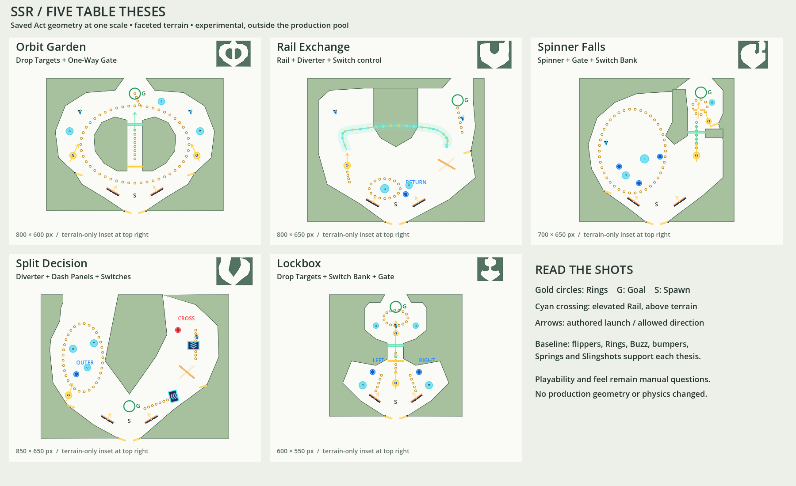

# Five experimental Act theses

Open a `.tres` under `data/acts/Experiments` in Act Geometry Editor and press Play. This now runs a single-Act Prototype test with a visible Goal, a 1,000-point target and Practice retries. These are independent, editable Acts, outside the production pool. The five production Acts and the earlier candidates are unchanged. The layouts themselves needed no engine, scoring or physics changes.

The overview uses saved terrain and the existing gameplay preview, at 0.5 screen pixels per physics pixel. Terrain-only insets make silhouette comparisons possible without the objects. It is a geometry overview, not a trajectory prediction; the cyan rail crosses above the solid center of Rail Exchange.

## Orbit Garden

**Thesis:** A wide island court offers two circulation directions around a physically defended interior shortcut.

**Featured mechanics:** Drop Target Bank; One-Way Gate.

**Main intended shots:**
- Main paddles send Ball toward either side of the island; side Springs and recovery paddles feed the upper orbit.
- Attack the three targets across the island slot. Each dropped target exposes a usable opening; clearing all three exposes the full lane.
- Take the cleared slot or an orbit exit toward the upper Goal.

**Safe route:** Follow the outer Ring loop, visiting the side bumper/enemy pockets and returning to the lower pair.

**Risk route:** Aim into the narrow interior target row for a shorter climb and its denser Ring line.

**Testing:** Whether orbit terrain plus disappearing targets makes a satisfying repeatable loop.

**Current-system adjustment:** Drop Banks have no Gate-action binding. The targets themselves are the shortcut barrier. The Gate above them permits upward travel and prevents downward backtracking; it does not falsely pretend to receive a Bank-completion command. The substantial island is split into two solid halves to contain the physical slot.

## Rail Exchange

**Thesis:** A Spring-fed elevated crossover clears a central land mass and delivers Ball to a player-controlled left/right return.

**Featured mechanics:** Elevated Rail; Diverter; Switch control.

**Main intended shots:**
- From the main pair, attack the left Spring entry to mount the ring-bearing rail.
- Hit the lower `RETURN` switch to toggle the exit Diverter; it rearms after 1.5 seconds.
- Use the right return and upper-right paddle to attack the upper enemy and Goal; the other setting feeds back toward the lower court.

**Safe route:** Lower bumper/ring circulation with returns to the main pair.

**Risk route:** Commit to the rail entry and convert the selected exit into an upper reward shot.

**Testing:** Whether crossing real terrain at elevation and choosing a return makes the table feel spatially different.

**Current-system adjustments:** A Switch is the existing way to command a Diverter. It replaces Dash Panels in the featured trio, while the 315 px/s Spring supplies entry speed. The first crossover climbed too high and rolled back during testing; lowering its planar route fixed completion without increasing Spring strength. It still clears the central land at 65 px elevation. States A/B were physically checked to deflect right/left respectively.

## Spinner Falls

**Thesis:** A large left bowl recirculates score, while an angular, gated upper-right pocket makes the Spinner a deliberate destination.

**Featured mechanics:** Spinner; One-Way Gate; Switch Bank.

**Main intended shots:**
- Use the left recovery paddle and bowl rebounds to revisit the wide Ring arc and its enemy pocket.
- Collect three separated lower switches to open the upper-right throat.
- Hit the 280 px/s entry Spring through the open throat; the pocket's small 180 px/s Spring redirects repeat attempts through the Spinner and toward the Goal.

**Safe route:** Left bowl, bumpers and lower returns.

**Risk route:** Open and maintain contact inside the small Spinner court rather than repeatedly draining back to the bowl.

**Testing:** Whether the Spinner becomes a chosen scoring destination, and whether the pocket supports satisfying repeated shots instead of an incidental clip.

## Split Decision

**Thesis:** A large top-connected wedge divides a wide scoring bowl from a narrow boosted lane before both routes return to one lower apron.

**Featured mechanics:** Diverter; Dash Panels; Switches.

**Main intended shots:**
- Choose the wide left branch from the main pair for its bumper circuit, Ring arc and recovery Spring.
- Attack the right branch's Buzz/Dash lane for a faster return.
- `OUTER` selects the right-wall return; `CROSS` selects the cross-table return. The second Dash Panel points toward the shared apron.

**Safe route:** Left bowl and recovery paddle.

**Risk route:** Right Dash/Buzz lane and Diverter, with less time to settle the next contact.

**Testing:** Whether the branches communicate a conscious safe-versus-momentum choice.

**Layout adjustment:** Goal sits on the shared return apron, clear of the fork tip. Either branch can approach it at a different angle once the run's score condition is met. The optional top connector is in the left branch; it is not buried inside the dividing wedge.

## Lockbox

**Thesis:** A compact angular arena progressively exposes a narrow vault throat, turning the upper room into a repeatable reward destination.

**Featured mechanics:** Drop Target Bank; Switch Bank; Gate.

**Main intended shots:**
- Aim through the center approach Spring to knock down targets across the vault mouth.
- Hit the visible `LEFT` and `RIGHT` switches to open the separate Gate.
- Reuse the cleared throat for the vault Ring cluster, Buzz, bumpers and short final Spring shot to the Goal.

**Safe route:** Lower bumper rebounds, Slingshots and main-paddle recovery.

**Risk route:** Precise center shots into the initially defended throat, followed by upper-room scoring.

**Testing:** Whether clearing physical defenses makes progress more satisfying than completion score alone.

**Progression:** The two defenses are independent. Switches can be cleared before or after the targets; no hidden sequence is required. Targets stay down and the Gate stays open. Individual target gaps can be used before the entire Bank is cleared.

## Population and restrained routing values

| Act | Size (px) | Rings, including rail | Buzz | Flippers | Springs (px/s) |
|---|---|---:|---:|---:|---|
| Orbit Garden | 800 × 600 | 60 | 2 | 4 | 300 / 300 |
| Rail Exchange | 800 × 650 | 43 (17 on rail) | 2 | 3 | 315 |
| Spinner Falls | 700 × 650 | 58 | 1 | 4 | 280 / 180 |
| Split Decision | 850 × 650 | 50 | 1 | 4 | 260 |
| Lockbox | 600 × 550 | 31 | 1 | 2 | 270 / 160 |

Every Act has a main flipper pair and inward-aimed lower Slingshots. Slingshot outgoing speeds are 260-280 px/s. Dash Panels add 90/110 px/s with a 420 px/s cap, rather than applying an unlimited boost. Existing flipper/profile values remain unchanged. Buzz placement rewards orbit pockets, upper chambers, the fast lane or the opened vault; it is not counted as a featured mechanic.

Terrain is authored as broad-facet composite outlines, using the isolated 16-side study's visual language where curves are appropriate, with deliberate angular faces elsewhere. The same contours control visuals and collision. This is not a global change to `CURVE_STEPS` or a production migration. Authoring knobs remain experimental.

## Verification

`Godot.exe --headless --fixed-fps 120 --path . --script res://tests/act_theses_regression.gd`

43 focused checks passed: valid resources, exact save/reload, all five shared-engine startups, featured/baseline instantiation, clear spawn/Goal positions, physical strikes from both primary paddles, target/Bank completion and linked Gate actions. The rail also passes the compiler's terrain/hardware clearance checks. A physical contact with its actual entry Spring completed the whole crossover, and both Diverter states produced opposite horizontal returns. Rail Exchange separately passed an 11-check Forward+/Vulkan rendered run.

The tests do not certify fun, balance, every missed shot or end-to-end human Goal reachability. Alex's manual pass should focus on: Orbit's slot versus the long orbit; Rail's return choice; Spinner pocket retention; Split's perceived route difference; Lockbox's visible progression. No exhaustive visual matrix, production bake or production Act edits were made.

**Play-path correction:** The original content smoke pass used the older standalone engine, which did not instantiate Goal Rings. Editor Play now launches the current Prototype session. Nine focused session checks pass headlessly and with Forward+/Vulkan: the saved Lockbox loads without bakes, its Goal is visible, score unlocks it, contact completes the Act, and restart resets it. Normal run planning retains its 41 passing checks.

Regenerate the overview after edits with `Godot.exe --path . --script res://experiments/act_theses/overview.gd`. A dedicated 1800×1100 viewport avoids dependence on the game's window/stretch settings.
