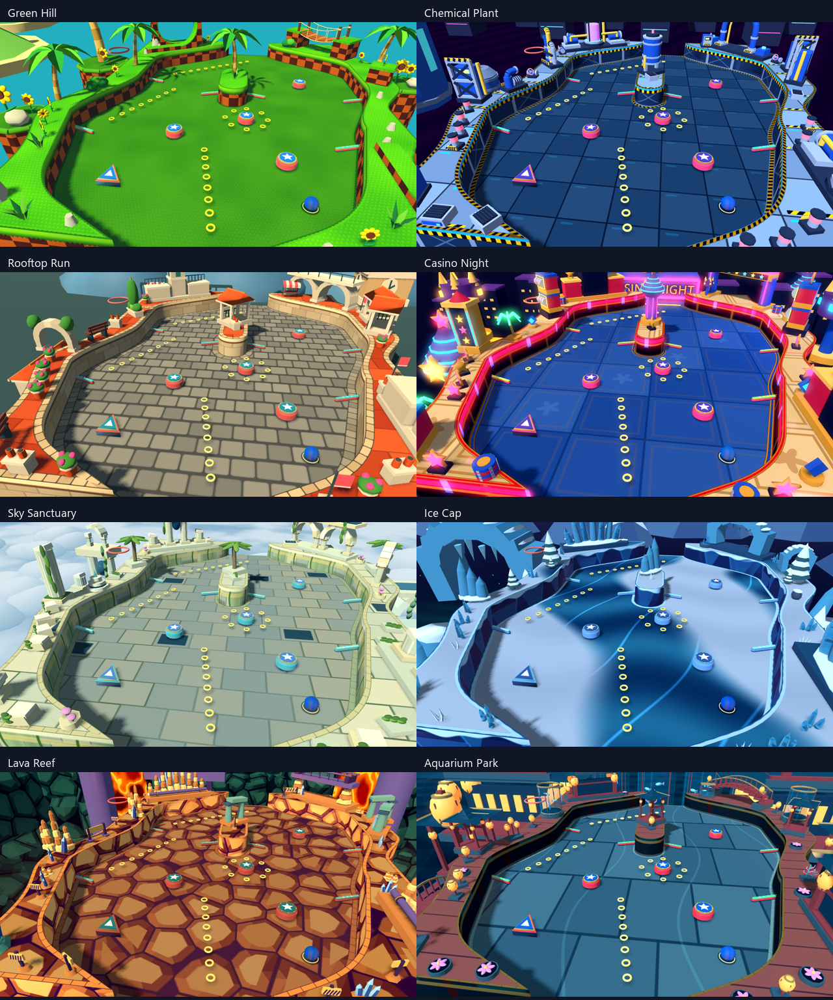
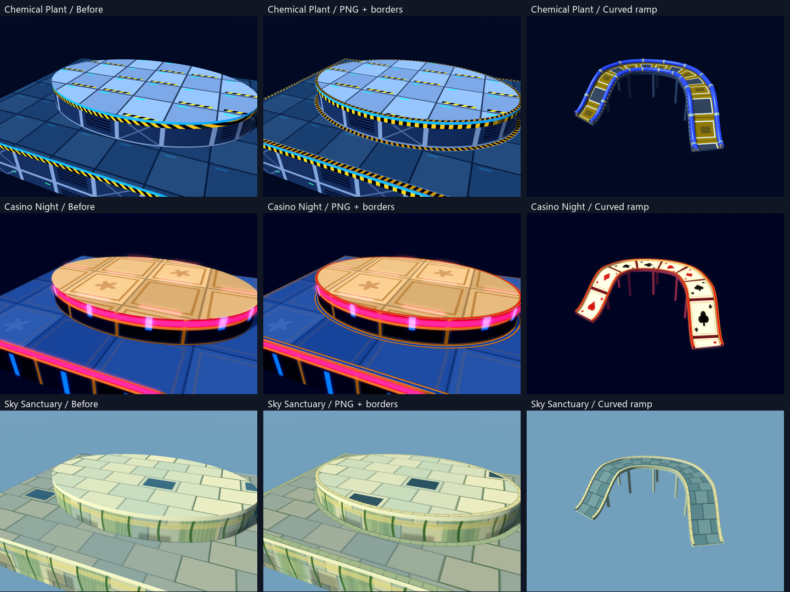
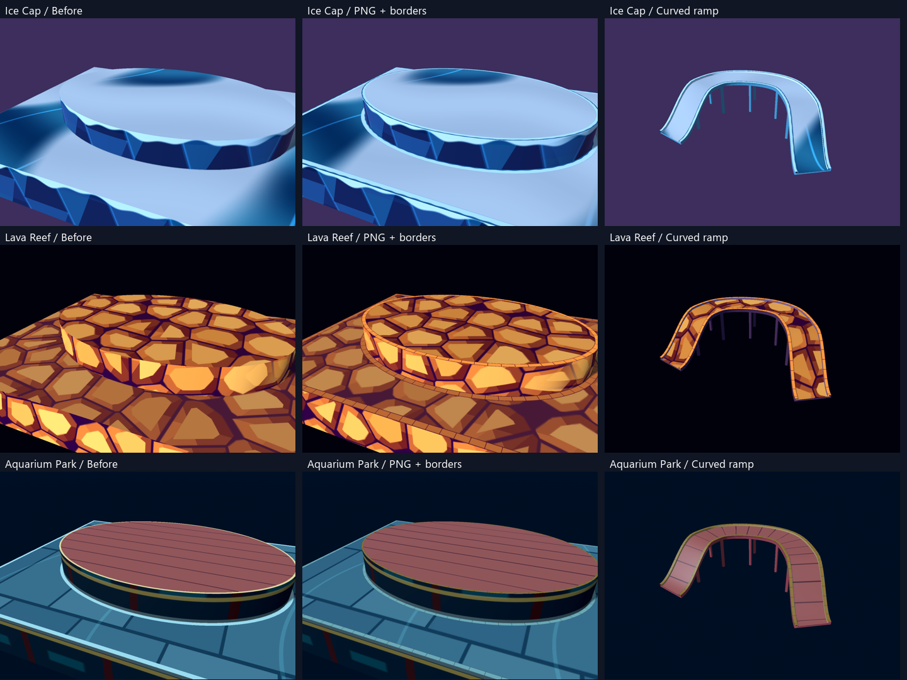

# Editable terrain textures across all eight themes

Every registered theme now has image-based floor, raised-top, wall, outer-facade and ramp artwork, plus floor and top borders that follow the final terrain contours. Ramp edge caps use the same top-border artwork with route-distance coordinates. These are presentation changes: Act geometry, collisions, route height, width, control points, scoring and physics remain unchanged.

## Coverage and tuning

| Theme | Floor / top border width, physics pixels | Border treatment | Curved ramp |
| --- | --- | --- | --- |
| Green Hill | 5 / 3 | Existing grass trim | [Timber deck and grass edges](all-theme-textures/green_hill-ramp.png) |
| Chemical Plant | 6 / 4 | Steel-framed hazard strip | [Panel modules, pipes and hazard edges](all-theme-textures/chemical_plant-ramp.png) |
| Rooftop Run | 12 / 8 | Existing cobblestone courses | [Terracotta deck and coping stones](all-theme-textures/rooftop_run-ramp.png) |
| Casino Night | 6 / 4 | Brass with blue/ruby luminous inset | [All four card suits and brass edges](all-theme-textures/casino_night-ramp.png) |
| Sky Sanctuary | 7 / 5 | Pale stone with moss-colored joints | [Stone deck and segmented coping](all-theme-textures/sky_sanctuary-ramp.png) |
| Ice Cap | 6 / 4 | Snow over a blue ice rim | [Snow/ice deck and snowy edges](all-theme-textures/ice_cap-ramp.png) |
| Lava Reef | 7 / 5 | Gold rock with dark mineral joints | [Boulder deck and mineral edges](all-theme-textures/lava_reef-ramp.png) |
| Aquarium Park | 4 / 2 | Slate floor edging and brass top trim | [Lacquered planks and brass edges](all-theme-textures/aquarium_park-ramp.png) |

Widths and colors are provisional visual tuning. Narrow open walls retain reduced borders so their center remains visible. Ramp trim retains its existing width and bend-radius protection. Sharp corners and junctions use the existing miter/local-tangent behavior; the conversion does not smooth or simplify stored outlines.

The six newly converted sets live in `assets/textures/<theme_id>/`. Each contains seven editable color images: `floor.png`, `top.png`, `wall.png`, `facade.png`, `ramp.png`, `floor-border.png`, and `top-border.png`. Every image has two companion maps:

- `*-emission.png` stores glow divided by the theme's `emission_scale` in `scripts/themes/terrain_texture_sets.gd`. Black means no glow. Lower scales preserve precision for subtle ice and lagoon lighting; Casino retains HDR neon intensity.
- `*-surface.png` stores roughness in red, specular strength in green and metallic amount in blue. It is linear data, not color artwork.

Color/glow imports use the shader's color hints; surface maps do not. All maps use lossless import and mipmaps. Edit the PNGs, allow Godot to reimport, and restart or reselect the theme. Ordinary gameplay never regenerates painted artwork. Green Hill and Rooftop retain their previously documented file layouts: [Green Hill](GREEN_HILL_TEXTURES.md), [Rooftop](ROOFTOP_TEXTURES.md).

Floor/top/ramp maps are 1024², walls/facades 1024×512, and border strips 512×128. Floor interiors remain world-aligned. Walls retain normal-weighted projection, repeating horizontally while clamping their 1.6-world-unit depth strip. Border U follows the path and V spans its width. Ramp decks now follow route distance in every theme; Chemical Plant's panel modules and Casino's cards also use normalized deck width. Runtime shaders handle mapping, lighting and Ice Cap's view-dependent Fresnel response. Animated lava, liquid, water, aurora, scenery and decor effects keep their existing shaders.

## Comparisons

The same camera, light and mesh were captured before conversion and after conversion. The initial recipes preserve each theme's motifs; some spatial variation was made periodic so the PNGs tile. Ice drift frequencies, Sanctuary's repeating stone palette and Lava Reef's boulder seed repeat are therefore not pixel-identical to the unbounded procedural versions.

Individual full-size `*-curve-before.png`, `*-curve.png`, `*-ramp-before.png` and `*-ramp.png` files are in `docs/all-theme-textures/`. Before images are historical captures; rerunning the tool against current code produces current materials.

Actual-game captures of the same smoothed local Act are named `local-act-<theme>.png` and `local-act-<theme>-detail.png`. The review loads an isolated copy and checks its bytes after the theme cycle; the user's source Act is not rewritten or committed.

## Missing-surface audit

All eight themes supply non-null floor and top borders. The runtime ramp audit checks one deck, two edge caps, two fascia faces, two inner-edge faces and an underside per ramp, plus finite path-aligned border coordinates. Chemical Plant retains both blue pipes and their couplings. Ice Cap, Lava Reef and Aquarium Park previously reused world-projected terrain on ramps; they now have dedicated route-mapped PNG decks.

Generated wall-mounted flipper housings bypass the authored terrain border path. Their missing top-border surface is now included in their existing presentation mesh. Authored solid walls, open rails and floor boundaries retain their existing border builders, without duplicate coplanar bands. This audit checks the rendered fixtures and registered themes; it does not add gameplay ramps to Acts that have none.

## Reproduce and limitations

Use Godot 4 with `--path .`. Graphical captures on the verified Windows setup use `--rendering-method gl_compatibility --rendering-driver opengl3_angle`.

- `--script res://tests/all_theme_texture_review.gd`: curved walls/ledges and elevated ramps, all eight themes.
- `--script res://tests/all_theme_texture_scene.gd -- --act=res://data/acts/YourAct.tres`: actual game, identical document and ball identity across theme switches. The default Act is the committed terrace example.
- `--headless --script res://tests/theme_texture_regression.gd`: imported maps, lossless mipmaps, route mapping and generated housing borders.
- `--headless --script res://tests/ramp_height_theme_regression.gd`: physical ramp clearance plus rendered ramp/border coverage across all themes.
- `--headless --script res://tests/terrain_border_regression.gd` and `res://tests/theme_runtime_regression.gd`: contour validity and gameplay-state preservation.
- `--script res://tools/bake_theme_textures.gd -- --overwrite`: explicitly regenerate the six new sets from the original shaders and border recipe. This overwrites painted edits; do not use it for ordinary texture tuning.

PNG artwork uses texture memory and has finite close-up resolution. Dense smoothed Acts still take several seconds to rebuild presentation; borders are built on loading/theme changes, not every frame. Human review still owns border widths, mortar contrast and readability under the retro filters. No external artwork was downloaded.

## Verification — 2026-10-25

Godot 4.7.2 on Windows, isolated checkout of `4c6a297` plus this change:

- Editor import completed without script or shader errors.
- Theme texture coverage: **282 checks, 0 failures**.
- Terrain border geometry: **226 checks, 0 failures**.
- Ramp heights, surfaces and all-theme ledges: **90 checks, 0 failures**.
- Theme runtime, authored/generated layouts and state preservation: **813 checks, 0 failures**.
- Pinball mechanics, including elevated traversal and source switching: **42 checks, 0 failures**.
- **16** final curved-wall/ramp captures and **16** actual-game captures completed without errors and were visually reviewed. All eight theme switches kept the document fingerprint and ball identity; the local Act copy remained byte-identical to its source.

The five regression scripts total **1,453 checks**. A final authored-game integration run in the main working directory passed another **70 checks**, bringing the total to **1,523**. Four mixed-indent lines in the local gameplay script were normalized back to their committed whitespace so this startup check could run; gameplay code was not changed. The smoothed local Act's theme rebuilds measured approximately **2.1–3.5 seconds** during the capture run; these are loading/rebuild times, not frame-rate benchmarks. The full regression suite used an isolated checkout to preserve unrelated local work. Logs are under the ignored `test-results/all-theme-textures/` directory.
