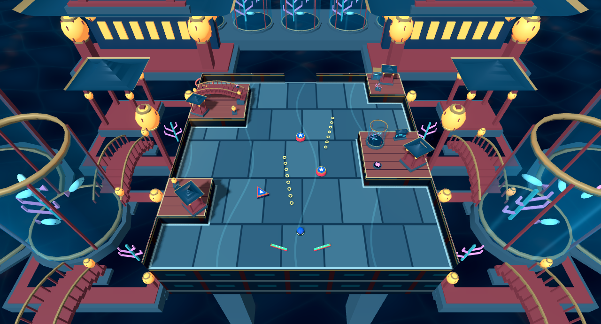
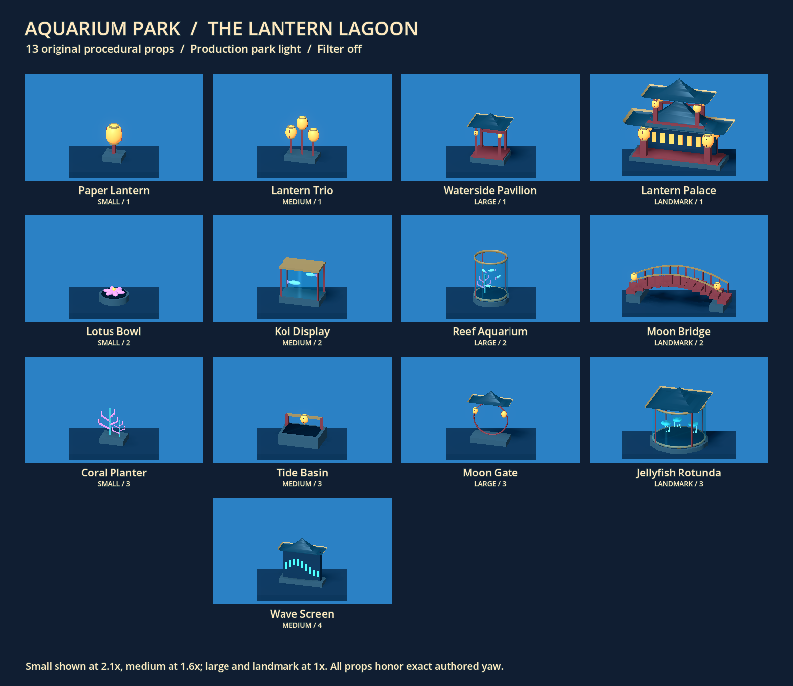

# Aquarium Park — the Lantern Lagoon

Aquarium Park is the eighth selectable presentation skin. The same authored or generated table gains polished slate, lacquered raised walkways, architectural retaining walls, amber lanterns, curved aquarium glass and a layered nighttime water park. All geometry and shaders are original procedural work. No Sega textures, meshes, sprites, models or audio are included.

## Research before implementation

The primary visual source was [SEGA's official Sonic Colours Ultimate stage gallery](https://sonic.sega.jp/SonicColors/Ultimate/), with four screenshots inspected directly in the browser:

- [Architecture](https://sonic.sega.jp/SonicColors/Ultimate/assets/images/jp/common/ss/img_world05_ap01.jpg): layered red pavilions, swept roof silhouettes, repeated warm lamps, cool enclosure panels and small luminous structural accents.
- [Underwater structures](https://sonic.sega.jp/SonicColors/Ultimate/assets/images/jp/common/ss/img_world05_ap02.jpg): lantern-lined platforms, aquatic displays and cool depth around warm architecture.
- [Water surface](https://sonic.sega.jp/SonicColors/Ultimate/assets/images/jp/common/ss/img_world05_ap03.jpg): blue rippled water, visible underwater detail, rocky boundaries and an illuminated pavilion beside the pool.
- [Aquatic planting](https://sonic.sega.jp/SonicColors/Ultimate/assets/images/jp/common/ss/img_world05_ap04.jpg): layered coral and plant fans, large vertical supports and architecture seen through water.

The defining combination is an illuminated attraction built around enormous aquatic spaces. Architecture provides scale and rhythm; water supplies the atmosphere. The game's stylized East Asian imagery is treated as inspiration rather than a historically exact architectural reconstruction.

### The Generations reference

Aquarium Park is not an official Sonic Generations stage. The [Generations mod guide](https://steamcommunity.com/sharedfiles/filedetails/?id=159333239) identifies its Aquarium Park entry as a port of Colours Act 1, credited to SonicHyuga. This task used official Colours imagery only. No claim is made about having visually studied that community port or about an official Generations reinterpretation. Colours already provides both three-dimensional architecture and underwater views.

## Our interpretation

**Water and architecture:** A deep lagoon sits below the table. Three waterside terraces on each flank, arched connecting bridges, two large aquarium towers and a remote pavilion gallery establish a multi-level attraction. Four structural piers support the table visually. Background placement derives from table bounds; it never changes collision geometry. Distant buildings deliberately exceed the table's scale.

**Playable surfaces:** Staggered slate slabs with restrained wave inlays distinguish the floor. Raised terrain and the existing ramp deck use lacquered planks. Pale stone contours separate floor from obstacles; narrow brass contours finish raised caps. World-projected retaining bays use red uprights, stone courses and small cyan inserts, including on curved or arbitrary authored walls. This is an architectural structure, not a dirt cliff.

**Lantern light:** Faceted paper bodies have visible ribs, caps and tassels. Warm emission and modest Environment glow make the fixtures luminous. Exactly two unshadowed amber spill lights sit beside visible large lanterns; there is no light per prop. Cool ambient and directional light keep the ball and slate readable. Early white-clipped lanterns were changed to darker paper with saturated amber emission.

**Water:** An opaque lagoon surface uses broad animated waves, gently perturbed normals, low roughness, Fresnel, sky specular and a quiet caustic-like emissive pattern. Domain warping breaks up a regular interference grid. Small amber reflection ribbons are artistic suggestions, not physical reflections of each lantern. Pools and tank beds share this material. No screen-copy refraction, planar reflections, simulation or water gameplay is added.

**Glass:** Curved tanks use original open cylindrical shells, transparent cyan tint, Fresnel edges and restrained reflection streaks. A rectangular display uses the same material. Fish and jellyfish forms are static decorative geometry inside the tanks. Background opaque primitives are batched; glass shells remain separate objects for transparency sorting. Finite panels remain readable without refraction, but glass is intentionally stylized and not optically accurate.

**Motion and readability:** Animation is confined to water shading. No caustic pattern runs across the playable floor, and no fish, sparkle or particle moves through the ball's lane. Water follows shader time, including while gameplay is paused, as in the existing ambient-water approach. Main-floor brightness was raised after the first render proved too dark under the preferred retro stack.

## Thirteen decor variants

Every size supports Surface, Edge and Either. Variant ordering is fixed; the Act stores only the shared generic slot fields.

| Size | Fixed index | Variant | Purpose |
| --- | --- | --- | --- |
| Small | 1 | Paper lantern | Warm rhythm at small placements |
| Small | 2 | Lotus bowl | Compact water and aquatic ornament |
| Small | 3 | Coral planter | Branching aquatic silhouette |
| Medium | 1 | Lantern trio | A varied-height cluster of warm lights |
| Medium | 2 | Koi display | Rectangular glass exhibit with fish forms |
| Medium | 3 | Tide basin | Small pool beneath an illuminated rail |
| Medium | 4 | Wave screen | Architectural sign with a cyan wave motif |
| Large | 1 | Waterside pavilion | Red supports and a swept roof |
| Large | 2 | Reef aquarium | Tall cylindrical fish-and-coral exhibit |
| Large | 3 | Moon gate | Circular architectural opening beneath a roof |
| Landmark | 1 | Lantern palace | Broad, stacked upright architectural silhouette |
| Landmark | 2 | Moon bridge | Long arched span with railings and lamps |
| Landmark | 3 | Jellyfish rotunda | Circular illuminated aquarium pavilion |

Landmark indices preserve the shared upright, span and circular roles. The first two retain roughly 3 × 1 cell footprints; the circular variant remains about 1.6 cells across. Auto uses the existing shared landmark role selection. Missing fixed indices retain the existing warning and deterministic fallback. Exact authored anchor, yaw and scale survive theme switching.

## Integration and review

Select **Aquarium Park** in the main Theme picker. Registry-based editor decor choices also include the new skin. Ready-to-run example configurations are `scenes/theme_examples/aquarium_terraces.tscn` and `scenes/theme_examples/aquarium_curves.tscn`; both run the shared main engine with existing Acts.

Only the theme registry, theme implementation, decor factory, materials, example configurations and relevant tests changed. The shared ramp receives a lacquered deck, brass edges, wooden supports and a cyan accent through `ramp_materials()`. No Aquarium-specific mechanic was introduced. Water has no buoyancy, slowdown, drowning timer, controls, enemies or interactions.

### Captures

- [Eight-theme matched overview](aquarium-captures/eight-themes.png): Green Hill, Chemical Plant, Rooftop Run, Casino Night, Sky Sanctuary, Ice Cap, Lava Reef and Aquarium Park on `decor_terraces.tres`.
- [Filter off](aquarium-captures/overview.png), [N64 dithering](aquarium-captures/n64.png), [preferred N64 + VHS + CRT](aquarium-captures/retro.png), and [follow view](aquarium-captures/follow.png).
- [Curved authored terrain](aquarium-captures/curves.png) and [wide park study](aquarium-captures/park.png). The park study deliberately changes the camera; it is not part of the matched comparison.
- [Main capture manifest](aquarium-captures/manifest.json) and [curved-Act manifest](aquarium-captures/curves-manifest.json) record Act fingerprints, camera transforms, ball positions, filters and draw calls. Raw per-theme views and water animation pairs are retained under ignored `test-results/aquarium-review/` and `test-results/aquarium-curves/` and can be regenerated.

The eight-theme gallery records the actual shared checkout at capture time, including concurrent presentation edits to other skins. No other theme's artwork was changed by the Aquarium implementation.

### Verification — 2026-10-25

Godot 4.7.2, Windows, Compatibility renderer. Graphical captures used ANGLE on an RTX 4060; the Godot MCP scene smoke check also started successfully with native OpenGL.

| Check | Result |
| --- | --- |
| Aquarium decor regression | 95 checks, zero failures |
| All-theme landmark contracts | 387 checks, zero failures |
| Theme runtime, including fresh-process determinism and generated source | 813 checks, zero failures |
| Shared ramp height and all-theme presentation | 58 checks, zero failures |
| Eight-theme terraced Act captures | 23 captures, zero failures |
| Curved Act Aquarium captures | 9 captures, zero failures |
| Thirteen-prop library render | Saved and visually inspected |
| Water at controlled times 0 and 2.5 seconds | Rendered pixels differ; comparison state remains fixed |
| Main scene smoke through Godot MCP | Ready messages; no runtime errors; existing shared-script warnings remain |

The first runtime attempt exposed four tab-indented lines in an unrelated concurrent edit to `scripts/game.gd`. The final editor import encountered the same edit again. Restoring their existing space indentation removed the parse failure without changing behavior; the file has no Aquarium gameplay diff. The runtime suite was rerun after the second repair. The editor import is therefore not reported as an error-free check. An initial invalid environment enum in the new theme was also fixed before the successful checks.

Run the headless checks with `Godot.exe --headless --path . --script tests/<test>.gd`, using `aquarium_park_decor_regression`, `landmark_theme_regression`, `theme_runtime_regression`, and `ramp_height_theme_regression`. Run `aquarium_park_capture.gd` graphically with `--rendering-method gl_compatibility --rendering-driver opengl3_angle`. Its `--aquarium-only`, `--act=res://...`, and `--output=res://...` user arguments support additional reviews. `--sheet-only` rebuilds the contact sheet from existing captures. `aquarium_park_library_capture.gd` produces the prop gallery.

Remaining human review: fast-ball visibility over slate, warm lanterns versus collectible rings, glass clarity under VHS grain, and decor overhang on unusually tight custom Acts. Static captures and invariance tests establish presentation behavior, not subjective gameplay feel or a performance guarantee. Material brightness, bloom and scenic scale remain provisional art tuning.
