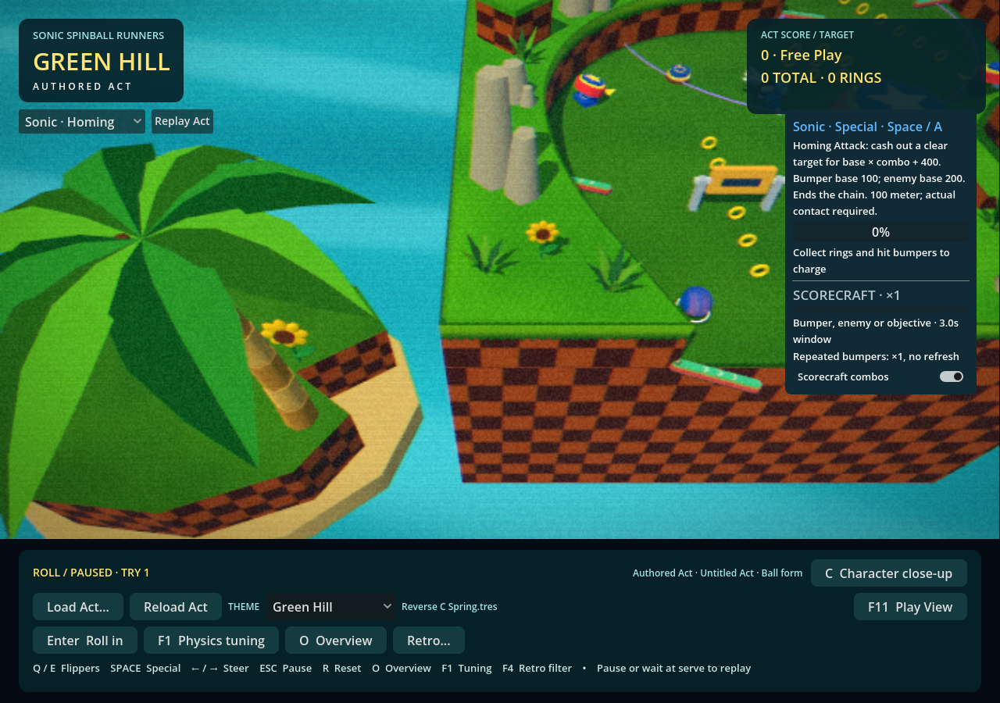
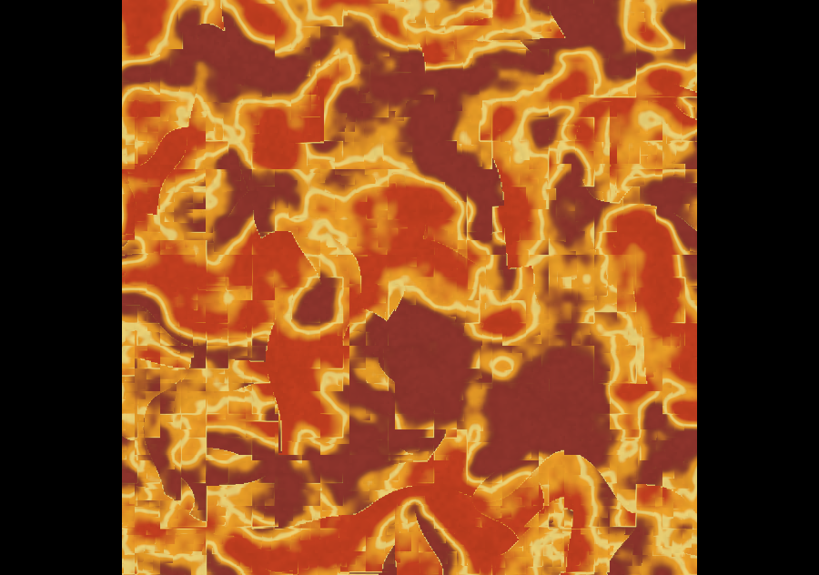
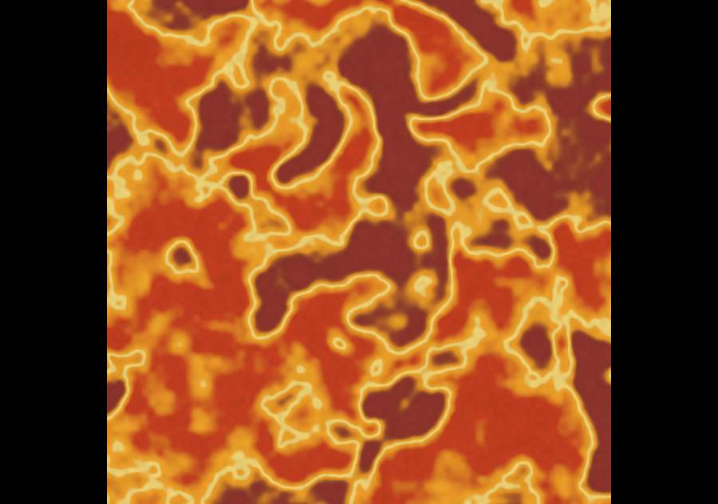
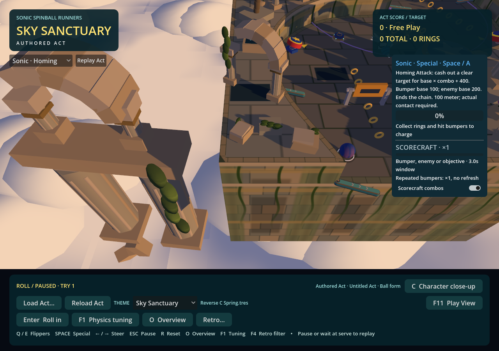
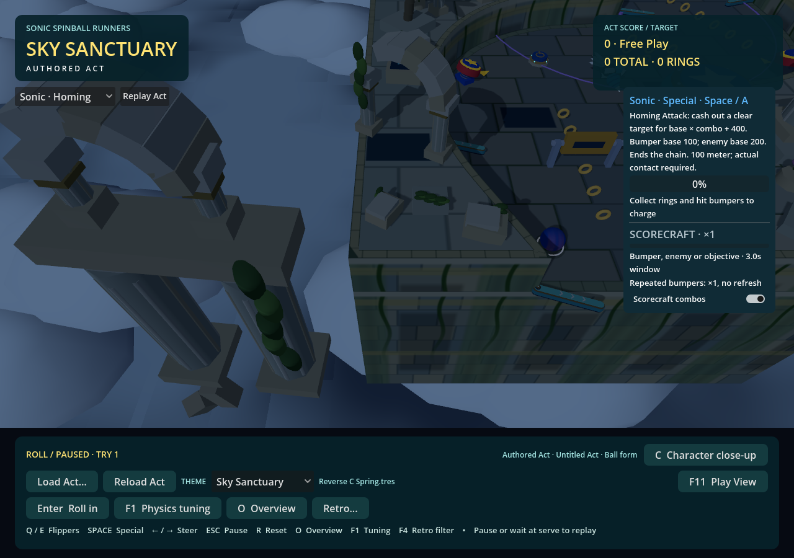

# Atmosphere verification — 2026-10-31

## Matched palette comparison

RTX 4060, Godot 4.7.2, Forward+/Vulkan, 1280×900 window, 673×363 filtered world viewport, VSync off and no FPS cap. The standalone generated **Reverse C Spring** uses a stationary left-edge inspection view with the Prototype's 50° tilt, 52° FOV and 1.3 zoom. It retains the existing Retro stack and shadow settings. This is a one-Act authoring view, not a baked three-Act streaming benchmark or a whole-run FPS claim.

`tests/atmosphere_profile.gd` runs authored / modified / modified / authored blocks, each with 480 settled frames. Every exposed palette color changes to a strongly different purple; palette strengths become 0.25. Lighting, glow settings, geometry, camera and emission multipliers remain identical. Application and the next 60 frames are recorded separately, followed by another 120 settling frames. Screenshots/readbacks are outside measured blocks. No other Godot test ran during the final all-eight comparison.

Values are **authored → modified**, in milliseconds. Each reported timing is the arithmetic mean of the two corresponding **per-block** medians or p95 values, not a pooled percentile. Exact individual blocks, preparation windows and pipeline counters are retained in [measurements.json](atmosphere-captures/measurements.json).

| Theme | Frame median | Frame p95 | Render CPU median | Render GPU median |
| --- | ---: | ---: | ---: | ---: |
| Green Hill | 4.986 → 4.998 | 6.982 → 7.583 | 2.574 → 2.599 | 0.552 → 0.552 |
| Chemical Plant | 3.263 → 3.027 | 5.084 → 5.094 | 1.329 → 1.263 | 0.520 → 0.517 |
| Rooftop Run | 3.735 → 3.714 | 5.529 → 5.448 | 1.714 → 1.687 | 0.646 → 0.646 |
| Casino Night | 4.125 → 3.932 | 5.988 → 5.829 | 1.976 → 1.889 | 0.751 → 0.751 |
| Sky Sanctuary | 3.773 → 3.729 | 5.806 → 5.491 | 1.832 → 1.804 | 0.568 → 0.568 |
| Ice Cap | 3.333 → 3.232 | 4.966 → 5.063 | 1.491 → 1.443 | 0.625 → 0.625 |
| Lava Reef | 3.335 → 3.646 | 4.590 → 5.367 | 1.587 → 1.714 | 0.669 → 0.669 |
| Aquarium Park | 3.607 → 3.640 | 5.299 → 5.383 | 1.790 → 1.816 | 0.711 → 0.711 |

Render CPU/GPU values sum Godot's enabled viewport timers. They are separate measurements and must not be added to wall-frame time. GPU differences are at most 0.003 ms here. No shader/pipeline compilation counter increased during any settled block or palette application.

All following counts are unchanged between authored and modified in every final block:

| Theme | Draw calls | Rendered objects | Unique active geometry materials | Resource monitor |
| --- | ---: | ---: | ---: | ---: |
| Green Hill | 2630 | 3237 | 388 | 100 |
| Chemical Plant | 781 | 1498 | 98 | 116 |
| Rooftop Run | 1112 | 3257 | 99 | 108 |
| Casino Night | 1109 | 4121 | 94 | 124 |
| Sky Sanctuary | 910 | 4080 | 104 | 130 |
| Ice Cap | 892 | 2800 | 95 | 137 |
| Lava Reef | 926 | 3481 | 102 | 145 |
| Aquarium Park | 932 | 4325 | 94 | 149 |

The resource monitor is Godot's `OBJECT_RESOURCE_COUNT`; unique active materials are counted independently from geometry slots, including MultiMeshes. They measure different populations. The Lab retains original resources alongside private editable copies, but color changes allocate no new material. That preview memory cost is paid when binding a theme, not per scenery instance or per color edit.

The first profiling attempt included the timed Retro notification after unfiltered screenshots, adding two UI draws and 22 rendered objects. The final probe explicitly hides it and the changing FPS text during measurements. Those transient UI counts are excluded above; normal Lab FPS behavior is unchanged.

Lava's wall/CPU fluctuation warranted a second, reversed-order test with 1200 frames per block. Modified/authored/authored/modified medians were **3.916 / 3.368 / 3.747 / 3.725 ms**; render CPU was **1.786 / 1.547 / 1.675 / 1.681 ms**, GPU **0.678 / 0.677 / 0.678 / 0.679 ms**. The later authored/modified pair reverses the wall-time difference, while GPU, pipelines and counts remain effectively identical. There is no per-frame palette work in the source. These samples support neutral GPU/submission cost; they do not establish exact wall/CPU neutrality on a busy workstation.

## Green Hill ocean

The separate comparison swaps only the existing ocean plane's material between the old flat `StandardMaterial3D` and the new opaque stylized shader. It uses the same camera, viewport, other materials, lights and passes. The final-shader ABBA confirmation reports:

| Metric | Old flat | Stylized |
| --- | ---: | ---: |
| Frame median | 5.514 ms | 6.201 ms |
| Frame p95 | 8.264 ms | 9.238 ms |
| Render CPU median | 2.840 ms | 3.308 ms |
| Render GPU median | 0.553 ms | 0.579 ms |
| Draw calls | 2630 | 2630 |
| Rendered objects | 3237 | 3237 |
| Active materials | 388 | 388 |

Individual GPU medians were **0.555 / 0.600 / 0.558 / 0.550 ms** for old/new/new/old. The largest paired increase was approximately **0.045 ms**, below the requested 0.25 ms GPU/frame budget in this view. An earlier ABBA run measured **0.566 / 0.558 / 0.554 / 0.549 ms**; both reports are retained. The final confirmation follows the addition of a Compatibility-only output color conversion, which is inactive in Forward+.

This is a measured RTX 4060 result, not a guarantee at other resolutions or on the work laptop. Wall-frame and render-CPU variation is larger than the GPU delta, including a slower middle pair in the final sample. The earlier run's CPU means were 2.915 / 2.887 ms, so these runs do not establish a repeatable CPU penalty or exact CPU neutrality. There are zero extra draws and no extra pass, screen texture, refraction, SSR, transparency or light. No quality tiers were added.

## One-time preparation

These figures are deliberately separate from settled timing:

- Initial Lab creation plus 120 frames: **5.002 s** in the all-eight run. The printed authored-player ready time was approximately **2.10 s**. Application and driver caches were not cleared, so this is not a guaranteed cold-start measurement.
- Theme construction plus the following 60 frames: Chemical **1.862 s**, Rooftop **1.857 s**, Casino **1.828 s**, Sky **1.937 s**, Ice **2.822 s**, Lava **2.143 s**, Aquarium **1.857 s**. These include ordinary rendered frames, resource creation and graphics preparation; they are not isolated compiler timings.
- Pipeline preparation remains at theme load: for example, entering Ice increased draw/surface/specialization counters by **8 / 17 / 11**. The complete per-theme counter changes are in the JSON. Godot's probe exposes counters and viewport GPU time, not an isolated GPU compiler duration.
- First modified-palette application took **0.289–0.745 ms CPU** across the eight themes. The following 60-frame maximum wall time ranged **5.271–9.957 ms**; no compilation counter increased.
- Ice's combined palette update, including its custom sky, took **0.472 ms CPU**. The following GPU peak was **1.002 ms**, versus approximately **0.625 ms** settled. This includes the sky/radiance update and material uploads; it is not a pure radiance-only timer. Subsequent settled blocks retain the same GPU cost and pipeline counts. The sky has no TIME dependency, and unchanged palette values are not submitted again.
- A separate Ice-only probe changed just the horizon color through the normal UI setter. The setter, including widget synchronization, took **3.014 ms CPU**. GPU time briefly rose from a **0.582 ms** baseline median to **0.918 ms** on the second frame, returned to **0.582 ms** on the third, and settled at **0.581 ms**. No pipeline counter increased. This bounds the visible update cost in that Lab view; it does not isolate radiance work from UI or renderer uploads. The first 12 GPU samples and all three 120-frame windows are retained in the evidence JSON.

The ocean was already prepared during Lab startup before its material comparison. Reintroducing the old flat material added one draw pipeline and one specialization; subsequent switches compiled nothing. The test does not claim a separately measured cold ocean compilation duration.

## Lava diagnosis and visual review

An isolated, unfiltered plane with frozen time reproduced the reported rectangular seams using the original sine-based lattice hash. Replacing just the hash with integer arithmetic removed the boundaries. The exact compiler/driver rounding path was not traced. The existing interpolated/domain-warped noise algorithm, flow and approved cave composition remain.

| Before | Hash corrected |
| --- | --- |
|  |  |

All eight themes were captured with authored and strongly modified palettes, plus Sunset and Night, with Retro enabled and disabled. Sky's unshaded cloud highlights now respond to the recipe:

| Sunset starter | Night starter |
| --- | --- |
|  |  |

These are test recipes, not approved production variants. Human review still owns the final palette, ocean motion, camera readability and low-end hardware gate.

## Checks and scope

- Existing Forward+ lighting smoke: **45/45** checks.
- Rendered atmosphere regression: **379/379** on Forward+ and **379/379** on ANGLE, covering all semantic bindings, exact original restore, shared material reuse, drafts, migration/backup, renderer isolation, existing lights, cloud sun direction, cached Ice sky and independent far/local visibility.
- Existing headless static-batching regression: **111 checks, zero failures**, including local-background ownership behavior.
- Fresh offline bakes: **56 Endless variants** and **40 Prototype variants**, plus a seven-variant Green Hill refresh after its final shader adjustment.
- Rendered Forward+ Endless smoke with required bakes: **256 checks, zero failures**, 27 streamed transitions, two resident Acts maximum and zero procedural fallback builds. This is a correctness run, not the matched performance sample above.
- Script/shader loading, all-eight visual captures and unchanged palette draw/object/material counts are recorded above.

The restricted test profile emits the existing certificate-store message. The streaming test reports two ObjectDB instances at shutdown; no in-test assertion fails. The final Forward+ atmosphere regression exits without resource warnings. ANGLE passes its assertions but reports GL texture cleanup errors at shutdown. Alex explicitly excluded further ANGLE investigation: Forward+/Vulkan is the acceptance gate for this work.

All work and measurements started from `cfeff926` in an isolated worktree. Uncommitted local art/texture experiments in the main workspace are preserved and are not included in these measurements. No authored geometry, physics, scoring, production renderer defaults or new production variants were changed. Raw logs and captures remain under ignored `test-results/atmosphere/` in that worktree; the compact evidence above is committed.
