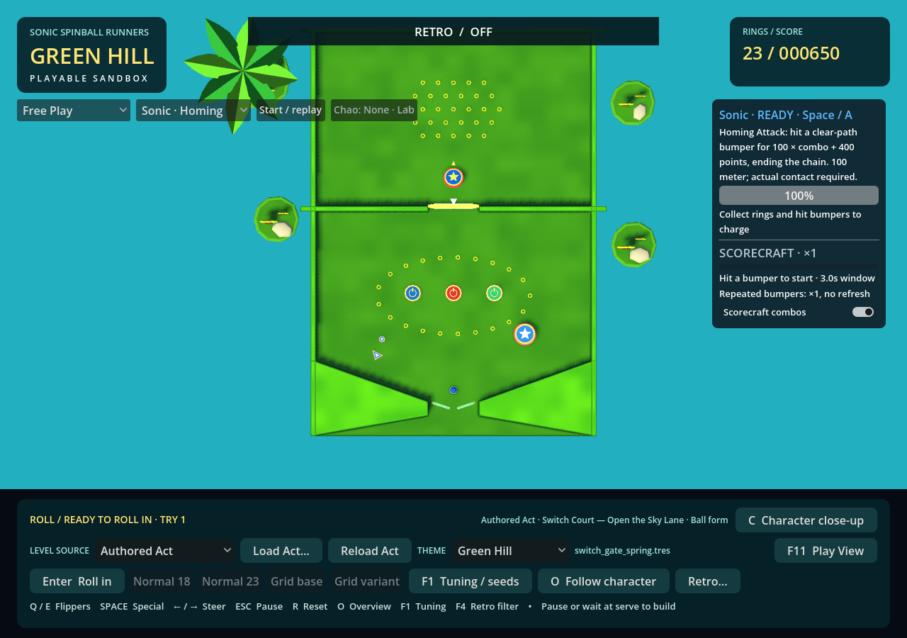
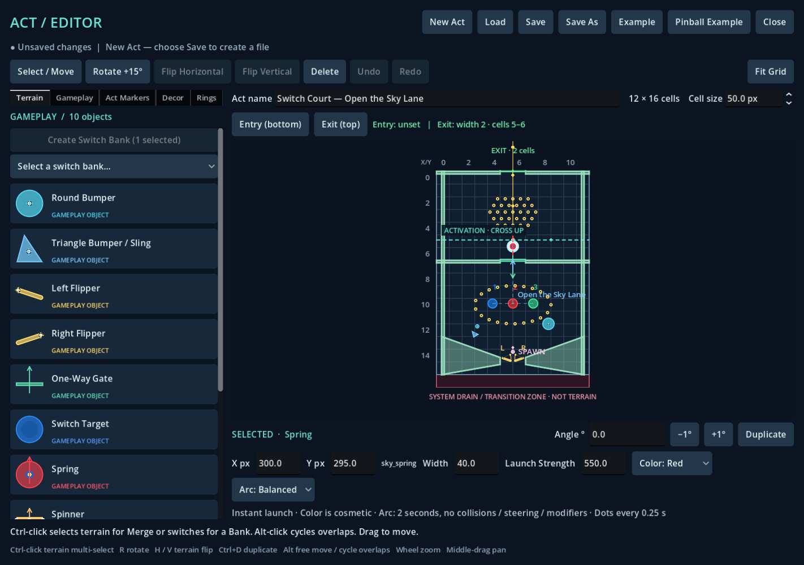
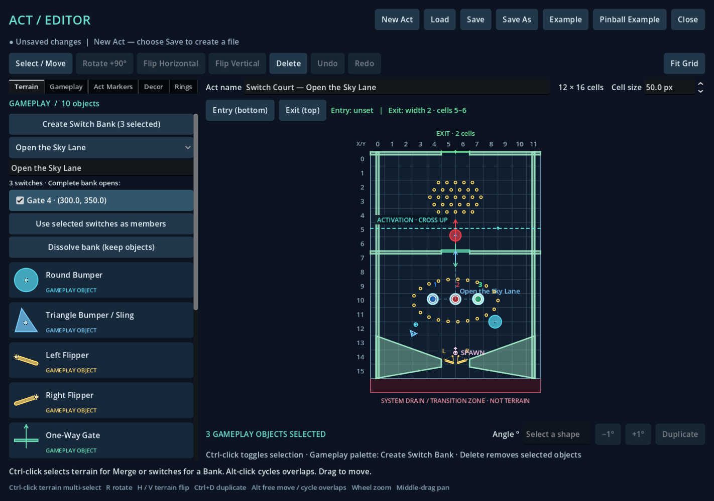
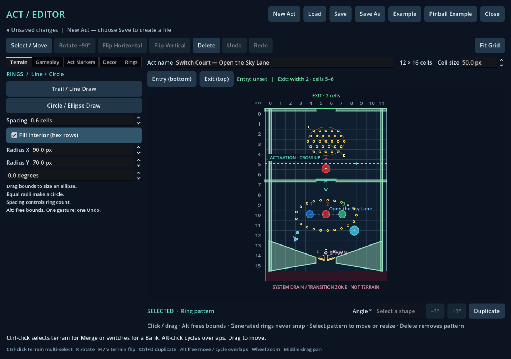

# Authored gates, switches, springs and ring patterns

Implemented 2026-10-25 in the existing Act Editor and main gameplay engine. These objects use the same authoritative 2D ball, profile/modifier system, scoring, ring collection and reload workflow as other authored Acts. All models are collisionless.

## Try the objective

Open **Act Geometry Editor.cmd → Pinball Example** for an editable copy of [Switch Court — Open the Sky Lane](../data/acts/switch_gate_spring.tres). Save it, then open **Play Green Hill.cmd → Level source: Authored Act → Load Act…**. Alternatively load the supplied `.tres` directly in the game.

Hit the three colored switches in the lower chamber. Each awards 25 points once per ball attempt. Completing the bank retracts the center gate. Shoot through the opening into the red spring, which immediately sends the ball through the upper ring pool toward the physical Exit. Small and large bumpers shape shots; flippers and return slopes provide recovery. This is a Free Play mechanic objective, not a new victory mode or permanent unlock.

Save edits and press **F5 / Reload Act** in the main game. The remembered path reloads without another file picker. Invalid replacements preserve the current playable Act and its state.

## Authoring controls

Gameplay placement retains default snapping, **Alt** for free placement, 15° rotation steps and exact numeric angles. Rotation 0° points up; 90° points right. Stable object IDs appear in the inspector and survive save/load. Duplication creates a new ID.

| Object | Properties and behavior |
| --- | --- |
| One-Way Gate | Width 20–500 px; initially Closed or Open; visual mode Auto. The arrow marks allowed travel. Closed gates reject opposite travel; open gates permit both directions. |
| Switch Target | Blue, red, yellow or green; optional label; score reward 0–1000. A real ball contact depresses the pad and lights its assigned color. Repeated contact cannot activate or score again during the same attempt. |
| Spring | Width 20–100 px; strength 100–2400 px/s; rotation sets launch direction. Red, yellow and blue are cosmetic choices with identical physics. Contact immediately replaces velocity without capturing or replacing the ball. |
| Round Bumper / Triangle Bumper | Uniform scale 0.35–2.5, default 1.0. Scale affects the shared editor silhouette, runtime collision and themed model dimensions about the existing origin. |

The spring's **Arc: Balanced / Floaty** selector previews two seconds using project gravity and the selected shared profile. Marks are spaced by 0.25 seconds. The preview begins at the pad's forward edge, including ball radius; actual contact can occur elsewhere on the pad. Steering, drag, modifiers, other fields and collisions are intentionally excluded. The selector changes the preview, not the main game's chosen profile. Launch strength and the example's shot layout are provisional feel tuning.

### Switch banks

1. Place switches and gates in **Gameplay**.
2. Choose **Select / Move**, then **Ctrl-click** two or more switches.
3. Click **Create Switch Bank** at the top of the Gameplay palette.
4. Name the bank and check each gate it should open.

Bank lines connect member switches to their linked gates on the canvas. The bank picker reopens its relationship controls. **Use selected switches as members** replaces membership; **Dissolve bank** keeps all physical objects. Deleting an object prunes its links in the same undo action; deleting the last member dissolves the empty bank. Undo restores both objects and relationships. Duplicated switches start outside any bank.

All member switches must be active. One bank can open several gates. Several banks can share a gate; completing any linked bank opens it. Colors communicate switch identity and do not implicitly create links. There are no arbitrary scripted actions.

### Rings → Circle / Ellipse Draw

Drag opposite corners of the bounds, inspect the live ring preview, then release. Equal X/Y radii form a circle. **Fill** off produces an evenly spaced perimeter; **Fill** on produces centered hexagonal rows clipped to the ellipse. Spacing, X/Y radii and rotation remain editable after placement. Select a pattern to move, duplicate, delete or resize it through its bounds handles. One draw gesture is one undo action.

Bounds handles describe the unrotated authoring box; the generated pattern rotates around its center. Centers never snap individually. Radii must be at least 1 px; validation caps the candidate distribution at 4096 to bound work. Very dense or extreme patterns require larger spacing. **Trail / Line Draw** retains the existing single-ring and straight-trail behavior.

## Runtime and lifecycle

The existing `pinball_mechanics.gd` manager processes these objects during the ball's 120 Hz integration. Analytic swept circle/capsule queries prevent fast contacts skipping narrow gates or switches. Contacts are ordered along the motion and clipped by native terrain. Gate responses reflect the blocked normal using shared restitution while preserving tangential velocity. A ball entering from the allowed side may finish crossing even if gravity reverses it while overlapping the gate.

Springs have a 0.12-second cooldown plus an overlap latch: the ball must leave the pad before another launch. Pause freezes both physics and cooldowns. Reset, drain/serve, replay, successful reload and source replacement clear switches, bank completion, spring latches and pulses, then restore each gate's authored initial state. Theme changes preserve active gameplay state. Existing Free Play score/reset rules still apply; switch rewards can be earned again on the next attempt.

## Presentation and reference research

The requested [Sonic Switch](https://sonic.fandom.com/wiki/Switch) and [Sonic Spring](https://sonic.fandom.com/wiki/Spring) references informed this original procedural interpretation. Direct page/image access was blocked in this environment; indexed page text was available. Switch references describe touch-activated route/door mechanisms across games. Spring references describe a round pad, blue inset, gold star and coiled base. No Sega images, textures or models were downloaded or imported.

Switches use an octagonal housing, raised/depressed colored plunger, power mark and activated emission. Springs retain their colored pad, yellow rim/star, blue inset and metal coils under every theme; a short compression pulse shows contact. Gates retract their panel when open and retain a direction marker.

| Theme | Original gate treatment | Capture |
| --- | --- | --- |
| Green Hill | Timber braces and brass hinges | [View](gimmick-captures/green_hill.png) |
| Chemical Plant | Valve hub and energy vents | [View](gimmick-captures/chemical_plant.png) |
| Rooftop Run | Brass-trimmed iron spindles | [View](gimmick-captures/rooftop_run.png) |
| Casino Night | Neon strip and marquee bulbs | [View](gimmick-captures/casino_night.png) |
| Aquarium Park | Illuminated lanterns and spindles | [View](gimmick-captures/aquarium_park.png) |
| Sky Sanctuary | Pale stone and sacred crests | [View](gimmick-captures/sky_sanctuary.png) |
| Ice Cap | Crystal spires | [View](gimmick-captures/ice_cap.png) |
| Lava Reef | Riveted forge housing | [View](gimmick-captures/lava_reef.png) |

[Open gate comparison](gimmick-captures/open.png). Each capture uses the same authored hardware and camera, with red/green switches active. Materials and ornamentation never alter physics.

## Format 13

`gameplay_objects` keeps `{object_id, type, position, rotation_degrees, properties}`. New types are `one_way_gate`, `switch_target` and `spring`. The table above describes their property ranges; existing bumpers gain `properties.scale`. Defaults support old objects without explicit properties.

`switch_banks` contains `{bank_id, label, members, gates}`, where members and gates are arrays of stable object IDs. Validation rejects duplicate IDs, missing links and links to the wrong object type. Runtime activation/completion is never saved into authoring data.

`ring_trails` retains existing `{start, end, spacing}` line records. Ellipses use `{kind: "ellipse", start, end, spacing, fill, rotation_degrees}`. Start/end store opposite unrotated bounds corners. Ring centers are deterministically regenerated. Existing exact numeric payload encoding also covers ellipse angles and new numeric properties; save validation reopens and compares fingerprints before replacing the destination.

Formats 2–12 migrate in memory and gain empty banks; the source is untouched until explicitly saved. Format-12 scattered decor remains supported. Old version tags cannot silently contain new gimmicks, banks or ellipse records. Future or invalid formats are rejected through the existing safe replacement path.

## Verification and remaining playtesting

Godot 4.7.2 on Windows, Compatibility renderer. New main-game and editor suites run headless and graphically; fresh-process persistence is also checked. The main-game suite uses controlled real-ball shots through the existing game integration, including the complete example objective. This verifies physical reachability, not a human flipper-only completion.

- `authored_gimmick_regression.gd`: 90 checks pass headless (86 gameplay/data checks also passed graphically before four migration assertions were added). Covers gates, real switch contacts and glow, banks, eight-theme state retention, spring direction/strength/overlap/pause/reset/drain/reload, six real scaled-bumper contacts with model/collision dimension checks, ring generation, persistence and failed reload recovery.
- `authored_gimmick_editor_regression.gd`: 24 graphical checks pass. Covers placement, Ctrl-selection, bank links, history/deletion, scaling, ellipse gesture/preview/history, properties, save/load and the Pinball Example button. The initial 22 checks also passed headless.
- Existing geometry, gameplay, ring model/editor, pinball editor/mechanics and graphical reload-workflow suites were also run successfully. `gimmick_presentation_capture.gd` captured all eight themes plus the open gate.

The invalid-reload test deliberately prints resource parse errors. Graphical main-game teardown also reports GL texture-leak warnings; they occur in the existing reload workflow as well and remain a renderer/lifecycle follow-up. Headless execution cannot validate native file-dialog mouse routing, so that workflow was checked graphically.

Human checklist: judge flipper feeds and switch-shot difficulty, spring strength with normal steering/specials, gate direction readability, and pressed/glow contrast under the preferred camera and retro filters. These feel and polish judgments remain open.
