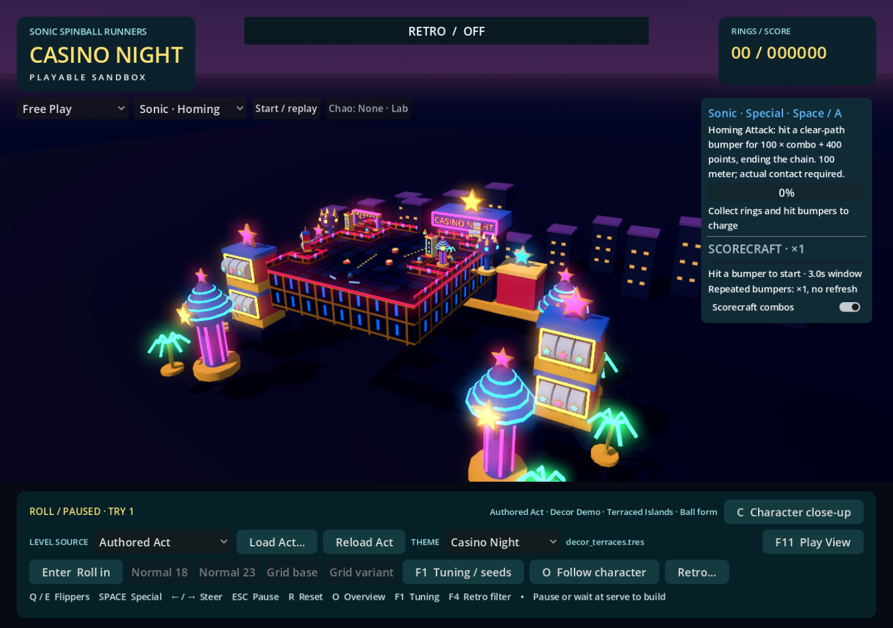
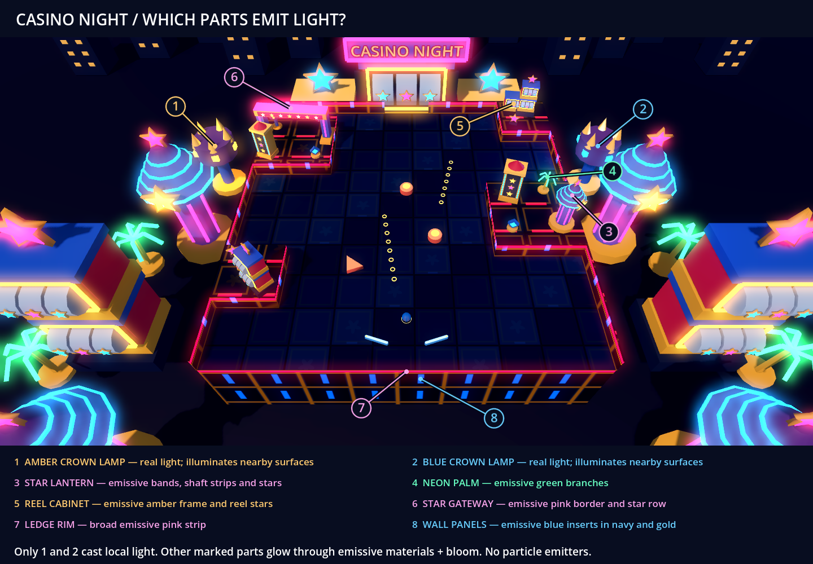
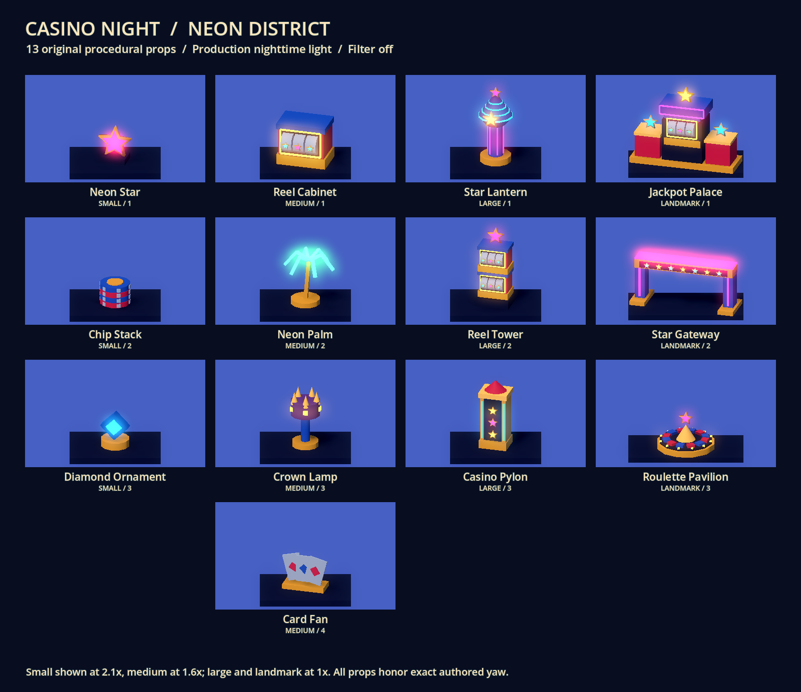
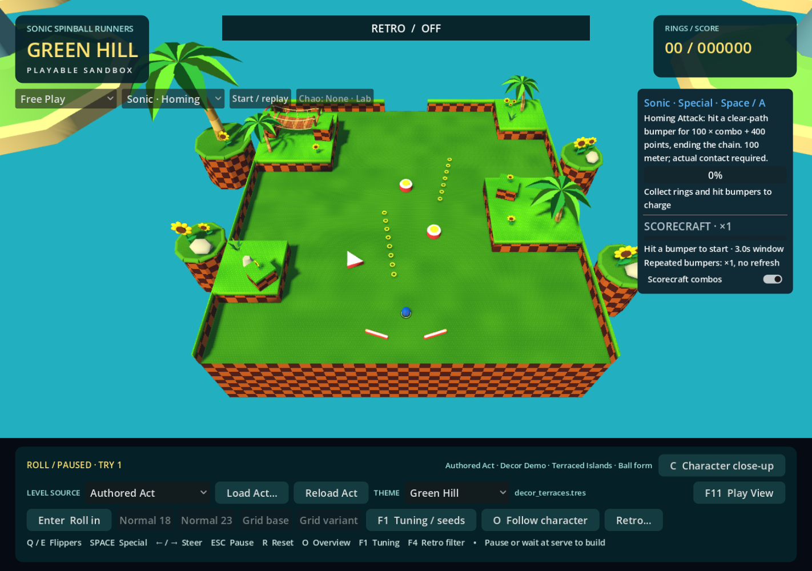
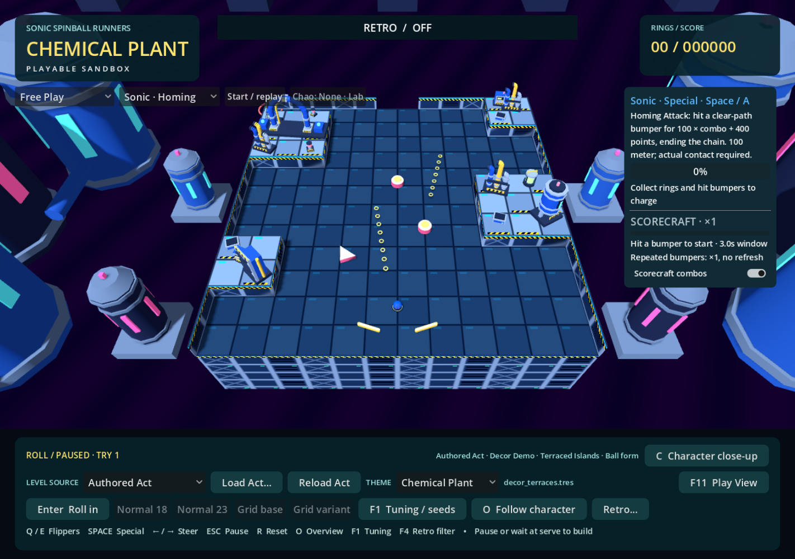
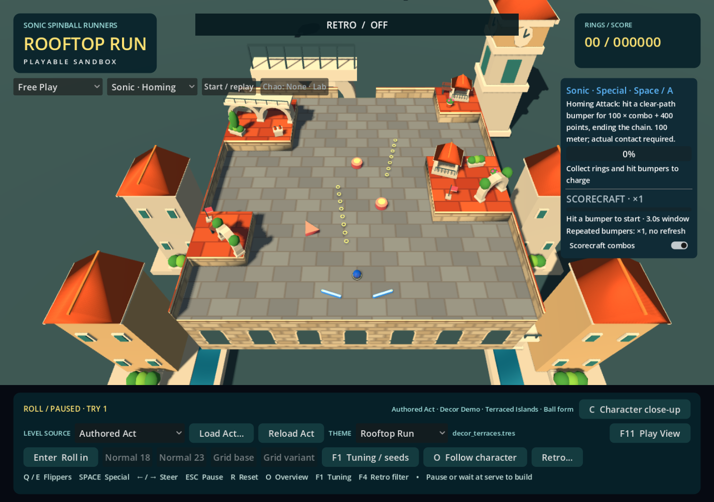
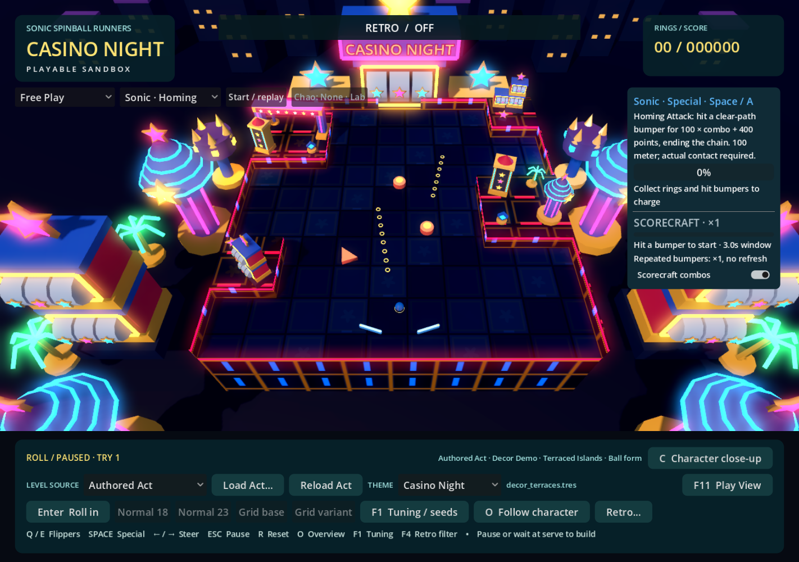
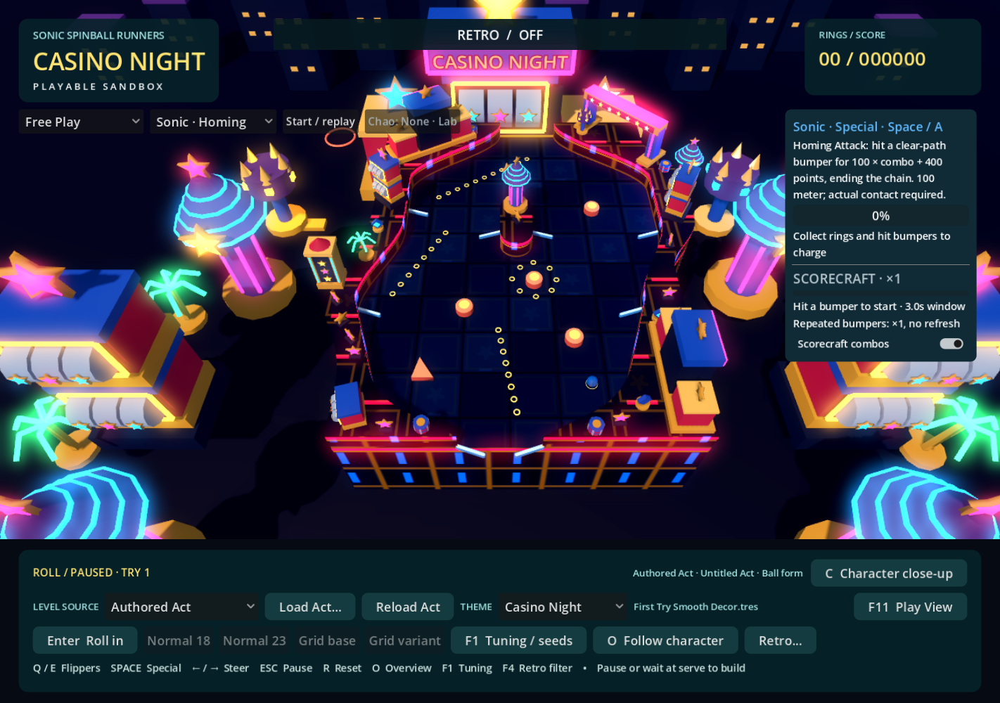
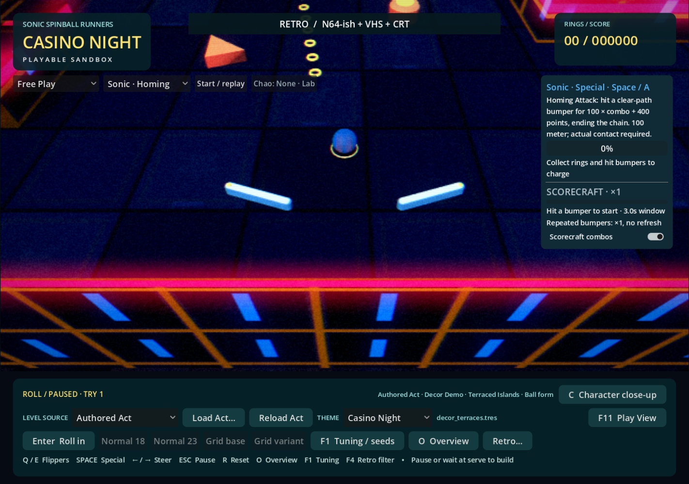
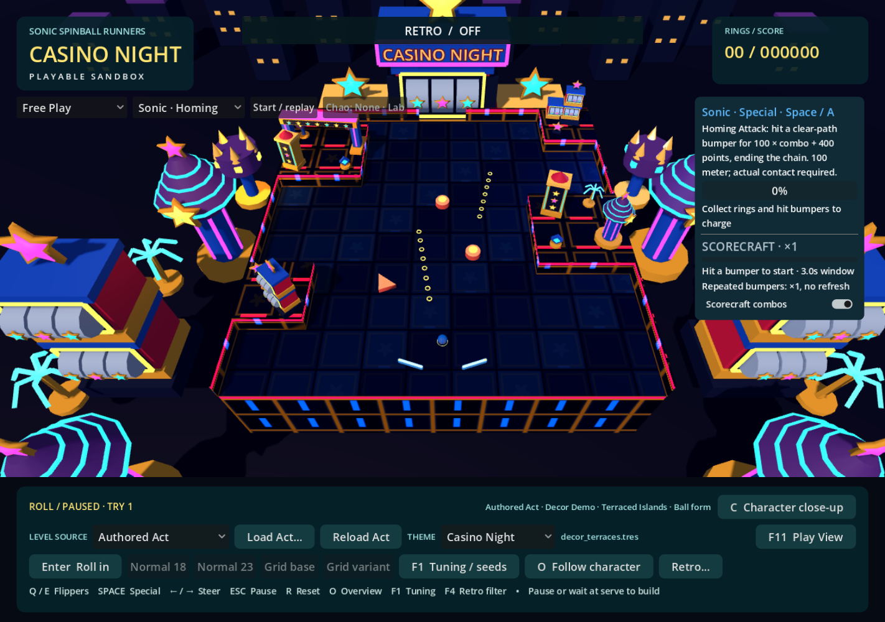

# Casino Night

Casino Night is the fourth selectable presentation skin. Launch **Play Green Hill.cmd**, then choose **THEME → Casino Night**. The editor's decor preview also includes it. Direct launch accepts `-- --theme=casino_night`; `scenes/theme_examples/casino_terraces.tscn` and `casino_curves.tscn` open existing checked-in Acts in overview with the retro filter off.

The same Act, physics, gameplay objects, score, character and camera remain authoritative. Selecting a skin rebuilds only presentation. No slot-machine rules, gambling, rewards, enemies, new scoring or character-specific physics were added. No Sega assets were imported: all meshes and materials are original GDScript and procedural shaders.

## Research and interpretation

Research preceded asset creation. The following game imagery was inspected in the browser; source images were not saved into the repository.

| Reference | Visual observations | Our interpretation |
| --- | --- | --- |
| **Sonic 2:** [Casino Night tile sheet](https://www.sonicgalaxy.net/wp-content/img/sprites/gen/sonic2/casinonightzone-2.png), [game screenshots](https://www.gamegrin.com/directory/game/sonic-the-hedgehog-2/images) | Dense dark-gold architectural frames, blue table fields, red edges, graphic stars, slot panels and dark negative space | World-projected gold facade bays, blue inset tables, red raised caps and large star silhouettes. The playable surface deliberately omits dense original graphics. |
| **Sonic Generations:** [SEGA's PC/console Casino Night DLC gallery](https://store.steampowered.com/app/200590/Sonic_Generations__Casino_Night_DLC/) | A monumental table framed by casino architecture; tall striped lantern towers, stars, neon palms, ornate gold, giant reels and a nighttime skyline | Faceted tulip lanterns, a giant jackpot facade, neon palms and a repeated district below the table. Golden character statues become abstract stars and crowns rather than copied character sculptures. |
| **Lost World / Frozen Factory Zone 3:** [casino screenshot from trailer coverage](https://images.nintendolife.com/bbdb2a61989e7/large.jpg), [stage coverage](https://www.nintendolife.com/news/2013/07/sonic_lost_world_has_a_casino_stage_and_it_looks_kind_of_fun) | Broad red carpet, strong gold trim, purple columns with luminous rings, oversized chip stacks, bright strips and toy-like casino forms | Chunky chip ornaments, stacked reel towers, purple lantern bodies and saturated red/blue/gold blocks. Fine checker detail is removed from the floor to protect collectibles. |

The [PC footage reference](https://www.youtube.com/watch?v=x-WeR7bYBBI&t=616s) identifies the casino segment at 10:16. Playback could not be inspected because browser navigation stalled; the Lost World interpretation above is based on the inspected screenshot and linked stage coverage, not a claimed video review. The 3DS Frozen Factory screenshots found in search depict a different icy stage and were not used as casino references.

Our scene combines Sonic 2's graphic palette, Generations' architectural scale, and Lost World's exaggerated ornaments. It is a warm entertainment district suspended around a pinball table, visually separate from Chemical Plant's industrial piping and cold reservoir.

## Materials, lighting and performance

- **Playable surface:** quiet royal-blue panels with dark seams, subdued geometric borders, sparse embossed stars and short blue light inserts. Raised terrain has dark navy panels, gold inset borders and broad pink strips. All patterns use world coordinates and derivative filtering, including authored curves and open rails.
- **Walls:** large navy recesses, slim gold frames, broad vertical blue inserts and a luminous pink ledge rim. This user-selected finish replaces the original repeating gold circles and red bays. Normal-weighted world projection wraps arbitrary authored outlines; no new collision or geometry repair occurs.
- **Night light:** warm directional key, cool ambient fill and a dark violet horizon. Shared gameplay materials retain familiar object colors. Rings and flippers sit against the darkest table surfaces.
- **Emission:** pink, blue, green and amber trims use actual emission at energy 2.8, increased from 1.15 after feedback that the emitters were hard to see. Large silhouettes carry the light; there are no animated flashing bulbs or per-prop lights. Reel faces were darkened after review to reduce competition with gameplay highlights.
- **Bloom:** enabled in the theme's Environment, before the existing world-only retro passes. Godot 4.7.2's Compatibility renderer supports this path; see [Godot's glow documentation](https://docs.godotengine.org/en/4.5/tutorials/3d/environment_and_post_processing.html). Only supported controls are set: intensity 1.1, bloom 0.12, HDR threshold 0.75 and HDR scale 1.6. No renderer or project-setting change is required. Earlier Godot 4 releases without Compatibility glow will still render emission, but that fallback was not tested.
- **Local spill:** exactly two unshadowed OmniLights, amber and blue, each with range 4.8 and energy 2.4 (previously 4.0 and 0.7). Visible crown fixtures now identify their positions along the table sides. Slightly reduced ambient/key light improves neon contrast. Emission alone is not claimed to illuminate nearby geometry through GI. The local lights supply that spill. Theme rebuilds clear them; Green Hill explicitly disables glow when returning from Casino.
- **District:** thirteen quiet skyline buildings, one giant casino facade, six larger lantern/reel towers and six palms. Static background primitives share meshes/materials and are batched into MultiMeshes. A single original CASINO NIGHT sign remains separate. Immediate lane edges stay clear of scattered fake gameplay objects.
- **Cost:** the revised terraced Act's overview measured 793 total draw calls for Casino, versus 1135 Green Hill, 821 Chemical Plant and 616 Rooftop Run. Curved Act Casino measured 613. The two visible fixtures add 56 calls over the initial Casino version. These are whole-frame counters including HUD, shadows and gameplay, not GPU-time or FPS benchmarks. Android and low-end devices remain unmeasured.



## Which objects emit light?

The numbered guide is rendered from the real terraced Act. **1–2** identify the two crown lamps that illuminate nearby surfaces. **3–6** show examples of emissive decor: lantern bands and stars, palm branches, reel frames and stars, and gateway borders. **7–8** identify the new pink ledge rim and blue wall inserts. Other props reuse the same four emissive materials; these labels are representative, not an exhaustive list of every glowing mesh. There are no particle emitters.



The review script also captures an identical paused frame with just the two local lights switched off. The sampled RGB mean absolute difference was **0.00367** on the tested renderer, confirming that these lights change nearby surface lighting independently of bloom. The guide overlay exists only in the capture script.

## Stable decor library

Thirteen props cover three small details, four medium silhouettes, three tall structures and three shared landmark roles. Every `surface`, `edge` and `either` pool has this order. Displayed variant numbers are one-based; saved indices remain zero-based.

| Size | Variant 1 | Variant 2 | Variant 3 | Variant 4 |
| --- | --- | --- | --- | --- |
| Small | Neon star | Chip stack | Diamond ornament | — |
| Medium | Reel cabinet | Neon palm | Crown lamp | Card fan |
| Large | Star lantern | Reel tower | Casino pylon | — |
| Landmark | Jackpot palace | Star gateway | Roulette pavilion | — |



Small details establish stars, chips and jewel shapes without pretending to be rings or bumpers. Medium props vary in silhouette: box, spreading palm, upright lamp and fan. Large props give vertical rhythm through lanterns, reels and architectural columns. Landmark 1 supplies a central mass with low side wings; Landmark 2 spans the authored long axis; Landmark 3 provides a circular sculpture. No decorative flippers, cannons or targets mimic active objects.

Fixed Small 1 / 2 / 1 therefore becomes Star / Chips / Star under every placement hint. Auto remains the existing deterministic Act/slot/theme hash. Landmark Auto keeps the shared upright/span role and never selects the circular variant. Long landmarks measure about 3×1 cells; the roulette base measures 1.64 cells across. Exact anchors, arbitrary yaw, scale and existing support validation are unchanged. Missing indices retain the shared warning and deterministic fallback; Casino's Medium 4 can therefore remain saved when another skin lacks it.

The requested one-way gate was absent from this checkout's authored gameplay definitions. The existing Zone score gate is a different mechanic. No placeholder gate or new gameplay dependency was introduced.

## Same Act, four identities

These four production-game captures use the checked-in `data/acts/decor_terraces.tres`, identical overview camera transforms, identical ball positions, identical Act fingerprints and filter OFF. The capture script asserts those invariants and checks source bytes were not changed.









The same verification also covers `decor_curve_relay.tres` and the user's untouched local `First Try Smooth Decor.tres`. The latter remains untracked and is not required by the theme or tests.



## Retro and bloom review

The preferred production **N64-ish + VHS + CRT** stack is unchanged. It runs after environment glow and filters only the world, leaving HUD text native. Broad neon shapes remain visible at reduced resolution; the floor is quieter than the architectural rim. The inherited VHS grain is visible on dark backgrounds. Fast-ball perception and personal tolerance for that grain still need human judgment.




The following capture disables only Environment glow; compare it to the Casino overview above. Emissive shapes remain bright, but the surrounding halos disappear. This isolates real renderer bloom from CRT glow, without changing materials or gameplay.



## Verification

The stronger-neon revision reran all **95 decor checks and 425 runtime checks**, with zero failures. Graphical runs refreshed 35 main-game captures, the thirteen-prop library and the numbered guide with local lights on/off. Filter OFF, the preferred retro stack, and bloom-disabled comparisons were inspected. The table below records the broader original skin validation; those additional suites were not all rerun for this material-only revision.

Executed on Windows with Godot **4.7.2**, GL Compatibility / ANGLE / RTX 4060:

| Check | Result |
| --- | --- |
| `casino_decor_regression.gd` | 95 checks, zero failures; thirteen props, all size/hint pools, fixed indices, fallback, collision isolation, shared primitives and exact non-round transforms |
| `landmark_theme_regression.gd` | 195 checks, zero failures; four themes, measured bounds, shared roles, centered anchors and immutable fixed/Auto records |
| `theme_runtime_regression.gd` | 425 checks, zero failures; authored and generated sources, live state preservation, fresh-process determinism, glow reset and exactly two Casino lights |
| `authored_main_game_regression.gd -- --theme=casino_night` | 70 checks, zero failures; existing gameplay, scoring, abilities, source switches, lifecycle and camera |
| `decor_editor_smoke.gd` | 30 checks, zero failures; includes Casino preview labels without changing saved fixed indices or Act data |
| Graphical capture | Same-camera groups for two checked-in Acts and one untouched local Act, filter OFF and preferred stack, bloom-disabled comparisons, district studies and thirteen-prop sheet |

An isolated copy of committed baseline `d2e8837` with only this task's source changes completed a clean headless editor import and passed all 95 decor, 195 landmark, 425 theme-runtime and 30 editor checks. This confirms Casino does not require concurrent scatter or local project-setting edits. Final graphical runs produced 35 main-game captures, the Casino library, a complete 50-prop catalogue and the four-theme landmark sheet (196 checks including rendering), with no script or shader errors in their logs.

New parser issues found during development were fixed before the passing runs. A concurrent whitespace-only change in `scripts/game.gd` temporarily broke parsing; four invalid indents were normalized without changing logic. Other concurrent editor, scatter, project-setting and local Act changes were preserved and excluded from this commit.

Reproduce from the repository:

```powershell
& 'C:\Program Files\Godot\Godot.exe' --headless --path . --script tests/casino_decor_regression.gd
& 'C:\Program Files\Godot\Godot.exe' --headless --path . --script tests/landmark_theme_regression.gd
& 'C:\Program Files\Godot\Godot.exe' --headless --path . --script tests/theme_runtime_regression.gd
& 'C:\Program Files\Godot\Godot.exe' --headless --path . --script tests/authored_main_game_regression.gd -- --theme=casino_night
& 'C:\Program Files\Godot\Godot.exe' --path . --rendering-method gl_compatibility --rendering-driver opengl3_angle --script tests/casino_capture.gd -- --city-study
& 'C:\Program Files\Godot\Godot.exe' --path . --rendering-method gl_compatibility --rendering-driver opengl3_angle --script tests/casino_library_capture.gd
& 'C:\Program Files\Godot\Godot.exe' --path . --rendering-method gl_compatibility --rendering-driver opengl3_angle --script tests/casino_emitter_capture.gd
```

Full capture manifests live under ignored `test-results/casino-review/`; selected screenshots are checked in here. Manual review remains short: fast-ball visibility in all four character colors, tall authored props near tight lanes, and bloom/grain preference at the user's normal window size. No automated check establishes final feel or polish.
