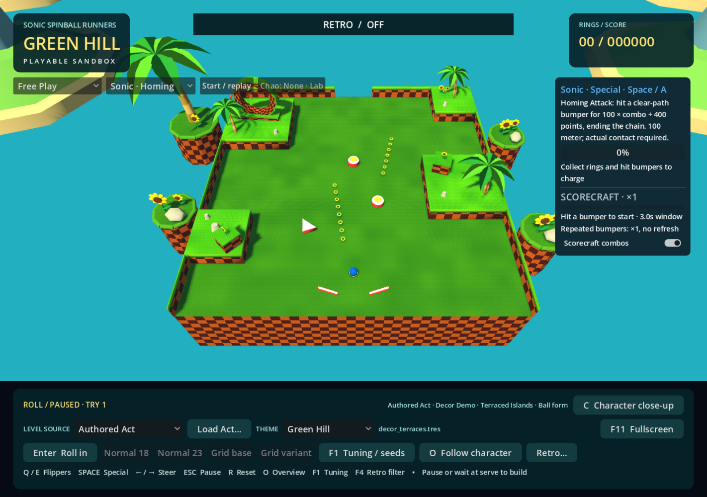
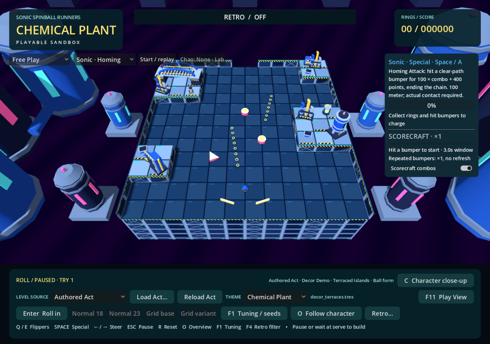
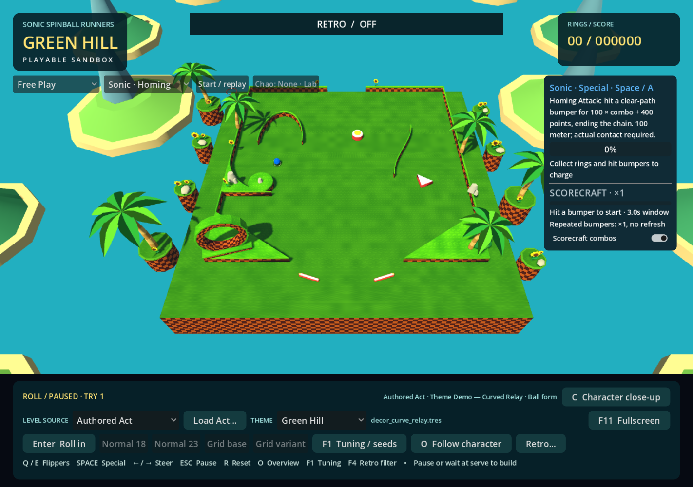
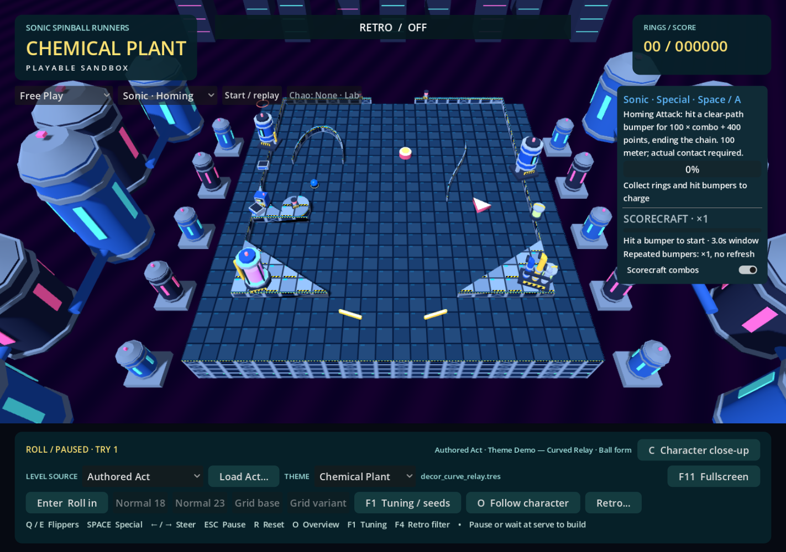
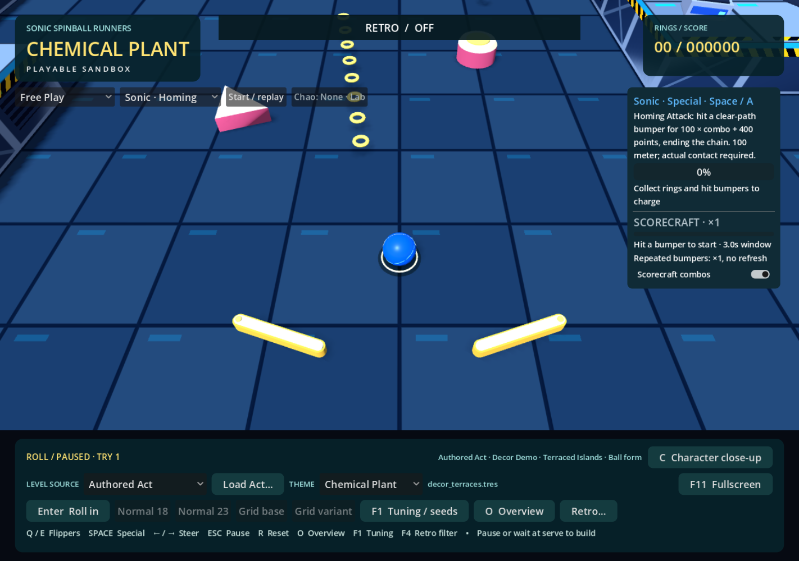
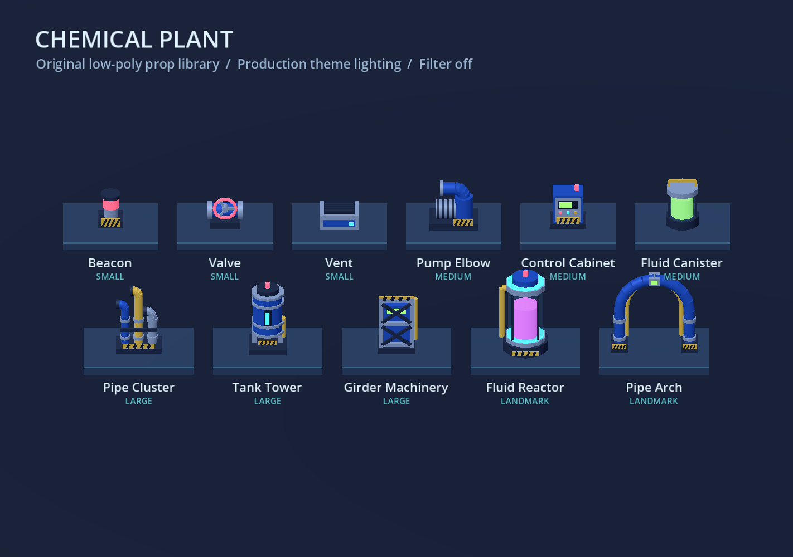
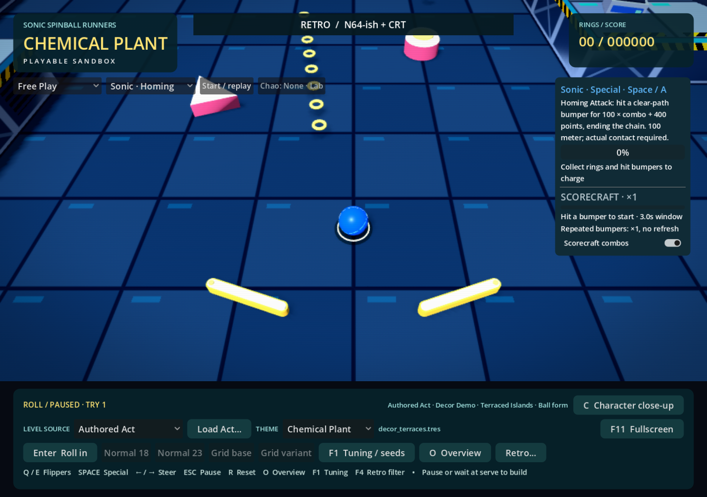

# Chemical Plant and the shared theme pipeline

Chemical Plant is a selectable presentation skin in the same main game as Green Hill. Open **Play Green Hill.cmd**, choose **THEME → Chemical Plant**, then load any authored Act. The same selector also works with generated Free Play, Score Attack and the existing Zone. A theme is independent of the gameplay mode; Chemical Plant does not add a second Zone campaign.

The selector changes materials, lighting, scenery and semantic decor resolution. It retains the current Act, actual 2D collision objects, ball position/velocity, character, physics tuning, score, collected rings, camera and transient pickup/bumper feedback. Selection is temporarily unavailable during a level build, source picker or character close-up. The selection lasts for the current session. For direct launch, pass `-- --theme=chemical_plant` to Godot after the normal main scene.

## Matched authored examples

Open an example scene in Godot and press F6. These scenes configure the ordinary main game; they contain no alternate gameplay loop. They start in overview with the retro filter OFF. Press O for follow mode, or use the Theme selector to compare without reloading.

| Composition | Green Hill | Chemical Plant |
| --- | --- | --- |
| Open terraced table, 16 authored slots | `scenes/theme_examples/green_hill_terraces.tscn` | `scenes/theme_examples/chemical_terraces.tscn` |
| Enclosed curved relay, ramps and rails, 12 authored slots | `scenes/theme_examples/green_hill_curves.tscn` | `scenes/theme_examples/chemical_curves.tscn` |

Both terrace scenes load the existing `data/acts/decor_terraces.tres`. Both curve scenes load `data/acts/decor_curve_relay.tres`, a decorated copy of `playtest_showcase.tres`: its terrain, gameplay objects, connectors and lifecycle positions are unchanged. Only generic decor slots, a stable decor seed and the title were added; its format declaration enables those slots. Terrain, rings, bumpers, flippers, spawn and connectors remain identical to the existing Curve Relay example.

### The same open Act, filter OFF





### Curved geometry, filter OFF







## Visual research and decisions

Research preceded asset construction. The following game screenshots were inspected in the browser. They remain references only; no Sega image, sprite, texture, mesh or material data was downloaded into the repository or sampled into our assets.

- **Sonic 2:** [exterior and interior screenshots](https://www.thepixelempire.net/sonic-the-hedgehog-2-smd--chemical-plant-zone--landmark-levels.html) show silver modular panels, black recesses, X-braced structural bays, blue channels, yellow/black warnings, red signal panels and a warm industrial skyline. An [underwater screenshot](https://www.neversaw.us/palettes/sonic-2-chemical-plant-zone-act-2.jpg) makes the contrast between lime pipework, silver framing and saturated magenta fluid especially clear.
- **Sonic Generations:** [blue tube tracks](https://en.sonicscanf.org/gallery/sonic-generations/chemical-plant-retro-sonic/), [wall/catwalk layers](https://en.sonicscanf.org/gallery/sonic-generations/chemical-plant-retro-sonic-4/), and a [high view over the plant](https://en.sonicscanf.org/gallery/sonic-generations/chemical-plant-modern-sonic-7/) show large cylindrical vessels, cage-like supports, yellow collars, green illuminated machinery, small magenta signals and multiple depths of pipework.
- The [Sonic 2 tile reference listing](https://www.spriters-resource.com/sega_genesis/sonicth2/asset/33755/) and [Generations texture inventory](https://textures.spriters-resource.com/pc_computer/sonicgenerations/asset/370021/) were located as research aids. The tile viewer hit site verification, so its pixels were not used as evidence; the accessible screenshots supplied the material observations. No archive was downloaded.

Our interpretation combines Sonic 2's graphic readability with Generations' machinery scale. The playable floor uses broad blue-steel plates, subdued seams and small service indicators. Raised top surfaces use lighter metal, cyan inserts and sparse hazard markings. Vertical sides use silver structural frames, dark blue bays, X-braces, vents, a warning band and a cyan boundary rim. World-space shaders retain a consistent density on arbitrary authored silhouettes, including curves and composites. They do not recolor Green Hill grass or change terrain vertices.

The environment uses a deep blue/crimson sky, a muted purple reservoir, near utility platforms, tall outer silos and a far processing district. Bright ambient fill and a cool key light retain gameplay readability. Cyan/lime fluid and magenta indicators supply the neon accents. This is deliberately brighter than a physically realistic factory at night. Compatibility rendering does not require bloom, screen refraction, volumetrics or the retro filter.

## Original procedural asset library

All props use local GDScript primitives, simple materials and low-sided cylinders. The decor library shares primitive meshes and materials within each theme instance. Transparent shells surround opaque emissive fluid cores; neither fluid nor piping participates in collision. The reservoir's slow shader bands are cosmetic, with no fluid simulation or per-frame scene script.

| Slot size | Variants |
| --- | --- |
| SMALL | Warning beacon, valve wheel, vent |
| MEDIUM | Pump elbow, control cabinet, fluid canister |
| LARGE | Pipe cluster, tank tower, girder machinery |
| LANDMARK | Fluid reactor, sweeping pipe arch |

Landmark footprints are at most about 1.8 cells wide/high. Placement hints choose pools; they do not move anchors. Existing authored position, arbitrary rotation and optional scale remain authoritative. Unsupported anchors remain saveable drafts and are skipped visually, exactly as in Green Hill.



## Theme ownership

`scripts/themes/theme_definition.gd` is the small presentation contract:

```text
ThemeDefinition
  theme_id / display_name
  floor_material / top_material / side_material / cliff_material
  material(color, glow)                 shared gameplay-object styling
  configure_environment(presentation)   sky and lights
  create_decor(presentation)            DecorSkin pools and factory
  build_background(presentation)        distant structures
  build_edges(presentation)             exterior dressing
  build_study(presentation, parent, origin)
```

`themed_presentation.gd` owns the common visual extrusion and authored support queries. It uses the same terrain/compiler data and shared `TablePresentation` helpers for both themes. `green_hill_theme.gd` preserves the prior Green Hill shaders, palms, flowers, islands and daylight. `chemical_plant_theme.gd` supplies its independent art. `theme_registry.gd` lists both implementations. The old `experiments/visual_lab/green_hill_presentation.gd` path remains a compatibility wrapper for existing tools.

`visual_lab.gd` owns the UI and calls only the presentation rebuild during a theme change. It restores camera pose/damping state, ring pickup transforms and bumper flash timers. The `game.gd` loop, physics profiles, flippers, bumpers, abilities, scoring, lifecycle, connector behavior and authored terrain are not changed by this milestone.

Acts never reference theme names or asset filenames. `DecorSkin.resolve()` hashes `[act_identity, slot_id, skin_id]` with SHA-256 to select Auto variants without touching gameplay RNG. Auto remains the default. Authors can also store `variant_mode = "fixed"` and a generic zero-based `variant_index`; each theme maps that index into the selected type/hint pool. Missing indices warn and fall back to deterministic Auto without rewriting the Act. Reloading or reordering other slots does not reshuffle a slot. Published pool order is part of visual continuity. The editor's preview-theme selector shows the friendly names in either pool; see [decor workflow](DECOR_SLOTS.md).

To add another theme, implement the contract, provide decor pools for the four sizes and three placement hints, then register its stable ID/name. No gameplay branch or Act schema change is needed. Optional post-processing remains the existing independently controlled OFF/retro stack; no theme forces a filter.

## Verification and review

Commands run with Godot 4.7.2 on Windows:

```powershell
& 'C:\Program Files\Godot\Godot.exe' --headless --path . --script tests/theme_runtime_regression.gd
& 'C:\Program Files\Godot\Godot.exe' --headless --path . --script tests/decor_runtime_smoke.gd
& 'C:\Program Files\Godot\Godot.exe' --headless --path . --script tests/authored_main_game_regression.gd
& 'C:\Program Files\Godot\Godot.exe' --path . --rendering-method gl_compatibility --rendering-driver opengl3_angle --script tests/theme_capture.gd -- --retro
& 'C:\Program Files\Godot\Godot.exe' --path . --rendering-method gl_compatibility --rendering-driver opengl3_angle --script tests/chemical_library_capture.gd
```

The theme regression checks authored and generated sources, exact gameplay identities/state, retained camera state, collisionless scenery/decor, unchanged source resources, supported slot transforms and deterministic variants in a fresh process. Capture output includes a JSON manifest with Act fingerprints, camera transforms/settings, ball positions and filter state. Screenshots are generated from the actual main application.

Verified on an isolated copy of the committed baseline plus only this milestone's changes: **215 theme assertions, 17 existing decor assertions and 70 main-engine assertions passed**, with no failures. The Chemical Curves example also started successfully headlessly. The original prop factory passed a separate 23-check instantiation/bounds smoke check. Graphical ANGLE runs produced **10 matched main-game captures and one prop sheet**, with selected captures visually inspected; no shader errors appeared. Capture pairs retain identical Act fingerprints, camera transforms and ball positions. Filter OFF is the primary comparison; N64-ish + CRT was also captured as an optional treatment.



The final combined working directory also passed all 215 theme, 17 decor, 70 main-engine and 48 Player View assertions after the concurrent camera work was committed separately. Earlier camera failures during that work were resolved; no runtime regression remains. Unrelated editor changes were preserved and excluded from this milestone's commit. Godot's sandboxed editor import reported user-cache/certificate access diagnostics; runtime parsing, scene startup and captures succeeded. No clean editor-import result is claimed for that sandboxed run.

Manual review remains useful for fast-ball contrast across all four characters, prop overhang at authored edges, and personal preference for night brightness. Backgrounds use a few hundred small static meshes; this is a desktop prototype, not an Android performance claim. Larger prop batching can wait for measured need.
