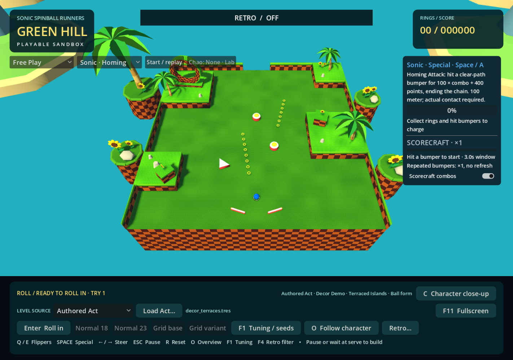
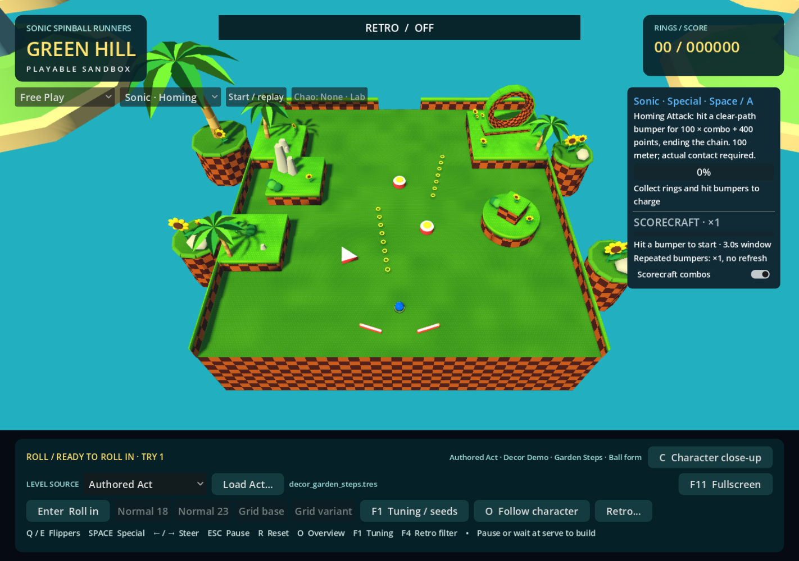
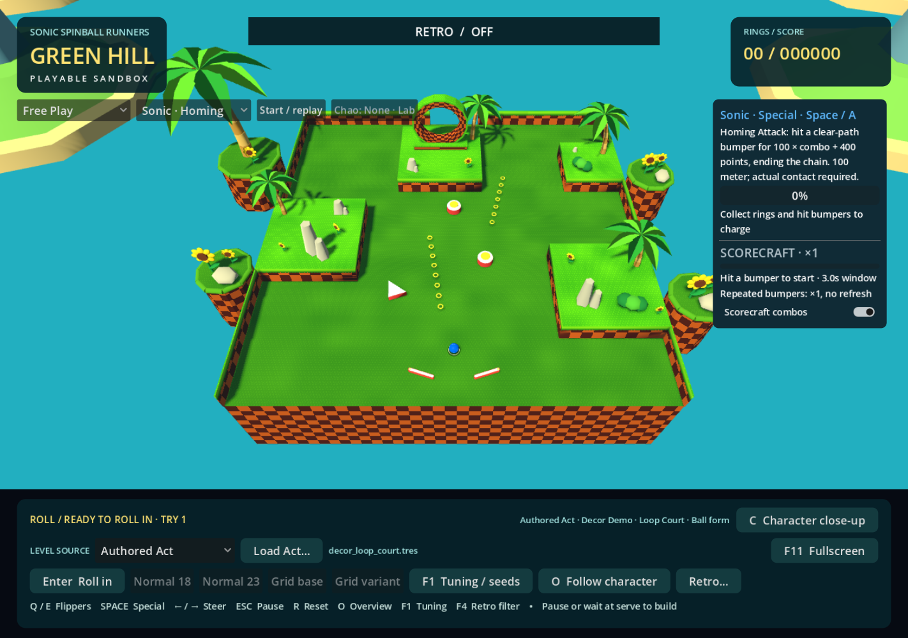
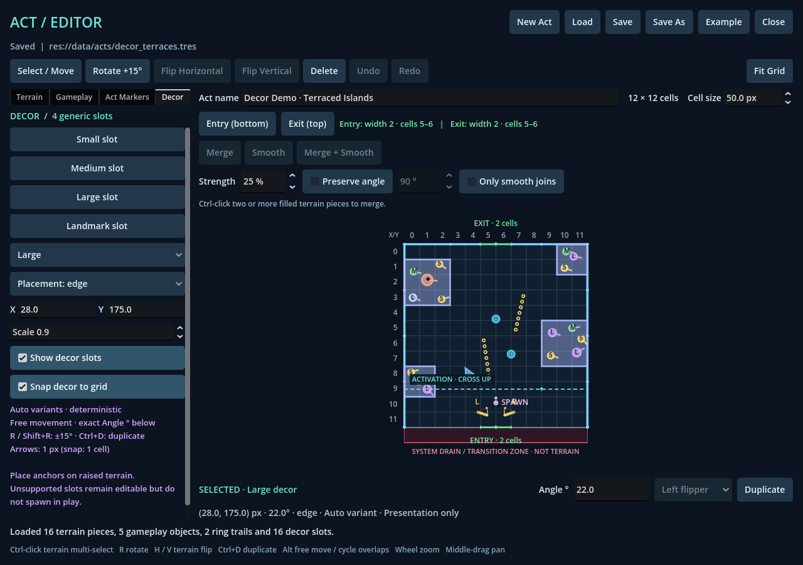
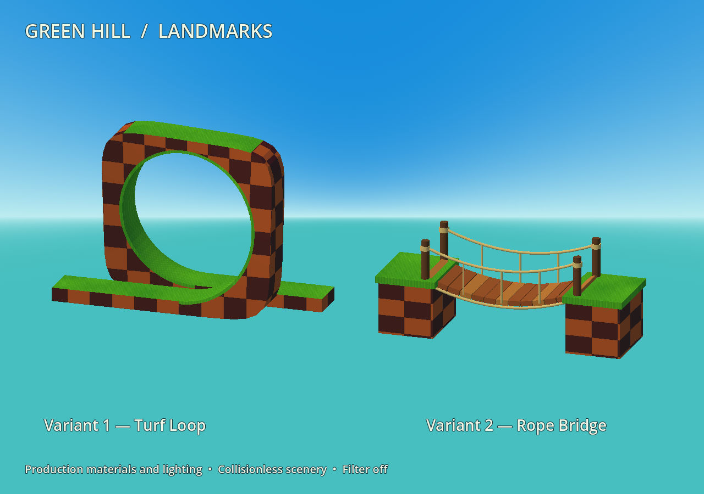
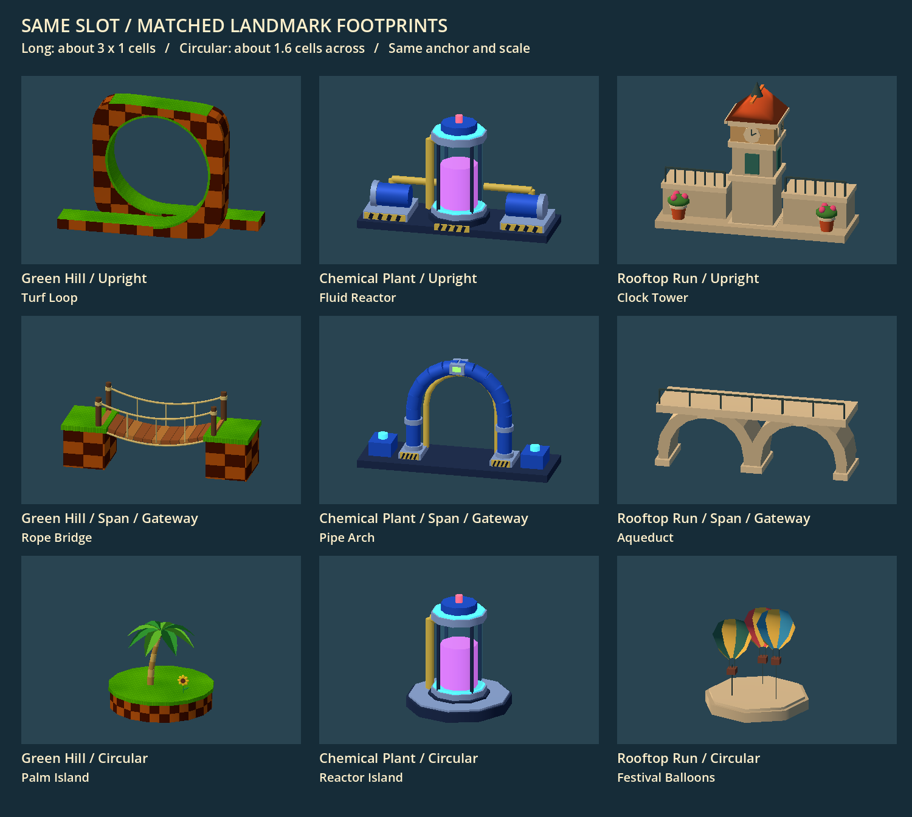
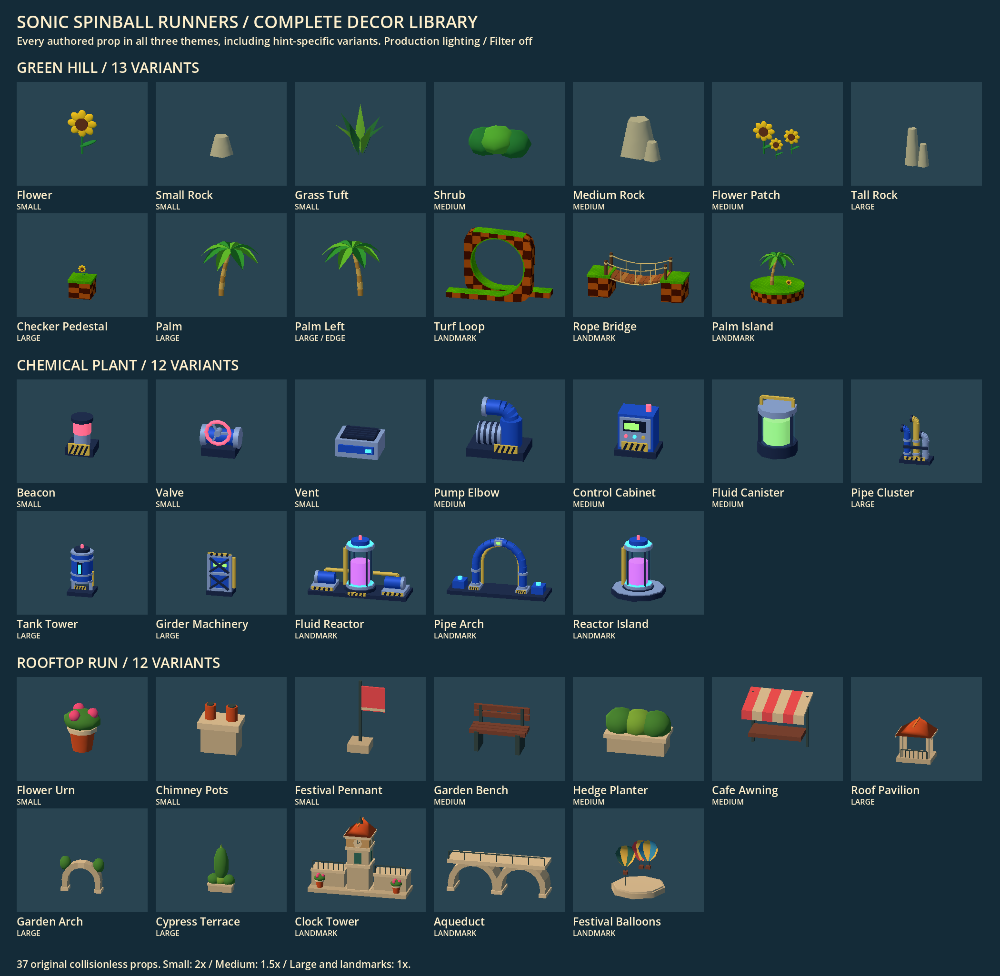

# Theme-aware decoration slots

The Act Editor stores manually placed, theme-independent decor slots. The active presentation skin selects collisionless props. Green Hill and Chemical Plant now reuse the same authored geometry and slot records. Choose **THEME** in the main game; see [Chemical Plant and the shared theme pipeline](CHEMICAL_PLANT.md) for comparisons, original assets and implementation details.

## Try the examples

Open **Act Geometry Editor.cmd → Load** to edit a file below. Open **Play Green Hill.cmd → Load Act…** to play it. Press **O** for an overview of the composition; normal follow mode remains available.

| File | Composition | Slots |
| --- | --- | --- |
| [`decor_terraces.tres`](../data/acts/decor_terraces.tres) | Broad side terraces, edge palms, checker details and a loop island | 16 |
| [`decor_garden_steps.tres`](../data/acts/decor_garden_steps.tres) | Stepped small islands, a rounded rock island and an upper landmark | 17 |
| [`decor_loop_court.tres`](../data/acts/decor_loop_court.tres) | Central raised loop court and two decorated side shelves | 17 |

All examples include small, medium, large and landmark slots, Spawn, connectors, rings, bumpers and flippers. They are workflow/look demonstrations, not final balanced Acts. Every slot anchor is on raised terrain. Their geometry and slot compositions are explicit authored records; nothing scatters across the map on load.





## Editor workflow

1. Choose **Decor**, then **Small / Medium / Large / Landmark slot**. Click inside the Act to place repeated slots. Colored markers grow with slot size; S/M/L/◆ labels and an orientation tick remain visible without loading a 3D skin.
2. Press **Esc** or **Select / Move**, then click and drag a marker. Decor uses free placement by default. **Snap decor to grid** is optional; **Alt** temporarily frees an enabled snap. **Alt-click** cycles overlapping items, including terrain.
3. Edit **type**, **Placement: surface / edge / either**, exact **X/Y** local pixels, **Angle °**, or **Scale**. Any finite angle is accepted; **R / Shift+R** adds/subtracts 15°. Scale is limited to 0.85–1.15. Position and angle are never normalized on save.
4. **Ctrl+D / Duplicate** copies the transform half a cell diagonally and gives the new slot its own ID. **Delete** removes it. Placement, movement, property changes, duplication and deletion share the existing undo/redo history. Arrow keys move one pixel in free mode, or one cell with snap; Alt+arrows always move one pixel.
5. **Show decor slots** hides markers and their selection targets without deleting records. Snap and visibility are session view preferences, not Act data.

The Decor inspector scrolls when the window is short. Exact angle editing uses the existing field below the canvas. **Auto** remains the default variant. Choose **Preview: Green Hill / Chemical Plant / Rooftop Run** to see the current type/hint pool's friendly names, then select a numbered variant. This preview selector changes labels and availability only; it is not saved in the Act and does not load 3D editor ghosts. Variant edits share undo/redo and persistence with other slot properties.

For Green Hill **small / surface**, **Variant 1 — Flower**, **Variant 2 — Small Rock**, **Variant 1 — Flower** stores indices **0, 1, 0**. Chemical Plant interprets the same records as **Beacon, Valve, Beacon**. If an index is unavailable after changing the preview theme, slot type or hint, the inspector retains it and displays a warning. Runtime uses deterministic Auto for that slot and lists the warning in the main game's level-source tooltip. Neither fallback changes the authored record.



### Placement rules

Place the anchor on a filled terrain stamp/composite or a narrow raised wall ribbon. The inspector reports when a selected slot has no supporting raised terrain. Such slots remain valid, saveable drafts but do not spawn in Green Hill. The runtime records their IDs in `skipped_decor_slots`. It never relocates a slot onto nearby geometry or puts a floating prop over the playable floor.

`placement_hint` chooses a theme pool; it does not detect a cliff, change height or move the anchor. `edge` is an artistic hint: choose it when placing at an island edge. The anchor determines support, not the full prop footprint. Leaves or the loop silhouette may extend beyond that anchor, so inspect the result in the normal gameplay camera.

## Data and deterministic resolution

Act format **7**, terrain library **2**, adds:

- `decor_seed`: a persistent Act decoration identity, generated on its first decor edit. It survives saves, Save As, renaming and copies. An unseeded hand-authored file falls back to its Resource path.
- `decor_slots`: an ordered array of dictionaries containing `slot_id`, `slot_type`, `placement_hint`, `position: Vector2`, `rotation_degrees`, optional `variant_mode = "auto"`, and optional `scale = 1.0`. Format **10** adds `variant_mode = "fixed"` with a required nonnegative integer `variant_index`. Indices are zero-based; the editor displays one-based variant numbers. Auto selection removes the index.

Act records contain no mesh paths, Green Hill prop names or skin IDs. Slot IDs are generated only during authoring and stay fixed through movement, rotation and undo. A duplicate gets a fresh ID. IDs must be nonempty and unique within the Act.

For small, medium and large Auto slots, `DecorSkin.resolve()` hashes the JSON array `[act_identity, slot_id, skin_id]` with SHA-256, converts its first eight hexadecimal digits to an integer, then takes modulo the selected pool length. Landmarks instead share two composition roles across themes, using the original Green Hill hash namespace and modulo two. This preserves existing Green Hill choices while matching the other themes to them. Fixed mode directly indexes the selected pool, independently of the seed and slot identity. Neither mode consumes gameplay RNG. Reloading, reordering slots, deleting other slots, or editing unrelated geometry cannot reshuffle an existing slot. Preserve published pool order: fixed indices refer to those positions. An unavailable index falls back to Auto with a warning; an empty pool warns and skips the visual.

The document fingerprint, deep-copy history, validation, and atomic save/reload comparison include variant mode and index. Angles and scale use the existing exact numeric byte storage convention. Formats 2–6 load in memory with no decor and no file rewrite. Format 7 introduced decor; current saves use format 10. Formats 7–9 retain their Auto slots unchanged on load. Formats below 7 cannot carry decor, and below 10 cannot carry fixed-variant fields. Existing terrain transforms and composite outlines remain exact.

For two-monitor authoring, save in the editor, then click **Reload Act** beside **Load Act…** in the main game, or press **F5**. Reload reads the current file without a picker, rebuilds the entire authored playfield and current theme, resolves decor again, and returns the ball to serve. It retains presentation preferences and the previous pause state. A missing file or invalid draft leaves the live Act intact; correct the file and press F5 again.

## Skin and runtime ownership

- `scripts/act_editor/decor_slots.gd`: generic schema, IDs, markers' dimensions/colors, and raised-surface support queries.
- `scripts/decor/decor_skin.gd`: skin ID, per-type/per-hint variant pools, deterministic resolution, and a visual factory callable.
- `scripts/decor/green_hill_decor.gd`: first skin's lightweight procedural meshes, built in cell units. It reuses the existing Green Hill palm and sunflower builders/material palette.
- `act_runtime_compiler.gd`: copies generic decor metadata into the runtime descriptor. Its physics compilation does not inspect or instantiate decor.
- `green_hill_presentation.gd`: resolves and spawns supported slots below `GreenHillTerrain/AuthoredDecor`, at the same `RAIL_HEIGHT + RAIL_CAP_HEIGHT` used by raised terrain. Cell size and safe per-slot scale control prop size. Canvas clockwise degrees map to negative world Y rotation.

Every spawned child is a visual `Node3D`/`MeshInstance3D`. There are no collision objects, physics shapes, hit targets, ring records, scores or ball callbacks. The normal presentation rebuild disposes all old props before a source/replay reload. Existing distant scenery and exterior edge-island dressing remain unchanged.

To add a decor skin, provide its stable ID, pools for all four sizes and three hints, and a factory returning a collisionless `Node3D` in cell units. Reserve landmark indices 0 and 1 for long upright and span/gateway compositions; index 2 is a circular composition selected explicitly. A full production theme supplies this skin through `ThemeDefinition.create_decor()` together with materials, environment and background builders. No Act schema or physics change is required. The original decor regression retains its minimal test factory; `theme_runtime_regression.gd` checks all three production themes with the same saved Acts.

### Green Hill library

| Size | Available props |
| --- | --- |
| Small | Single sunflower, small faceted rock, seven-blade grass tuft |
| Medium | Medium rock cluster, low shrub, sunflower patch |
| Large | Left/right leaning palm family (`edge`), tall rock formation or checker pedestal (`surface`); `either` combines these families |
| Landmark | Variant 1: Turf Loop, with a rounded rectangular checker cliff, continuous inner grass track and separate entry/exit aprons. Variant 2: Rope Bridge, with sagging wooden planks, rope rails and grassy checker-cliff ends. Variant 3: Palm Island, a circular grassy base with a palm and sunflower. All are visual ornaments. |

The composition borrows the broad checker silhouettes, palms and sunflower accents visible in [Sonic Generations' Green Hill screenshots](https://www.digitallydownloaded.net/2011/10/sonic-generations-demo-now-available.html) and [Sonic Mania's Green Hill screenshots](https://www.trueachievements.com/n25476/taegx-2016-sonic-mania-showcases-green-hill-and-studiopolis). These were visual references only. No external models, textures or screenshot assets were downloaded into the project. New props are local primitive geometry matching the project's existing low-poly presentation. Sizes and density remain provisional art tuning.

**Landmark revision, 2026-10-25:** The loop's separate radial blocks have been replaced with two continuous meshes. The classic 3D turf-loop screenshot in the Generations gallery above informed its broad outer cliff, grassy inner opening and tangent approaches. The [Generations bridge screenshot](https://pics.alphacoders.com/pictures/view/596117) informed the second landmark's crosswise wooden deck, rope rails and grassy cliff supports. Both were inspected as visual references; the project geometry is original and procedural.

Select a Landmark slot, preview **Green Hill**, and choose **Variant 1 — Turf Loop** or **Variant 2 — Rope Bridge**. All three placement pools share this order. Existing fixed loop slots retain index `0`; the bridge appends index `1`. Auto remains the default and now selects between those two shared composition roles. Fix the index when a particular silhouette matters. Acts still save only generic mode/index values. At scale 1 the loop spans about 3.04 cells including approaches, and the bridge 2.95 cells; check overhang on narrow islands.



### Consistent landmark footprints across themes

Landmark variants 1 and 2 use a common envelope of approximately **3 cells along local X by 1 cell deep**, centered on the existing anchor. The editor's angle tick points along that long axis. Variant 3 uses a **circular base about 1.6 cells across** in every theme. Geometry is composed to fit these envelopes; the renderer does not stretch a tower or rotate it independently of the slot.

| Saved variant | Composition | Green Hill | Chemical Plant | Rooftop Run |
| --- | --- | --- | --- | --- |
| 1 (index 0) | Upright centerpiece with long base | Turf loop and approaches | Reactor with service skid and pumps | Clock tower with side terraces |
| 2 (index 1) | Span / gateway | Rope bridge | Upright pipe gateway on a long service apron | Twin-span aqueduct |
| 3 (index 2) | Circular | Palm island | Reactor island | Circular balloon court |

Auto chooses between the first two rows, consistently across themes. Circular landmarks are explicit Variant 3 choices so adding them does not replace a long Auto prop with a round one. Existing landmark Auto choices and fixed indices remain stable. Rooftop's fixed Variant 3 retains its balloons but now uses a round court, replacing its long terrace. Chemical Plant's Variant 2 restores the original upright pipe-arch idea without a bridge deck. An unavailable fixed variant still warns and falls back to Auto.

Green Hill's new Small Variant 3 appends the grass tuft after Flower and Small Rock. Those two fixed indices remain unchanged. Small Auto uses the expanded three-prop pool, so some existing Auto small slots may change appearance; use a fixed index to keep a specific prop.



Background buildings keep their separate scenery proportions. This change affects authored landmark composition, with no Act schema change, source rewrite, terrain fitting, collision change, or anchor/rotation adjustment. Full-footprint support is still an authoring judgment; matching envelopes do not guarantee every narrow island supports an entire prop.

### Complete decor catalogue

The production libraries contain **37 distinct props**: 13 Green Hill, 12 Chemical Plant and 12 Rooftop Run. The sheet includes variants exclusive to a placement hint, such as Green Hill's left-leaning palm. Small props are shown at 2x, medium at 1.5x, and large/landmark props at 1x. This is the authored decor library; generated background scenery is composed separately.



Render it with Godot's graphical renderer and `--script tests/all_decor_capture.gd`. The capture enumerates the live size/hint pools, rather than maintaining a separate asset list.

## Verification and manual review

Run from the repository with Godot 4:

```powershell
& 'C:\Program Files\Godot\Godot.exe' --headless --path . --script tests/decor_regression.gd
& 'C:\Program Files\Godot\Godot.exe' --headless --path . --script tests/decor_editor_smoke.gd
& 'C:\Program Files\Godot\Godot.exe' --headless --path . --script tests/decor_runtime_smoke.gd
& 'C:\Program Files\Godot\Godot.exe' --headless --path . --script tests/green_hill_landmarks.gd
& 'C:\Program Files\Godot\Godot.exe' --headless --path . --script tests/landmark_theme_regression.gd
```

Omit `--headless` and add `--rendering-method gl_compatibility --rendering-driver opengl3_angle` for graphical captures. Tests save captures under ignored `test-results/`; this document includes selected captures from the actual editor/game.

The landmark check covers stable pool ordering, fixed selection, finite nondegenerate meshes and collisionless descendants. Its graphical mode captures front and three-quarter views using production materials and lighting.

The cross-theme landmark check covers all placement hints, fixed indices, long and circular measured mesh bounds and centering, span/gateway height envelopes, unchanged landmark Auto choices, shared roles, missing-index fallback, immutable slot records and the small grass tuft's dimensions. Its graphical mode captures the matched nine-prop sheet above. The circular revision passed 147 landmark checks, 302 theme runtime checks, 91 Rooftop decor checks, 46 decor-data checks, 29 editor checks and 16 original Green Hill landmark checks. The editor check now verifies the third small variant while retaining a genuine unavailable-index case through the medium/edge pools. The complete 37-prop gallery and normal/retro main-game captures were also reviewed.

For the 2026-10-25 landmark revision, an isolated checkout passed 18 graphical landmark checks, 21 graphical main-game decor checks, 29 graphical editor checks and 46 headless decor-data checks, with zero failures or script/shader errors. Front/three-quarter contact sheets and the loop/bridge in main-game overview captures were visually inspected. Subjective composition and overhang on custom Acts remain manual art review.

Manual checklist: place/move a slot at an island edge, rotate it to a non-round angle, duplicate it, save/reload, then compare follow/overview in Green Hill. Check ball readability, overhanging palm leaves, loop placement and the amount of decoration. These are human art/feel judgments; deterministic tests do not establish final gameplay balance.
