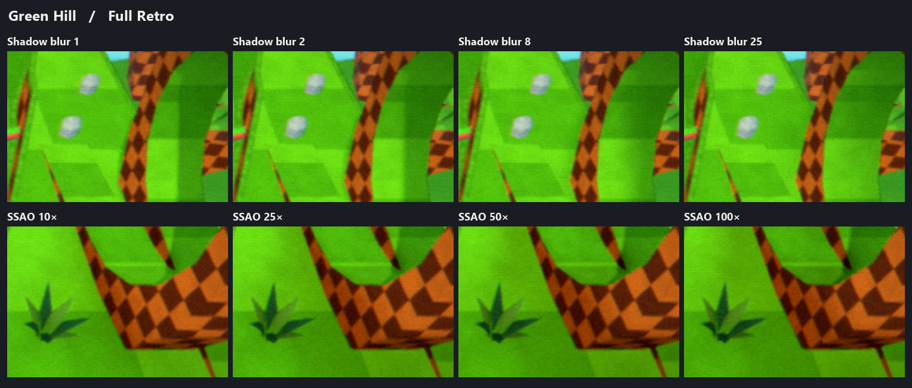

# Device shadow quality

Atmosphere owns shadow enablement, opacity, filter radius, physical sun angle, depth/normal bias and maximum distance. Device graphics owns atlas size, cascades, directional filter quality, FXAA, MSAA, native 3D scale and the terrain face and shadow treatments.

## Controls and defaults

Open **Atmosphere Lab → Shadows**. The **Device Quality** controls save immediately in the `rendering` section of `user://graphics_settings.cfg`.

| Key | Values | No saved preference |
| --- | --- | --- |
| `directional_shadow_resolution` | 2048, 4096, 8192 | 4096 |
| `directional_shadow_cascades` | 1, 2, 4 | 4 |
| `ultra_filter` | Off / on | Project filter, currently Medium |
| `fxaa` | Off / on | On |
| `msaa` | 0, 2, 4 samples | 2 |
| `scale_percent` | 75, 85, 100 | 100 |
| `authored_faces` | Off / on | On |
| `clean_eight_shadows` | Off / on (Forward+) | Off, native gradient |

**Authored terrain faces** gives risers, sidewalls and undersides a little more depth. **Clean 8 shadow gradient** rounds the filtered directional shadow to eight attenuation levels on eligible terrain. Both switches work with the full Retro stack. [Matched Prototype screenshots and verification](TERRAIN_FACE_SHADING.md)

Legacy `smooth_shadows=true` enables Ultra and FXAA. Explicit new keys take precedence independently. The first successful device save writes both keys and removes the legacy key. Reads preserve the file. Saves merge with the latest file and preserve unrelated keys.

The eight Default atmospheres share **0.80 opacity, blur 10, SSAO 8×, depth bias 0.01, normal bias 0.10 and shadow distance 40**. Named variants can override these values. Full Retro uses N64-ish, VHS and CRT.

**Shadow blur** scales the filtered directional shadow radius from **0.5 to 25**. Start at 1 and compare 2, 8 and 25 on the same Ring or wall shadow. Large radii can reveal individual filter samples. The Shadows tab no longer exposes the physical sun angle. Older variants still round-trip that property. Sun elevation and azimuth remain editable under **Light**. [Godot Light3D reference](https://docs.godotengine.org/en/4.7/classes/class_light3d.html#class-light3d-property-shadow-blur)

**SSAO strength (×)** controls Forward+ contact shading on the playfield. **0** disables it. **1×** uses the Retro AO Lab's subtle reference intensity (0.961) and radius (0.42 world units). The gain reaches **100×**. **SSAO radius** (0.06–1.50 world units) controls the width of the contact. **SSAO contrast** (0.25–8) changes its continuous fade inside the native pass. The production radius is 0.42 and contrast is 1.08. The high-gain comparison below starts at 10×. At **50×** and **100×** the dark strip covers more of the bend. The comparison below holds blur at 1 for the SSAO row and turns SSAO off for the blur row. The gain blends through Zone transitions. Both controls save with an atmosphere variant. Missing settings inherit the shared defaults. Set strength to 0 to disable native SSAO explicitly.

**Cast shadow tones** selects the device setting or 8, 5, 4, 3 or 2 clean attenuation levels on eligible terrain. The filtered shadow follows the same light and caster. Four tones have two intermediate values, five have three. Retro still filters the final frame. The ordered study lives in the separate Shadow Lab.

**Contact shadow tones** selects native SSAO or 8, 5, 4, 3 or 2 clean levels. On Forward+ with MSAA, the banded option replaces native SSAO with current-frame depth sampled in eligible foreground terrain materials. Other surfaces lose the native SSAO contribution while this option is active. Switching MSAA off restores native SSAO. The cast and contact selectors save independently. [Native, four and five contact tones](terrain-face-shading/green-hill-contact-tones.png)

**Try an atmosphere → Arcade daylight (Sega-inspired)** combines a low warm sun, cool ambient fill, four cast tones and broader, higher-contrast native contacts. It runs as a draft until explicitly saved. For the smooth reference choose **Device default** with **Clean 8 shadow gradient** off. [Native, three and two cast tones](terrain-face-shading/green-hill-cast-tones.png)

[Three, four and five cast tones](terrain-face-shading/green-hill-four-five-tones.png) · [Playfield lighting comparison](terrain-face-shading/green-hill-arcade-daylight.jpg) · [Contact radius comparison](terrain-face-shading/green-hill-contact-radius.png)

In the live Atmosphere Lab, compare **off** with **25×** around the foot of the raised grassy pillar and the wall on the right. The camera, lighting, full Retro stack and blur 8 stay fixed. Switching back to off reproduced the first frame pixel-for-pixel. [Blink between off and 25×](terrain-face-shading/green-hill-live-ssao-blink.webp) · [Side-by-side PNG](terrain-face-shading/green-hill-live-ssao-pair.png)

These preferences are local to the application's `user://` directory. Source Lab and Prototype share the game profile; the portable tools and their launched Prototype share the separate **Sonic Spinball Authoring Tools** profile. Copying Acts/Atmospheres or a ZIP does not transfer device preferences. Separate running processes load preferences on startup; they do not poll one another's files.

## Runtime ownership

`scripts/rendering_options.gd` is the single quality policy. The first viewport or light registration loads preferences before rendering gameplay. Resolution calls `RenderingServer.directional_shadow_atlas_set_size()` with the existing project depth precision; it never writes `project.godot`. Changes affect the whole renderer process, including all its viewports, without restarting. The Lab reports the size submitted to that API. Godot has no public atlas-size readback, so this is not a claim to independently measure the allocated GPU texture.

Directional light registrations use weak references and apply 1/2/4 cascades immediately. Live changes update existing lights; new lights inherit the policy. Covered paths:

- Shared table foreground, including Lab, normal Prototype, single-Act Prototype, and Endless.
- Source theme configuration and the temporary authoring/bake presenter, after theme setup.
- Atmosphere runtime configuration used by streamed Zone backdrops. These lights still have shadows explicitly disabled.
- Temporary foreground/background lights used to warm disk-baked visual recipes. Warm-up viewports also inherit FXAA.

Atmosphere snapshots and blends draw their cascade mode from device policy. Light registration preserves `shadow_enabled` and the artistic properties. The native terrain look uses the ordinary opaque pass. Clean 8 tracks resident Acts and attaches the correction when a new foreground becomes ready. Source changes can require an ordinary rebake. Changing device preferences takes effect with the same disk recipes.

Atlas size and cascade modes are supported by Forward+, Mobile and Compatibility, so the numeric preferences are shared across renderers. Ultra shadow filtering and FXAA require Forward+/Mobile. The Lab disables both toggles in Compatibility and retains the preferences for later supported launches. Native SSAO requires Forward+. Headless runs explicitly state that they cannot compare rendered shadows.

Engine references: [global runtime atlas API and directional filtering](https://docs.godotengine.org/en/stable/classes/class_renderingserver.html#class-renderingserver-method-directional-shadow-atlas-set-size), [Compatibility light storage](https://github.com/godotengine/godot/blob/master/drivers/gles3/storage/light_storage.cpp), [renderer feature support](https://docs.godotengine.org/en/latest/tutorials/rendering/renderers.html#antialiasing).

## Legacy atmosphere compatibility

`sun/directional_shadow_mode` is retired, not repurposed. Older format-1 production variants, renderer-specific Lab drafts and playtest snapshots still load. The exact legacy key is ignored/removed in memory and never overrides device policy; other unknown fields still fail production validation. Loading does not rewrite files or change their revision hashes.

Explicit variant saves omit the retired field from all records in that theme file. Explicit Lab draft saves omit it only from the selected theme/renderer section, preserving other sections. New snapshots omit it. Save, Reload, Reset, Show Original, quick looks, theme changes and variant changes neither save nor reset device graphics. The eight shipped Default records inherit the shared shadow values. Explicit settings on named variants still take precedence.

## Laptop comparison

Green Hill Prototype, RTX 4060, Vulkan Forward+, 1280×900, full Retro, 2× MSAA, 4096 atlas and four cascades. Each number is the median foreground GPU time from a 120-frame camera sweep. The second sweep reversed the treatment order. Both custom contact modes verified seven eligible receivers and a valid resolved depth texture. The cast treatment added six foreground draws.

| Shadows | First sweep (ms) | Reverse sweep (ms) |
| --- | ---: | ---: |
| Smooth cast and native SSAO, approved defaults | 0.479 | 0.480 |
| Smooth cast and native SSAO, matched contrast | 0.479 | 0.481 |
| Four cast tones and native SSAO | 0.567 | 0.562 |
| Smooth cast and four contact tones | 0.548 | 0.522 |
| Four tones on both | 0.593 | 0.567 |
| Five tones on both | 0.563 | 0.564 |

The first activation of custom contacts stalled for 5.4 seconds in one earlier run. Warm GPU timings exclude that startup cost. Whole-frame FPS and integrated-GPU results need a separate device measurement. Rerun using `Godot --path . --rendering-method forward_plus --rendering-driver vulkan --script res://tests/retro_contact_profile.gd`.

In a separate 180-frame sweep, the composite and output viewports together took about 0.14 ms with both the glow candidate and the earlier grid. That comparison preceded the final per-channel beam and color-edge tuning. Those totals cover display composition, independently of the foreground times above.

Extract the Shadow Review ZIP to a writable folder. Double-click **Shadow Review.cmd**. Option 1 opens the live Lab on the Shadows tab at B. Keep Act, camera, atmosphere and Retro fixed while switching A/B/C, FXAA, Ultra and Ring shadows. Review device changes last for that session. Ordinary Lab device changes persist. Option 2 runs the paired first/repeat benchmark. [Configurations, evidence and review instructions](SHADOW_REVIEW.md)

## Regression coverage

- `tests/device_shadow_regression.gd`: independent controls, defaults/invalid input, all eight themes, Save/Reload/Reset/Show Original, legacy read/save behavior and unchanged source hashes. Run a second process with `-- --reload-only` to verify disk persistence. Graphical runs also log texture-memory changes while resizing the real atlas.
- `tests/atmosphere_playtest_regression.gd`: Lab snapshot into the real Prototype session, foreground/background policy and runtime blend protection.
- `tests/prototype_variable_run_regression.gd`: ordinary disk-backed 1- and 7-Zone runs load preferences without a Lab, including resident/background/warm-up lights.
- `tests/portable_atmosphere_smoke.gd`: release executable live controls and fresh Lab instances; `--graphics-reload` additionally checks preferences from the previous process.

Human review still owns laptop performance, shadow quality, transitions and camera readability.

### Verification on 2026-11-04

Godot 4.7.2 / Windows / RTX 4060: 440 variant checks; 135 device-boundary checks in headless, Vulkan and Compatibility runs; 2 fresh-process persistence checks; 20 Lab-to-Prototype checks; 252 ordinary 1-/7-Zone Vulkan run checks; 31 graphical portable checks and 32 portable relaunch checks. All assertions passed. Vulkan atlas changes increased reported texture memory by 24 MiB from 2048 to 4096 and by 96 MiB from 4096 to 8192, consistent with live 16-bit atlas reallocations. This is allocation evidence, not a laptop FPS recommendation.

The broader headless production test emitted dummy-renderer mesh RID errors; the equivalent Vulkan run had no runtime errors but reported ObjectDB leaks at shutdown. Compatibility reported texture leaks at exit. The graphical portable multi-theme smoke completed its assertions but stalled in shutdown and was stopped; a separate normal portable launch/exit and headless relaunch both exited successfully. These cleanup limitations remain outside the shadow-ownership change. No production atmosphere bytes or project settings changed during verification. The portable ZIP passed CRC checks and its three entries matched the exported files byte-for-byte.
