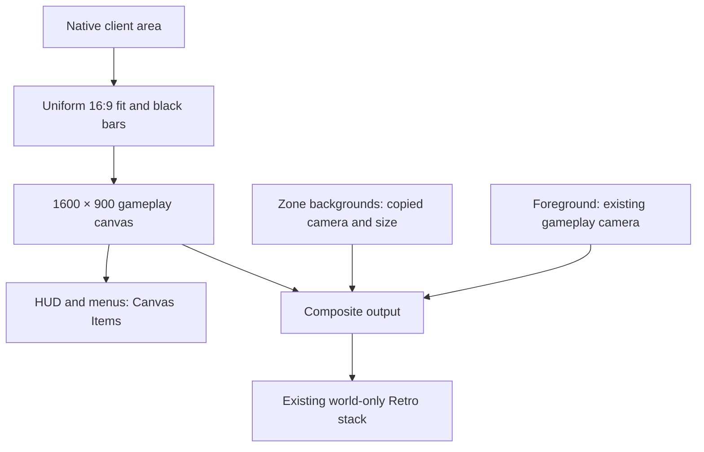

# Display and framing contract — isolated prototype

Status: **review prototype, not merged into main**. Base: `5ceab0c5a3b86eac3dbc239763867e39976ef2c2`; branch: `codex/display-framing-contract`. This base already contains the optional Launch Tube. The implementation deliberately avoids its physics, authoring and retry code.

## Finding

The substantial composition change is caused by **aspect ratio**, not pixel resolution alone. On untouched source, 1280×720, 1920×1080, 2560×1440 and 3840×2160 already produce the same logical canvas, camera and normalized landmarks. Moving from the default 1280×900 window to 16:9 fullscreen changes the aspect. Ultrawide expands it further.

The chain is explicit:

1. `project.godot` specifies a **1280×900** reference, `canvas_items` stretch and **expand** aspect. The reference is approximately 1.422:1, not 16:9. At 16:9, Godot expands the logical canvas to 1600×900; at 3440×1440 it expands to 2150×900.
2. `scripts/prototype/session.gd::_ready()` explicitly selects `CONTENT_SCALE_ASPECT_EXPAND`. Changing only the project setting would therefore miss Prototype.
3. `scripts/endless/endless_game.gd::_build_view()` fills that logical canvas with the composite output. `RetroFilter._refresh_output()` sets its resolution to the container size divided by the existing Retro divisor. Foreground and Zone backdrops follow the composite dimensions.
4. `TablePresentation._configure_camera()` reads the actual foreground viewport aspect, uses `Camera3D.KEEP_HEIGHT`, and fits the authored follow/overview envelope using that aspect. Wider aspects expose more horizontal world; narrow aspects can also change the fit distance. This is expected projection behavior, not a physics or field-of-view defect.
5. Prototype and Endless F11 handlers only change the native window mode. They do not establish a constant gameplay composition.

There is a separate ownership hazard: the Act editor sets `content_scale_mode = DISABLED` and does not restore it. A gameplay session in that same window can inherit native-pixel sizing, changing HUD/Retro density. This is **not** the explanation for extra world at identical aspect. The prototype handles such a caller explicitly without changing editor behavior.

Godot's documented distinction between [base size, stretch mode and aspect](https://docs.godotengine.org/en/stable/tutorials/rendering/multiple_resolutions.html), [Window content scaling](https://docs.godotengine.org/en/stable/classes/class_window.html#class-window-property-content-scale-aspect), and [Camera3D keep-aspect projection](https://docs.godotengine.org/en/stable/classes/class_camera3d.html#class-camera3d-property-keep-aspect) matches these measured results.

## Proposed contract

Use one **1600×900 logical gameplay canvas** with **Canvas Items / Keep** for Prototype and Endless, including Play Act. This preserves the existing normal 16:9 composition and Retro resolution. It does not invent a new camera zoom or graphics-quality tier.

- Fit the complete 16:9 reference uniformly inside the native client area.
- Use black pillarboxes on wider displays and black letterboxes on narrower displays. No extra useful playfield, crop, table distortion or additional background pass.
- Keep foreground, both Zone backgrounds, composite and Retro inside the same root fit. Keep native Canvas Items HUD outside the Retro-filtered world, but inside that root fit.
- Let Godot own the native-to-logical pointer transform. Keep the existing logical-to-world overview mapping and score-overlay projection.
- Preserve every camera preset, follow setting, projection, FOV and relative zoom. Dramatic, Wide (0.75× follow zoom), Real Pinball and Top-down remain distinct.
- Do not change Retro effects, divisor, shader parameters, MSAA, world scale, textures, atmosphere, artwork, physics or authored data.
- Scope the contract to gameplay lifetime. Restore the exact prior mode, reference size and aspect after the last gameplay owner exits. Editor and development/visual laboratories retain their own layouts.

The runtime change is one new scoped helper, `scripts/display_framing.gd`, and one installation line in `EndlessGame._ready()`. Prototype inherits that entry point. Nested gameplay owners share one window lease; the last owner restores the caller's settings. There is no new per-frame loop or rendering target. No project setting or fullscreen handler is changed.

To review ordinary play in this worktree, launch `scenes/prototype_run.tscn` or `scenes/endless_runner.tscn` with Godot, using the existing disk bakes. Resize the client and press F11; C still cycles the existing camera presets. The fixed contract is active on this isolated branch only. The Act editor itself keeps its unrestricted authoring layout.

## Matrix and evidence

The matrix includes both modes, all four cameras, Retro production stack and OFF, and eight sizes: the seven requested references plus the historical default window. See [before/after gallery and exact receipts](display-framing/README.md) and the local [interactive comparison](display-framing/index.html).

Representative production-Retro sizes:

| Native client | Old logical canvas | Old world/composite | Proposed world/composite | Proposed fit |
| --- | --- | --- | --- | --- |
| 1280×720 | 1600×900 | 842×473 | 842×473 | 1280×720 |
| 1920×1080 | 1600×900 | 842×473 | 842×473 | 1920×1080 |
| 2560×1440 | 1600×900 | 842×473 | 842×473 | 2560×1440 |
| 3840×2160 | 1600×900 | 842×473 | 842×473 | 3840×2160 |
| 2560×1080 | 2133×900 | 1122×473 | 842×473 | 1920×1080; 320 px side bars |
| 3440×1440 | 2150×900 | 1131×473 | 842×473 | 2560×1440; 440 px side bars |
| 1600×1200 | 1280×960 | 673×505 | 842×473 | 1600×900; 150 px top/bottom bars |
| 1280×900 | 1280×900 | 673×473 | 842×473 | 1280×720; 90 px top/bottom bars |

In the Dramatic reference, the old 2560×1080 and 3440×1440 views expose approximately **33.25% and 34.32% more horizontal floor span** than 16:9. The prototype holds normalized landmarks constant at every size. The existing integer rounding of fractional Retro dimensions remains unchanged; production and OFF are verified separately, rather than claiming their raster grids are mathematically identical.

### Capture limits

The available secondary monitor is 1920×1200. A native 4K/ultrawide window would spill onto another monitor. The large matrix therefore uses embedded Windows: measure the actual Canvas Items layout and gameplay cameras, temporarily use VIEWPORT only to read the complete logical canvas, then fit that image to the requested physical rectangle. These are explicitly **framing reconstructions**, not native 4K font-quality or performance evidence. Full physics state is frozen, and the final comparison pins seed 18 and the Default atmosphere. Shader animation can still vary between readback frames; numerical authority uses camera projections and gameplay state, not pixel identity.

Separate native tests exercise actual window sizes and the unmodified F11 handlers on monitor 2. Their final images capture only the game's native client rectangle through Godot's `screen_get_image_rect`, including the real OS-composited bars. Engine-local test input does not move the desktop cursor.

## Performance implications

There is no extra 3D viewport, shader pass, dynamic light or per-frame contract work. At ordinary 16:9, foreground/composite dimensions, MSAA, world scale and Retro parameters are unchanged at every tested physical resolution. Physical output/HUD composition still scales with the window.

At production Retro settings, the world/composite pixel budget changes with the contract: **0% at 16:9**, approximately **−24.96% at 2560×1080**, **−25.55% at 3440×1440**, **+17.18% at 1600×1200**, and **+25.11% at the old 1280×900 default**. This is the cost of consistently choosing the existing 16:9 reference; it is not a hidden quality-setting change. With Retro OFF, the same aspect policy holds at the full 1600×900 logical render size.

These are measured allocation counts, not FPS claims. No controlled GPU benchmark or physical 4K/UHD 620 measurement is claimed. Embedded-window readback timings are unsuitable for that purpose. Existing render-quality controls remain available and unchanged.

## Verification and retained limitations

The evidence index records exact final totals and commands. Coverage includes native HUD clicks through the display transform, rejection of bar clicks, overview wheel anchoring and relative drag, score-label alignment, restoration after leaving an editor-style caller, all camera presets, both Retro states, and actual two-Zone composition in Prototype and Endless. Crossfades are sampled forward and backward at identical seam coordinates and three display aspects; both background cameras, resolution, atmosphere blend and gameplay identities remain aligned.

The five display-specific fixtures pass **1,694/1,694** checks (fixed matrix, native input/F11, crossfades, lifecycle and exact physics traces). The legacy comparison adds 605 passing checks. Across all eleven final suites, **3,453/3,454** assertions pass; the remaining assertion is the existing OS clipboard check described below. Headless editor import completes without errors. This is targeted qualification, not a new claim of a full 32-suite baseline.

An unrelated existing Prototype run assertion is seed-sensitive. At seed `4141928365`, untouched parent and the prototype both compare full-precision exported `hue/foliage = -0.08499999999999996` against the test's rounded `-0.085`. Configuration and fingerprint match; the course matches when serialized with the exporter's existing full-precision mode. No telemetry, atmosphere, gameplay or assertion was changed to conceal this. Failed runs remain in task evidence. Existing native ObjectDB exit warnings are also retained; this branch does not claim to fix engine teardown.

One repeated Vulkan matrix capture crashed in native Godot/NVIDIA code after reporting lost-device `UI_PASS` / `BLIT_PASS` breadcrumbs. Earlier full matrices passed; the unchanged final retry passes 861/861. The cause is not proven, and this branch does not claim driver or repeated readback stability. Both seed-18 Prototype runs pass 161/162, with the OS clipboard check reporting `Unable to open clipboard`. These failed attempts remain available locally and are listed alongside the final results.

## Integration notes

Do not merge automatically. Review the reference composition and black bars first. The branch starts after Launch Tube commit `5ceab0c`; it does not edit `game.gd`, `ball.gd`, `prototype/zone_run.gd`, authored objects, input actions or camera code. The only existing runtime file touched is `scripts/endless/endless_game.gd`, with a single line near the beginning of `_ready()`.

At final pre-commit inspection, GitHub `main` and the original main checkout still point to `5ceab0c5a3b86eac3dbc239763867e39976ef2c2`, with no tracked modifications in that checkout. There is no intervening main delta to reconcile. This work is committed and published only on its isolated branch.

If main advances, rebase or cherry-pick into a separate integration branch and retain both sets of initialization hooks. Do not replace the whole function. A future change that writes Window scaling during gameplay must cooperate with the contract or explicitly own a different window. The shared brain note may need a manual documentation merge. Generated caches, private profiles and raw test logs are not repository artifacts; compact review captures and machine-readable receipts are included.
