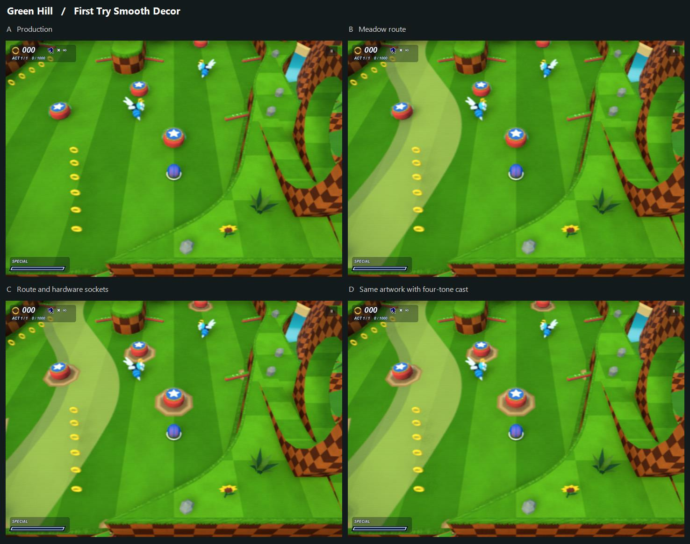

# Green Hill floor composition study · November 21, 2026

**D is my pick for visual review.** Follow the lower Ring trail in A and B. In A the mowing stripes run straight past the shot. In B a lighter swath turns with it and leaves the served Sonic on uninterrupted green. C gives the nearest star bumper a small ochre stone footing that is still legible under the CRT. D retains both gains under the four-tone cast treatment. C and D read very similarly at this pose. Most of the improvement is already visible in B.

Full-resolution captures are [A · shipping desktop defaults](green-hill-floor/A.png), [B · meadow route](green-hill-floor/B.png), [C · route and sockets](green-hill-floor/C.png) and [D · C with four-tone cast](green-hill-floor/D.png).

The three-second pan exposes a weakness in D. At the serve the swath picks up the lower Ring trail. As the camera rises it cuts inside the left-wall Rings, giving the upper court two competing directions. I would review that bend before extending the artwork further. Both halves use the same 72 camera positions with the Ball held. [Watch A and D in motion](green-hill-floor/gameplay-camera-pan.mp4)

## What to keep under review

The large curve, the quiet green around Sonic and the small visible rim under a target are the parts worth reusing. A pixel comparison puts the scale of the edits in perspective. The route changed 17.4% of the output frame from A to B. The mounts changed a further 2.8% from B to C. The return toward the left Ring bank matters more than the number of colors. A wider first socket covered about three bumper widths and turned the drums into a row of bullseyes. The revised socket is 61% of that diameter. Its small outline does enough work. The narrower flipper hinge seats disappear against the right wall at this camera. A future flipper trial should address the wall joint itself. The pale grass also narrows the value difference under the gold Rings. Alex should judge that section in motion before adopting the palette.

The transferable pieces are a route tied to an actual shot, an intentionally quiet neighboring surface, and a mount scaled to its hardware. The two-tone meadow cut and cut-earth/stone colors belong to Green Hill. This Act exercises bumper beds and hinge seats. A ramp landing would need a separate authored example.

## Matched conditions

The baseline was committed `main` at `d557f8d`. All four screenshots come from one real Prototype session running **First Try Smooth Decor** from current disk recipes. Sonic is served at (400, 500), seed 18, score zero, at the production follow camera's 1.3 zoom and 52° field of view. Window size is 1280 × 900. The 682 × 480 world, all three Retro passes, Default atmosphere, exposure, sun, contact intensity and terrain faces stay fixed. The HUD remains visible. The fixture holds time and hides its startup FPS counter. [Camera, settings, source hashes and per-frame measurements](green-hill-floor/study.json)

A uses fresh desktop defaults, including smooth cast and native SSAO. B changes only the existing ground receiver. C adds the mounts to the same texture sample. D changes just the device cast selector to four tones. This preserves a shipping reference and isolates both art changes from the incremental cast cost. Disabling the experiment and returning the cast selector reproduced A byte for byte.

The experiment rasterizes two small vector drawings in Act coordinates. It composites the seats into a single 640² color/coverage texture, adds mipmaps and samples it in the existing baked turf material before the authored atmosphere and face treatment. Only the explicitly launched study replaces that Act's ground material. It uses the existing mesh, contour, depth buffer, collision and artwork beneath the tint. [Artwork and capture source](../experiments/green_hill_floor/)

## Measured cost

RTX 4060, Godot 4.7.2, Forward+/Vulkan, 48 settled frames per state. Counts below cover the foreground viewport's visible pass. Material and shader counts are distinct resources bound to the active Act's visual tree, including overlays. GPU time is the foreground viewport median.

| State | Visible draws | Visible primitives | Bound materials / shader programs | Foreground GPU ms | CPU apply ms | First five frames + readback ms |
| --- | ---: | ---: | ---: | ---: | ---: | ---: |
| A | 177 | 26,469 | 147 / 12 | 0.482 | — | 116.9 |
| B | 177 | 26,469 | 147 / 12 | 0.480 | 70.0 | 145.3 |
| C | 177 | 26,469 | 147 / 12 | 0.479 | 46.3 | 92.9 |
| D | 183 | 31,595 | 151 / 16 | 0.568 | 0.04 | 237.5 |

B substitutes one material/program on the ground and retains its original for restoration. It adds one texture sample and one distinct study shader. Its first use registered four surface and two specialization pipeline compilations. C swaps the prepared artwork on that program and registered zero additional compilations. Preparing both images interactively costs measurable CPU time. A production candidate could bake its mipped map offline and warm the program through the existing recipe. The studio should measure that path before adopting it.

D activates the existing overlay on seven eligible terrain receivers. Compared with C it submitted six additional visible draws and 5,126 visible primitives. Shadow draws stayed at 597. Reported shadow primitives rose from 81,813 to 86,997. Four surface and four specialization compilations occurred during first use. The first-readback column includes the switch, five frames and image transfer. The GPU numbers reflect a held desktop view. The comparative costs on Intel remain open. Starting the Green Hill session took 4.86 s in this run. [Tuesday hardware protocol](TUESDAY_LAPTOP_DEPTH.md)

## Eight-theme audit

Priority reflects the value of a floor composition pass in **two matched views of this Act**. The first camera follows the served Ball. The second uses the same projection at (275, 250) to inspect the upper island and Ring turn. Each theme used its production surfaces, Default atmosphere and full Retro. These are findings about visible locations. Other Acts may expose different connections.

| Priority | Theme | Largest uniform or repetitive floor | Weakest connection | Hardware that feels placed | Leave visually quiet or already dense |
| ---: | --- | --- | --- | --- | --- |
| 1 | Rooftop Run | Pale pavers cover nearly the whole court between the lower Ring trail and tower. | The upper island's grass skirt meets street paving at a continuous edge, with no sign of how a shot enters the square. | The star drums sit across courses of brick with no local paving change. | The red terrace, awning, planters and tan coping on the right already carry the architecture. |
| 2 | Green Hill | The lower mowing stripes continue through both Ring banks and most of the bumper field. | Slender flippers leave the checker island and right wall with almost no visible hinge. | The nearest red bumper sits on the same stripe as Sonic. | Preserve the grass beside the Ball and the breathing room around the palm, loop and checker ledge. |
| 3 | Casino Night | The long blue panel field repeats behind the two rows of targets. | Lime flippers appear to project directly from the curved cabinet wall. | The magenta drums have no relationship to the panel seams beneath them. | Red-and-gold fascia, neon stars and the upper neon tower already pull the eye. |
| 4 | Chemical Plant | Repeated cyan/yellow light rows give the whole dark deck equal emphasis. | The right-wall flipper crosses the luminous deck edge without a machinery bed. | Two drums sit directly on glowing cells, which weakens their silhouette. | Tanks, caution strips and the upper reactor deck are saturated. A calmer interruption under targets is the stronger experiment. |
| 5 | Ice Cap | Blue patches repeat across the white basin with little relation to the Ring turn. | Thin blue flippers merge with the icy central plinth at their pivots. | Blue bumper bodies straddle snow and ice indiscriminately. | Preserve the white gaps around the Ring trail. The crystal island and faceted outside wall supply enough detail. |
| 6 | Lava Reef | The repeating cracked crust has few large changes across the lower court. | The curved metal edge clips the crust pattern along the machinery deck. | Warm bumper bodies disappear against the similarly valued rock cells. | The deep fissures, purple walls and right-side machinery already compete with Rings. Subtraction around hardware would help more than another motif. |
| 7 | Sky Sanctuary | The broad ivory center slab between the two blue inlays is the quietest region. | Flippers attached to the upper stone island emerge without an inset at the base. | The teal bumper crosses a pale slab seam with no masonry seat. | The blue side lanes already direct flow. Leave the colonnade, trailing greenery and pale center readable. |
| 8 | Aquarium Park | The lower blue-tile lane has a long straight run before the upper cross-pattern. | The side flipper meets the red pavilion edge through a narrow cyan bar. | The near drum lands on an ordinary blue tile. | Pale stone, blue cross-inlay, lanterns and red architecture already organize both views. Further floor notation would compete. |

[Green Hill, Rooftop, Casino and Chemical · both views](green-hill-floor/audit-1.jpg) · [Ice, Lava, Sky and Aquarium · both views](green-hill-floor/audit-2.jpg)

## Reproduction and review boundary

Bake **First Try Smooth Decor** for the desired themes through the normal Act baker. In an imported checkout, run Godot with `--rendering-method forward_plus --rendering-driver vulkan --script res://experiments/green_hill_floor/capture.gd -- --seed=18 --audit --output=res://test-results/floor-study`. Select a fresh output folder. On a desktop, supply the non-primary screen's Godot coordinates at launch. The fixture also selects that display. Omit `--audit` for Green Hill alone.

The final run checked the disk recipes and their source fingerprints, matched the served camera and gameplay state across all eight themes, verified three-pass Retro and required adjacent A/B/C/D images to differ. The restored reference matched exactly. Production launchers and theme definitions have no dependency on the study. The eight-theme review proposes priorities only. The next art decision is whether the route helps a moving player track the Rings and whether the socket is still legible at a glance.

For the motion comparison, replace `--audit` with `--pan`. It writes matched numbered PNGs to `pan-A` and `pan-D` at the original render size. The published clip plays them side by side at 24 fps. Frame readback and PNG encoding are outside the performance sample.

The capture fixture rejected the initial stale Green Hill recipe. The normal headless baker refreshed the eight authored variants and the Green Hill/Chemical Plant course used by the laptop test. Retro filter smoke passed 75 headless and 110 graphical checks. The device-shadow suite passed 176 graphical checks. Eight fresh-process replays matched all 600 physics ticks. An independent receipt check confirmed seed 18, one disk Act and one disk backdrop per theme, zero fallback builds, four distinct 1280 × 900 captures and equal lighting and Retro settings across the comparison.
