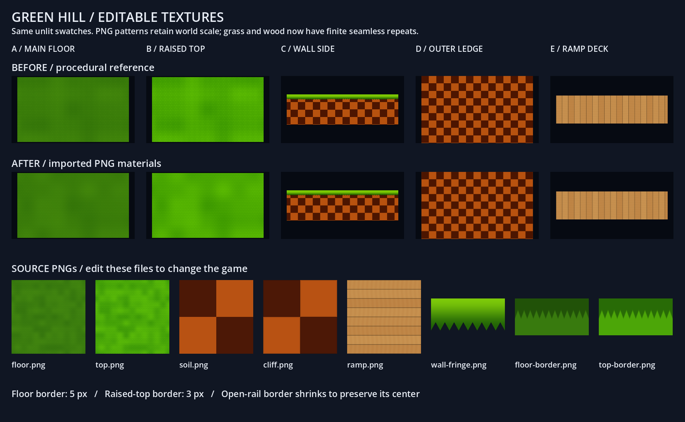
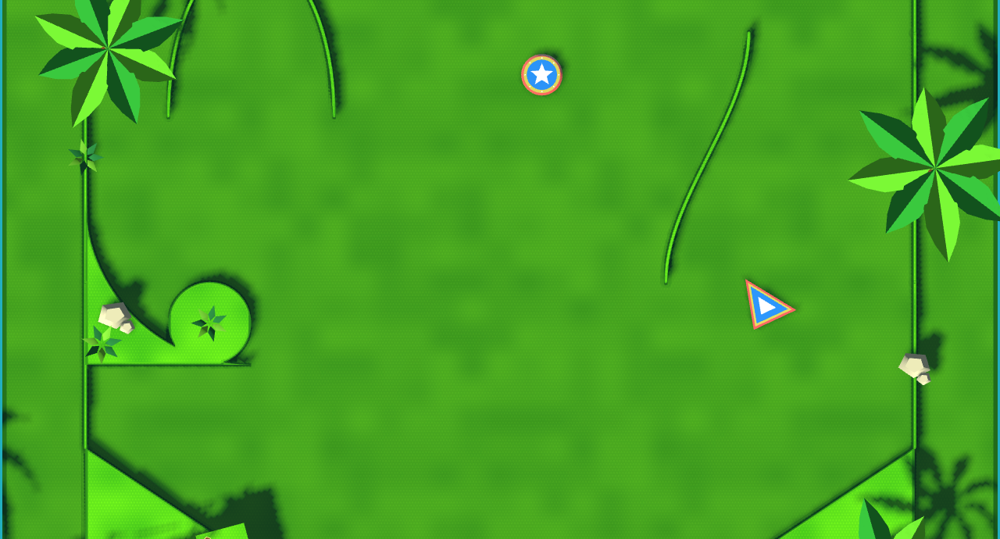

# Green Hill editable textures and contour borders

Green Hill now loads eight PNG assets from `assets/textures/green_hill/`. These are the production artwork, not screenshots: editing a PNG and allowing Godot to reimport it changes the material on the next game launch. Other themes keep their existing materials. Physics, collision outlines, saved Acts, scoring and character controls are unchanged.



## Artwork to tune

| File | Purpose | Repeat / layout |
| --- | --- | --- |
| [floor.png](../assets/textures/green_hill/floor.png) | Main playable grass | 4 × 4 world units (400 × 400 physics pixels), 1024² |
| [top.png](../assets/textures/green_hill/top.png) | Brighter raised turf | Same scale, independent artwork, 1024² |
| [soil.png](../assets/textures/green_hill/soil.png) | Raised checker wall | 0.32 × 0.32 world units, 256² |
| [cliff.png](../assets/textures/green_hill/cliff.png) | Checker cliff with seams | Same scale, 256² |
| [ramp.png](../assets/textures/green_hill/ramp.png) | Wooden ramp boards | 0.64 × 1.04 world units, 512²; existing route UVs |
| [wall-fringe.png](../assets/textures/green_hill/wall-fringe.png) | Vertical grass lip | 256 × 128 RGBA; horizontal repeat, transparent blade tips |
| [floor-border.png](../assets/textures/green_hill/floor-border.png) | Horizontal floor edge | 256 × 128; left/right tile along contour; top row is outer edge |
| [top-border.png](../assets/textures/green_hill/top-border.png) | Horizontal raised-top edge | Same layout; bottom row meets the cap interior |

The original shader recipes remain under `tools/texture_sources/` for reference and before/after comparisons. Grass noise now repeats cleanly every twelve broad cells; wood uses eight boards with periodic grain. These finite repeats approximate the original unbounded patterns rather than preserving every pixel. Checker colors and dimensions, grass density, world mapping and side projection are retained. Small shaders handle sampling, world-space projection and fringe placement; artwork is no longer recalculated per fragment.

PNG imports use lossless compression and mipmaps. Preserve seamless left/right and top/bottom edges on repeating surface images. Borders and the fringe repeat horizontally only in their intended layout; their shaders clamp the vertical sample. Do not paint lighting or shadows into the images: the game still supplies those.

## Borders

Floor borders follow the deck perimeter and the ground around solid terrain and open rails. Raised-top borders follow the final platform contours, including curved and concave outlines. Generated rails also receive top borders. Borders are collisionless meshes above the surface, not extra walls or altered terrain.

The Green Hill theme owns independent materials and provisional widths: **5 physics pixels for floor borders, 3 pixels for raised tops**. Open rails cap border width at one quarter of their thickness, leaving the center visible. Very small filled islands can become entirely border when their inset disappears. Other themes opt in only when they supply their own border material and width.

The mesh builder divides the border region into non-overlapping scanline slabs, including intersections between offset contours. This avoids filling holes or bridging concave notches. Floor markings exclude obstacle interiors. Texture coordinates follow the nearest contour segment; sharp corners can show a change in the blade direction. The original terrain and collision vertices remain unchanged.

## Review and reproduce



Compare [before](green-hill-textures/curves-before.png) and [after](green-hill-textures/curves-after.png) in the same authored Act, with retro effects disabled. The [before detail](green-hill-textures/detail-before.png) and [after detail](green-hill-textures/detail-after.png) use the same overhead camera. The material sheet is unlit for color comparison; game captures include normal lighting.

Run with the installed Godot 4 executable from the project root:

```powershell
& 'C:\Program Files\Godot\Godot.exe' --path . --rendering-method gl_compatibility --rendering-driver opengl3_angle --script res://tests/green_hill_texture_review.gd
& 'C:\Program Files\Godot\Godot.exe' --path . --rendering-method gl_compatibility --rendering-driver opengl3_angle --script res://tests/green_hill_texture_scene.gd
& 'C:\Program Files\Godot\Godot.exe' --headless --path . --script res://tests/terrain_border_regression.gd
```

Only to regenerate the initial artwork from its recipes, run `tools/bake_green_hill_textures.gd` with the same graphical renderer and append `-- --overwrite`. This deliberately overwrites all eight PNGs, including hand-painted changes. It is never called during import or gameplay. Ordinary tuning should edit the PNGs directly.

Manual review should focus on border width at play zoom, blade direction at tight corners, and whether grass repetition or fine detail distracts from the ball.

## Verification

Godot 4.7.2, Compatibility / ANGLE on Windows: editor import passed; border geometry regression passed **41 checks**; production theme switching passed **619 checks** across six committed themes; authored main-game integration passed **70 checks**. The graphical material comparison and matched game captures completed without shader/script errors and were visually inspected. Theme switching verifies retained physics bodies, geometry, ball state, scoring and camera state. The border regression covers concavity, holes, overlapping obstacles, deck-edge clipping, narrow rails and unchanged input contours.

Checks ran in an isolated checkout with these changes and the concurrently committed Ice Cap and pinball visual work, avoiding another chat's uncommitted edits. The final curved-Act presentation rebuild measured approximately **0.91 seconds with borders**, versus **0.20 seconds for the procedural reference** in that capture run. Border construction occurs at rebuild time, not every frame; no FPS improvement is claimed. Larger authored layouts may need further build-time optimization. Logs are retained locally under `test-results/green-hill-textures/`.
