# Ice Cap: twilight glacier

Implemented 2026-10-25 as the sixth selectable visual theme. Choose **Ice Cap** in the existing game Theme selector or the Act Editor's decor preview. The same authored Act, generic slots, collision shapes, ball, rings, score state and camera remain authoritative. Ice does **not** change friction or any other physics value.

## Research and art direction

### Sonic 3 / Sonic 3 & Knuckles: Ice Cap

The strongest motif is the separation between a continuous pale snow route and a dark crystalline interior. The [classic cavern screenshot, reproduced in Sonic Origins](https://images.gamersyde.com/image_sonic_origins-44267-4937_0002.jpg) shows blue-violet vertical shafts, repeated faceted crystal cells, snowy lips, hanging icicles and diamonds of reflected-looking light. The [Act 2 terrain/map sheet](https://www.spriters-resource.com/sega_genesis/sonicth3/asset/139099/) makes that contrast legible across curves, loops and cave openings. Its green empty areas are the extraction background, not a proposed environmental palette. Our wall shader uses broad fractured faces and a pale uneven lip rather than copying the crystal tiles.

### Sonic Advance: Ice Mountain

The [outdoor gameplay image](https://media.tenor.com/W2rFdTAimHgAAAAe/sonic-advance-winter.png) emphasizes crisp cyan daylight, layered snowy peaks, green conifers and long snowfields. That feels more alpine and open than Ice Cap's enclosed geometric caverns. The [screenshot gallery](https://www.sonicstadium.org/gallery/image/1436-sonic-advance-ice-mountain-zone/?context=new) and [tileset inventory](https://www.spriters-resource.com/game_boy_advance/sonicadv/asset/25391/) were supporting references. The outdoor image directly informed our tiered snow pines, mountain layers and restrained vegetation. The trail fence is an original small constructed accent, not a copied sprite.

### Sonic Advance 3: Twinkle Snow

The directly inspected [background and aurora reference sheet](https://www.spriters-resource.com/game_boy_advance/sonicadv3/asset/7183/) contains a violet-to-cyan sky, white peaks, star sparkles and a separate green curtain overlay. Its large vertical glacier shapes matter more than fine snow noise. The pink/purple variation suggests a twilight palette with a warm violet horizon rather than a uniformly blue world. Our interpretation keeps that color separation, but uses original moving 3D curtains and original silhouettes.

### Sonic Unleashed: Cool Edge / Holoska

The [daytime cavern screenshot](https://media.sonicscanf.org/gallery/den-2/cool-edge-4.png) distinguishes a quiet snowy path from towering blue, fractured ice walls. The [nighttime outdoor screenshot](https://media.sonicscanf.org/gallery/noch-2/cool-edge.png) adds dark open water, pale shelves, separate ice spires and wide aurora curtains. Those material/value differences are more useful here than copying detailed architecture. Sampled [Wii nighttime gameplay](https://www.youtube.com/watch?v=d5wLJflz8ks), including the blue cavern around 2:05, reinforced the use of broad illuminated planes and gold-ring contrast. Platform versions differ; the nighttime gallery and Wii footage were treated as separate visual references.

Research limits: Zone: 0's Ice Cap guide could not be opened because of a certificate error; no warning was bypassed. The Ice Mountain tileset archive was indexed but its full 497-item download was not inspected. The searched daytime walkthrough's sampled content did not reliably match the winter stage, so daytime material conclusions above rely on the directly viewed gallery image. No claim is made to have watched full playthroughs of all four stages. No Sega reference media, sprites, textures, audio or meshes were downloaded into or committed to the project.

### Our interpretation

The scene is a readable **moonlit glacier at violet twilight**. Bright snow shelves sit over fractured blue walls; conifers and low ice floes sit below the playfield; distant mountain ridges leave room for green/cyan/purple aurora. Cold ambient fill keeps the ball and gameplay objects visible without warm lamps competing with rings.

- **Snow:** opaque matte material, roughness 0.94, low specular, broad wind-packed variation. No high-frequency random grain. Raised terrain has more snow coverage than the lower playable floor.
- **Ice:** opaque cyan-blue patches with roughness 0.16–0.22, stronger specular, sky radiance and a restrained Fresnel contribution. Sparse seams suggest internal fractures. There is no screen-space or ray-traced reflection dependency.
- **Walls:** world-space fractured facets adapt to arbitrary authored contours. The snow lip is shaded within the existing mesh; it does not widen or smooth the collision silhouette.
- **Thin crystals/icicles:** a separate alpha-depth-prepass shader supplies limited translucency and edge highlights. Solid walls and playable floors remain opaque.
- **Lake:** dark frozen water separates the table from scenery. Broad moving teal streaks are an art-directed aurora-reflection approximation, not an accurate reflection of scene objects.
- **Atmosphere:** three slowly waving mesh curtains, a static star/violet sky, and 48 small snow flecks outside the playfield footprint. Background primitives are batched; the mountain meshes have original asymmetric facets and irregular snowlines.

The sky's radiance is static, avoiding an animated reflection-cubemap update every frame. Ice reflects that sky and catches the shared directional light; the mesh aurora itself is not captured dynamically in the cubemap. The normal steep overview naturally sees much more lake than sky. The wide review view shows the complete aurora, while ordinary play retains its reflected color and surrounding winter scenery. Camera framing is not changed by this theme.

## Original decor library

Fixed indices retain the established generic order. All surface/edge/either pools expose the same variants. Auto uses the shared deterministic resolver. Landmark Auto selects the existing upright/span roles; the circular third landmark remains explicit.

| Size / fixed index | Original variant | Purpose |
| --- | --- | --- |
| Small 1 | Crystal shards | Thin translucent highlights |
| Small 2 | Snow cairn | Dark rock beneath a soft snow cap |
| Small 3 | Frost grass | Sparse low vegetation silhouette |
| Medium 1 | Snow pine | Compact alpine conifer |
| Medium 2 | Ice fan | Radiating crystalline shape |
| Medium 3 | Trail fence | Snow-topped constructed detail |
| Medium 4 | Frozen spring | Dark basin and small crystal growth |
| Large 1 | Alpine fir | Tall vegetation with tiered snow |
| Large 2 | Icicle grotto | Cave mouth with hanging ice |
| Large 3 | Glacier sail | Leaning solid glacier blades |
| Landmark 1 | Glacier crown | Upright crystal massif on the shared 3×1-cell base |
| Landmark 2 | Frozen bridge | Snowy ice arch spanning the shared 3×1-cell footprint |
| Landmark 3 | Aurora basin | Round frozen pool within the shared 1.6-cell footprint |

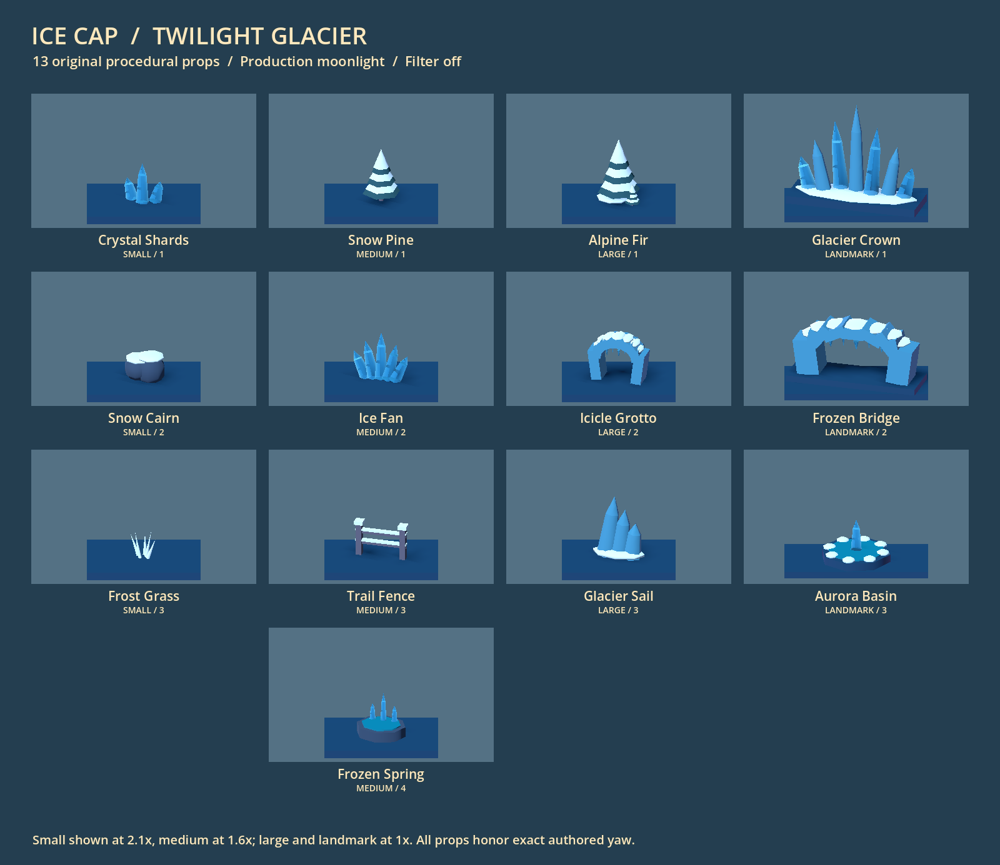

Elevated rails use snowy ice decks, pale edge caps, glacier supports and cyan accents through `ramp_materials()`. Spinner and attract/repel field colors retain their shared gameplay meanings. No authored one-way gate exists in this checkout, so no gate system was added.

## Aurora implementation and license comparison

[Aurora Borealis by miskatonicstudio](https://godotshaders.com/shader/aurora-borealis/) explicitly publishes its shader code under CC0. The reference combines noise sampling and a raymarch with a default 0.01 step inside a normalized cube. Its source is retained with only trailing whitespace normalized under `third_party/aurora/` solely for the reproducible benchmark; a locally generated noise texture supplies its test input. The separate GitHub repository's MIT label was not assumed to override or establish the web publication's license. See [source/license record](../third_party/aurora/README.md).

Production uses an original cheaper-to-bound approach: three subdivided planes, low-frequency vertex waves, soft vertical intensity falloff and several broad fold frequencies. There is no ray loop, sampled noise or CPU mesh animation. The material is unshaded and additive, providing luminous curtains without enabling bloom for the entire snowy scene. Motion uses approximately 84–140-second wave periods, with slower secondary folding, rather than rapidly scrolling a texture.

Measured on Godot 4.7.2 Compatibility/ANGLE, NVIDIA RTX 4060, 1440×1000 application window, VSync disabled. Each mode warmed up for 45 frames and sampled 120 frames, twice in reverse order. Camera equality is asserted after filter resolution changes settle. The ball is paused; shader animation remains active. Other user application windows were left open.

| View / filter | Aurora off, median ms | Original ribbons, median ms | CC0 volume, median ms |
| --- | --- | --- | --- |
| Overview / off | 6.01–7.46 | 6.37–6.52 | 6.18–8.00 |
| Overview / preferred stack | 7.36–8.55 | 6.75–7.13 | 6.22–6.40 |
| Wide vista / off | 5.14–6.79 | 5.25–6.26 | 6.00–6.98 |
| Wide vista / preferred stack | 6.66–7.56 | 6.15–8.45 | 6.12–6.40 |

These ranges are the two pass medians, not confidence intervals. Timing overlaps and background load make a small shader-cost difference inconclusive; the filtered volume was sometimes faster than the ribbons. No claim is made that the production shader won a GPU microbenchmark. The production ribbon passes had p95 values no worse than 10.95 ms in this run. Whole-frame timings include the live application and post-processing, with their actual filtered world resolution; this is not an Android performance claim.

The reference produced fine, faint vertical filaments with the tested generated noise and volume settings; the original ribbons produced broader, brighter curtain folds that survived the low-resolution filter more clearly. Their brightness and exact coverage are not photometrically matched. The choice is primarily visual control and bounded implementation cost: three draws and no ray loop. The raymarch is viable on this desktop, but its extra volumetric behavior adds little at the normal overhead angle. The original shader logic and benchmark remain available for future tuning rather than being wired into production.

| Original ribbons | CC0 reference evaluation |
| --- | --- |
| 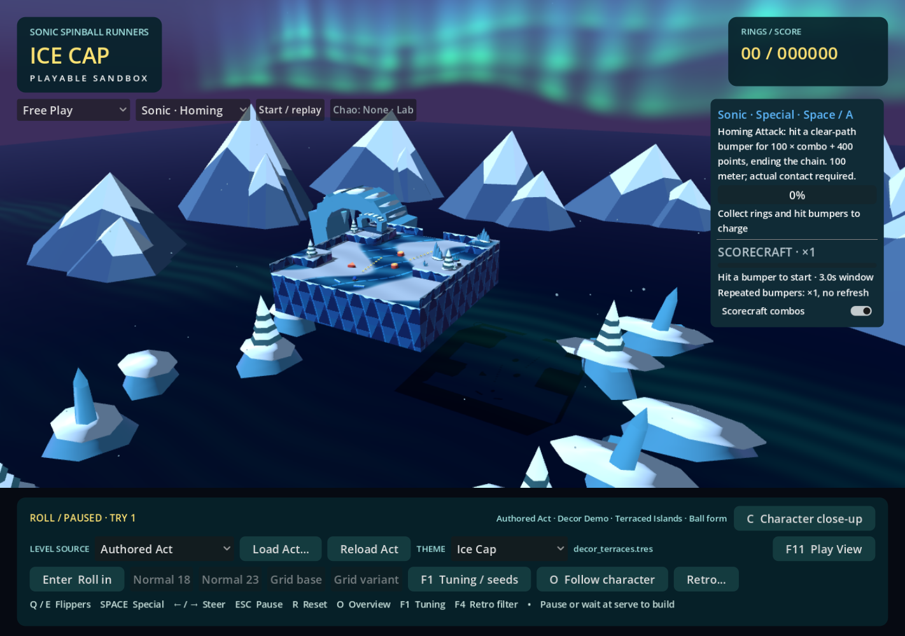 | 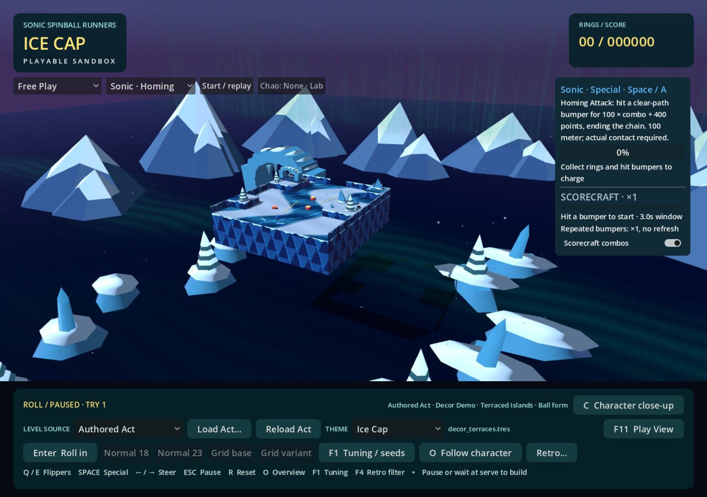 |

The committed [measurement record](ice-captures/aurora-benchmark.json) includes both passes, hardware, camera transforms and p95 values.

## Matched captures

The committed `decor_terraces.tres` is captured with all six themes at identical overview and follow transforms, ball position and Act fingerprint. The harness checks source bytes before/after. Full-resolution images and manifests are generated under ignored `test-results/ice-review/`.

| Green Hill | Chemical Plant |
| --- | --- |
|  | 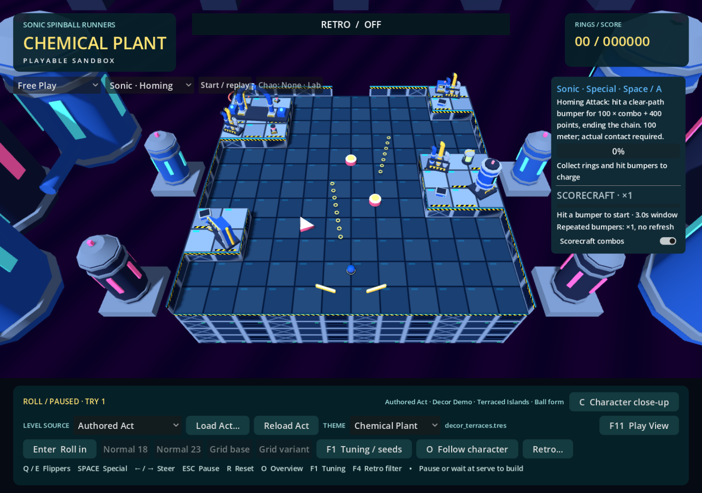 |

| Rooftop Run | Casino Night |
| --- | --- |
| 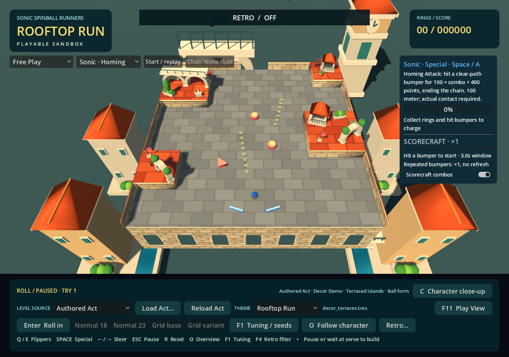 | 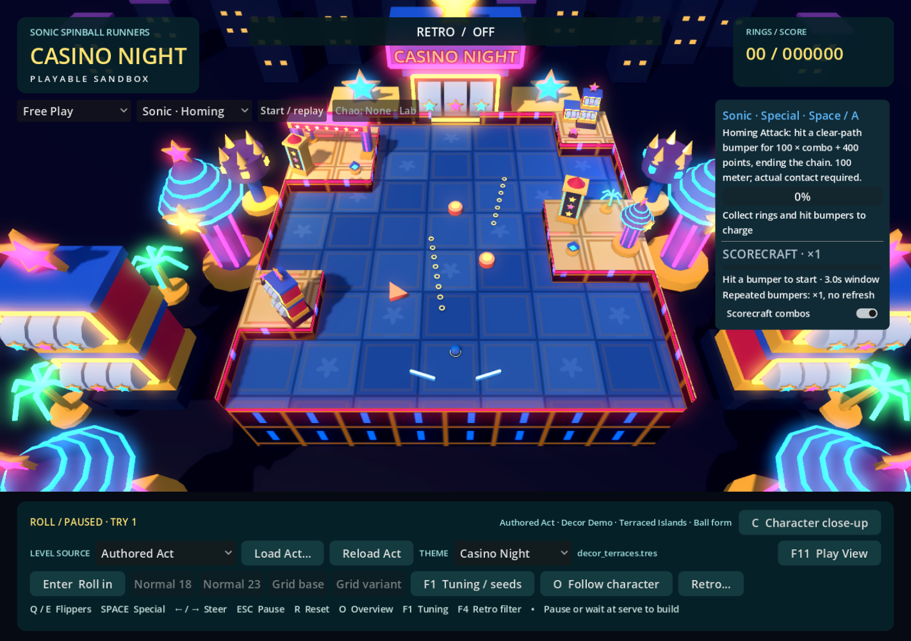 |

| Sky Sanctuary | Ice Cap |
| --- | --- |
| 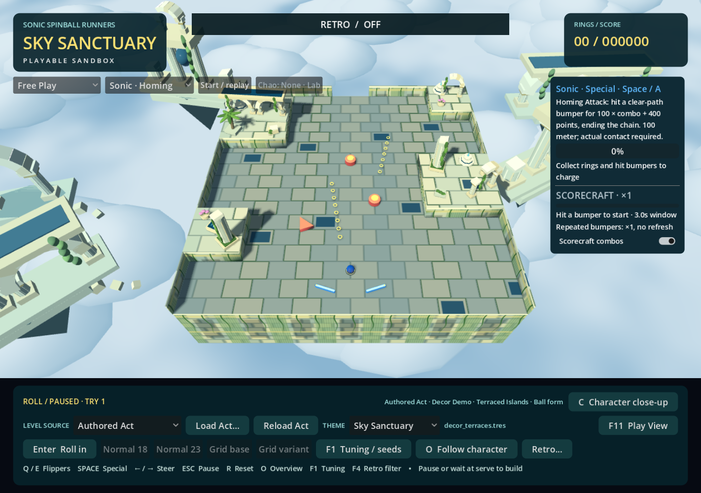 |  |

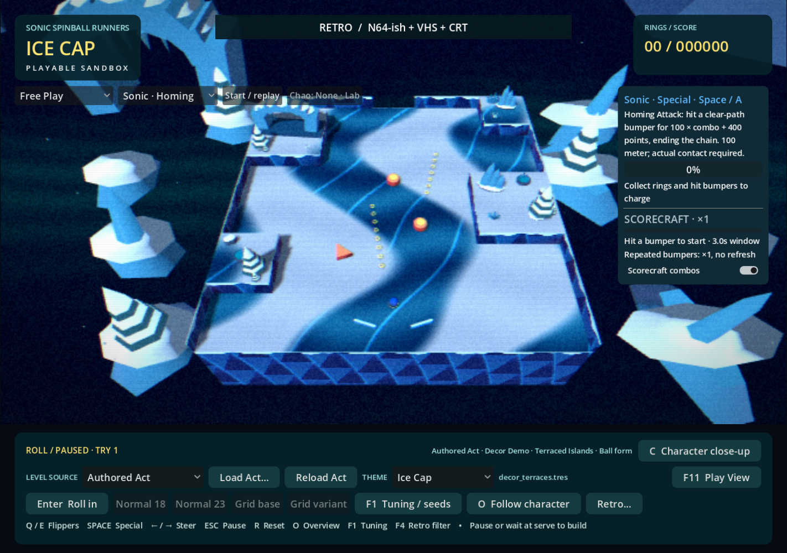

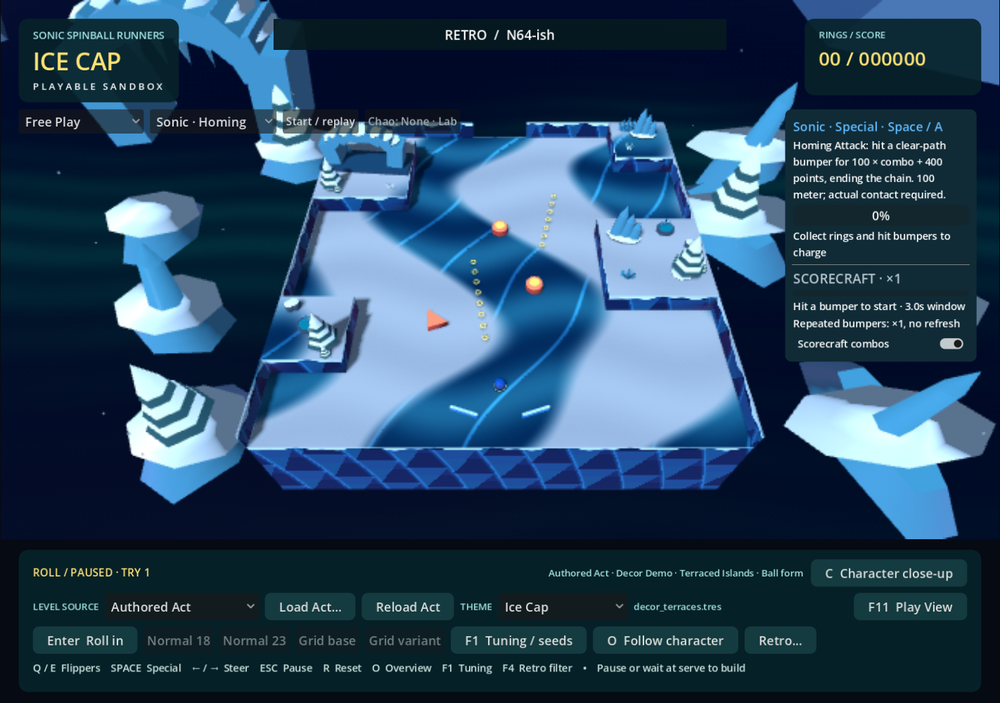

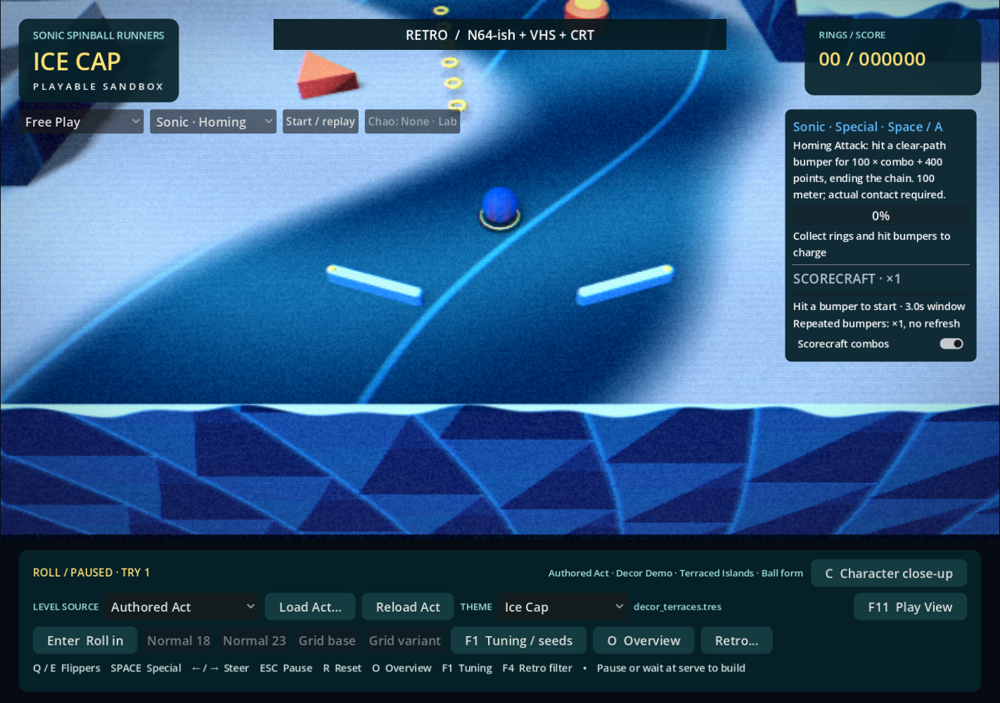

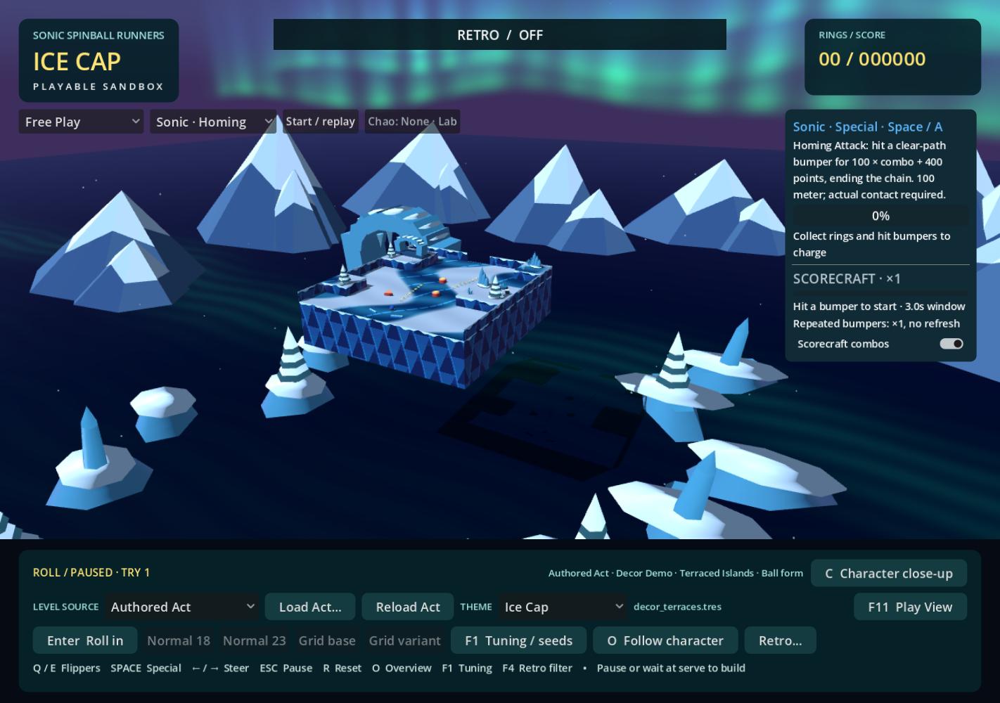

The same 17-image comparison also passed on the user's local `First Try Smooth Decor.tres`, without changing or committing that Act:

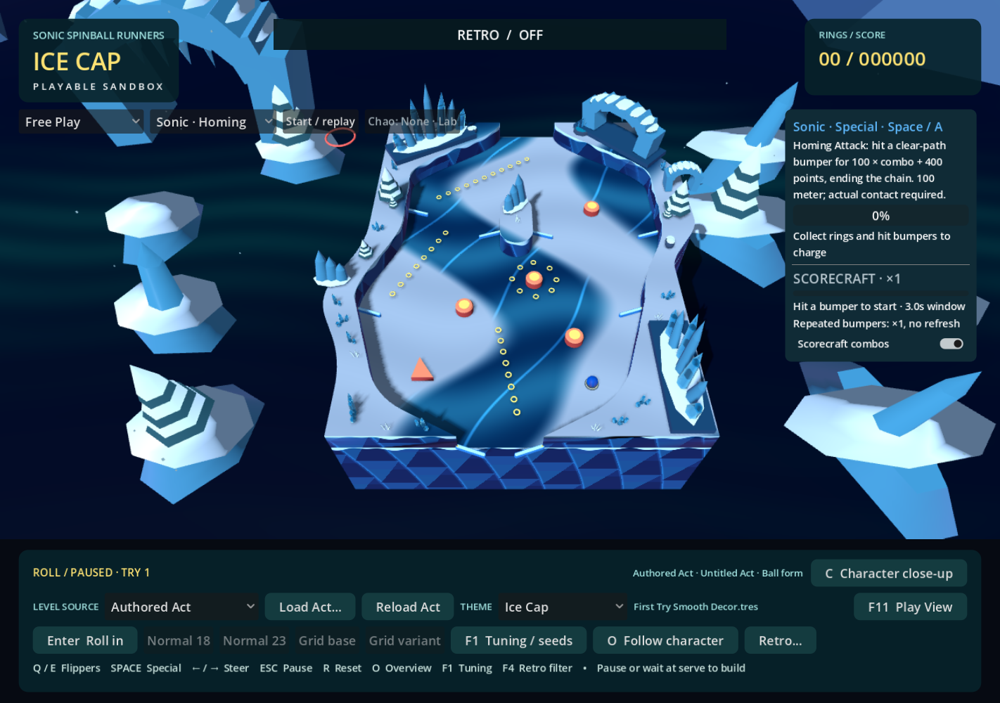

## Verification

- Ice Cap decor regression: 95 checks, zero failures.
- All-theme landmark regression: 291 checks, zero failures.
- Runtime theme switching: 619 checks, zero failures, including repeated Ice Cap transitions and live gameplay-state preservation.
- Ramp height/theme regression: 48 checks, zero failures.
- Graphical capture runs: 34 captures across the committed terrace Act and the user's local Act, zero camera/ball/fingerprint/source-byte failures. The separate 13-prop library capture completed successfully.
- Godot 4.7.2 Compatibility/ANGLE graphical startup completed for 180 frames with Ice Cap, without script or shader errors.

An editor import in the shared working directory encountered mixed tab/space indentation in four existing `scripts/game.gd` lifecycle lines. Restoring those lines to their committed spacing resolved parsing; a subsequent direct script check and graphical startup passed. That formatting repair introduces no gameplay change and is not part of the theme diff. A separate folder exported from the Git index then passed a clean editor import, all four regressions (1,053 checks total), and graphical startup without depending on concurrent uncommitted work.

## Reproduction and manual review

Use the installed Godot 4 console executable with `--path .`. Headless checks:

```text
--headless --editor --import --quit
--headless --script res://tests/ice_cap_decor_regression.gd
--headless --script res://tests/landmark_theme_regression.gd
--headless --script res://tests/theme_runtime_regression.gd
--headless --script res://tests/ramp_height_theme_regression.gd
```

Graphical checks use `--rendering-method gl_compatibility --rendering-driver opengl3_angle`:

```text
--script res://tests/ice_cap_capture.gd -- --act=res://data/acts/decor_terraces.tres --winter-study
--script res://tests/ice_cap_library_capture.gd
--script res://tests/ice_aurora_benchmark.gd
```

The capture harness accepts `--act=res://data/acts/First Try Smooth Decor.tres` for the user's local Act without rewriting or tracking it. Without an Act argument it captures both committed decorated examples.

Human review remains useful for fast-ball readability across snow/ice boundaries, small gold rings with the preferred filter stack, and how much aurora is visible during camera travel. Flipper timing and gameplay feel remain unchanged and are not established by screenshots.
