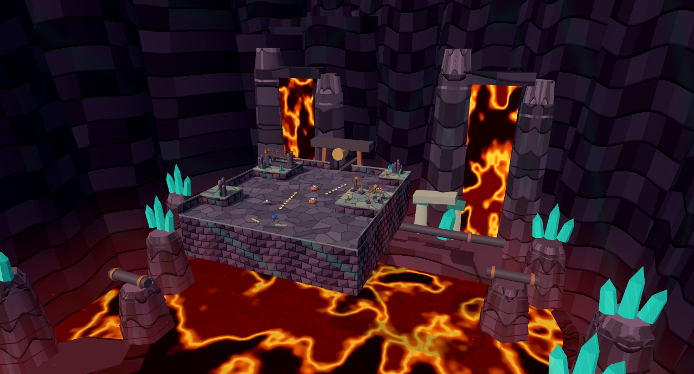
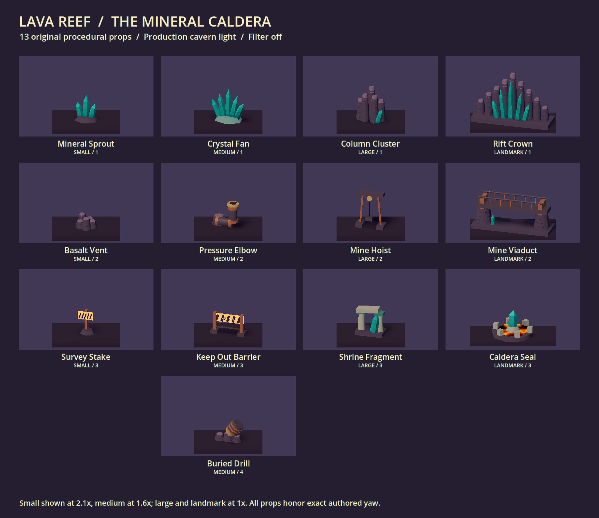
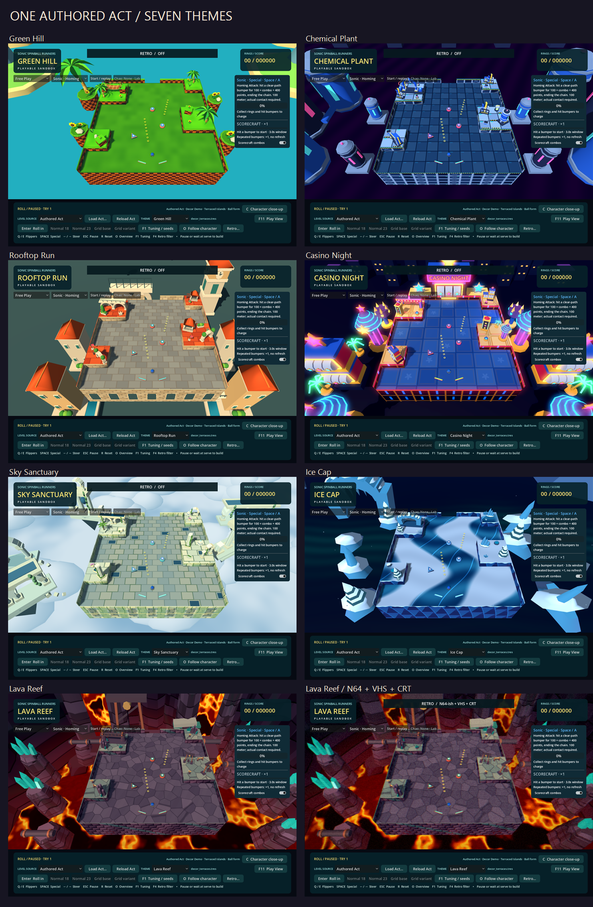

# Lava Reef — the mineral caldera

Implemented 2026-10-25 as the seventh selectable presentation theme. Choose **Lava Reef** in the existing Theme dropdown in **Play Green Hill**. The same authored or generated table becomes a cool mineral shelf above an active magma chamber. This is an original low-poly interpretation, not extracted Sega artwork.



## Research: both Acts, both interpretations

### Sonic & Knuckles / Sonic 3 & Knuckles

Act 1 combines warm, faceted rubble with green-tinted cavern pillars and purple plumbing. Its darkness is colored, rather than uniformly black. Lava is only one layer: rock masses, tunnels, industrial joints and deep background columns define the place. Act 2 reverses the foreground palette into blue stone and conspicuous crystal faces, with turquoise running-surface edging; machinery persists through that change. The difference between mineral structure and molten material matters more than literal tile reproduction. Sources: [Zone 0's illustrated Act comparison and map index](https://soniczone0.com/games/sonicandknuckles/lavareef/), directly inspected [Act 1 screenshot](https://cdn.staticneo.com/w/sonic/LavaReefZone.png) and [Act 2 screenshot](https://cdn.staticneo.com/w/sonic/thumb/LavaReefZone2.png/600px-LavaReefZone2.png).

### Sonic Mania / Mania Plus

The [Act 1 map](https://vgmaps.de/files/pc/maps/sonic-mania-lava-reef-zone-act-1-pc-map.webp) and [Act 2 map](https://vgmaps.de/files/pc/maps/sonic-mania-lava-reef-zone-act-2-pc-map.webp), credited to G.E.R., make the warm-to-cool foreground change particularly clear. They also show repeated industrial connections through differently sized chambers. These maps were viewed in the browser, not imported.

Mania emphasizes excavation, barricades and warning signage. The crystal-heavy later areas mix mining equipment with traces of older architecture, then lead toward Hidden Palace. Its expanded background scale is more useful here than copying an individual machine. Plus's Encore presentation also offers a hotter palette and heatwave variation. These details are described in the [Mania/Plus zone overview](https://sonic.fandom.com/wiki/Lava_Reef_Zone_%28Sonic_Mania%29). Directly inspected [Act 2 gameplay](https://www.youtube.com/watch?v=3BvQkG7KqQQ) at approximately 0:57, 1:16 and 1:54 confirms broad cyan facets, green edging, layered blue cavern silhouettes and substantial pipework. This was sampled footage, not a complete playthrough.

Mania includes views through openings to the outside. Our deliberately enclosed chamber is an interpretation for this brief, not a claim that every original section has a solid ceiling. Hidden Palace influence remains secondary; no shrine layout, Master Emerald model, boss, Death Egg, rocket or official object mesh is reproduced.

### What required a new 3D interpretation

- **Cliffs:** broad fractured strata and mineral seams replace tiny repeated tile details. World-space projection blends by wall normal, so curved, diagonal and arbitrary authored outlines use one material. No shape is changed to fit a texture.
- **Depth:** the lake sits 7.2 presentation units below the deck; the ordinary deck extrusion stays 1.45 units deep. Nested chambers, lower shelves and remote pillars imply a much larger cavity. These distances are invented for parallax and readability, not canonical measurements.
- **Camera access:** tall back/side rocks and stalactites imply enclosure against a near-black background. Camera-facing rocks form a lower cutaway. An opaque roof over the table was rejected because top-down and long-Zone overviews could sit above it. Production camera logic is unchanged.
- **Machinery:** heavy collars, oxide-colored iron, sparse brass, a buried drill and braced hoist suggest heat-damaged excavation. They use original primitive construction, not recolored Chemical Plant props.
- **Act contrast:** plum-gray cooled floor, mineral-green raised surfaces, teal crystals and warm lava coexist. Fixed generic decor choices can lean volcanic/industrial or crystal/ancient; Act number never selects a palette or changes geometry.
- **Scale and landmarks:** a fractured rift crown, low mine viaduct and circular caldera seal translate the geological/industrial/ancient balance into the established shared footprints. They are inventions, not claimed reconstructions of original landmarks.

## Materials, light and atmosphere

| Element | Implementation and reason |
| --- | --- |
| Playable floor | Matte, irregular cooled-stone slabs in plum-gray; lower-contrast seams and broad faces preserve ball/ring tracking. No orange flowing material on the normal playable floor. |
| Raised terrain | Cooler mineral-green cap; narrow pale edge separates the top from fractured sides without changing the polygon. |
| Vertical sides | Layered basalt, oblique mineral veins, restrained deep fissures and warm lower-face emission. Top-height variants serve raised obstacles and the main deck. |
| Lava | Original procedural value noise, slow domain warping, red crust islands, orange flow and narrow yellow cores. Different flow vectors and spatial frequencies serve the lake and falling sheets. Screen derivatives reduce distant glow contrast in long-Zone overviews, and the lake fades into darkness at its outer rim. No external textures or displaced collision. |
| Lighting | Cool ambient fill retains cave detail; a restrained warm key preserves gameplay silhouettes. Exactly three shadowless warm OmniLights accompany low-cost procedural bounce on lower rock faces. Emission does not pretend to provide real GI. |
| Glow | Intensity 0.55, bloom 0.025, threshold 1.05. Broad lava patterns remain legible, while ordinary ring highlights stay separate from the distant molten background. |
| Crystals | Original six-sided pointed meshes with opaque glass-like material, face-dependent cyan/teal color, subtle mineral veins and restrained emission. Opaque facets avoid transparent sorting and keep N64 silhouettes stable. |
| Scenery | Two distant lava falls framed by fissure lips, nested rock chambers, mineral shelves, crust rafts, industrial terrace and small ancient fragment. Static background primitives share meshes/materials and are batched into MultiMeshes. |
| Atmosphere | 32 tiny rising ember flecks, all below/outside the deck, in one MultiMesh. No ring-shaped particles, smoke veil or whole-screen wobble. |

The ceiling, strata, lake depth and geological light are stylized. They prioritize readable pinball play over physically accurate volcanology. The brighter crystal accents are mineral growth, not Ice Cap snow or ice. Industry carries no neon lighting system.

### Heat-haze experiment

Two local transparent refraction planes can cover the distant falls, with a maximum UV offset of 0.0007 before edge attenuation and 0.33 opacity. Opaque foreground depth remains in front of these planes. **Default: disabled.** Launch with `-- --theme=lava_reef --lava-heat-haze` to opt in; this is a presentation review option, not an Act property or saved setting.

OFF/N64 captures with haze enabled and disabled were visually inspected. The effect is restrained but contributes little at the retro resolution. Short 60-frame desktop samples ranged roughly 17.5–20.9 ms with inconsistent ordering between enabled/disabled cases. They include frame pacing and concurrent desktop work, so they do **not** isolate GPU cost or establish a performance advantage. Haze adds a screen read and up to two geometry draws; leaving it off avoids that cost. [Raw timing samples](lava-captures/effects.json).

## Original decor library and stable generic indices

Indices below are zero-based; the editor displays them as variants 1 onward. Every placement hint uses the same ordered pool within its size. Auto uses the existing stable hash. Landmark Auto retains the shared upright/span roles; the round landmark remains fixed index 2.

| Size | Index | Variant | Visual role |
| --- | --- | --- | --- |
| Small | 0 | Mineral sprout | Three pointed teal crystals on cooled rock |
| Small | 1 | Basalt vent | Broken column ring around a weak hot center |
| Small | 2 | Survey stake | Rugged striped mining marker |
| Medium | 0 | Crystal fan | Broad cool mineral growth |
| Medium | 1 | Pressure elbow | Collared pipe emerging from buried stone |
| Medium | 2 | Keep-out barrier | Original striped barricade and short stencil |
| Medium | 3 | Buried drill | Tilted, partially swallowed excavation hardware |
| Large | 0 | Column cluster | Uneven basalt organ with crystal intrusion |
| Large | 1 | Mine hoist | Braced lifting frame, winch, cable and suspended bucket |
| Large | 2 | Shrine fragment | Broken stone lintel, teal inlay and mineral growth |
| Landmark | 0 | Rift crown | Upright column/crystal ridge, approximately 3 × 1 cells |
| Landmark | 1 | Mine viaduct | Low industrial span on basalt piers, approximately 3 × 1 cells |
| Landmark | 2 | Caldera seal | Ancient mineral centerpiece in a 1.6-cell circular basin |



A vent or caldera's molten insert is decorative. It has no collision, trigger, damage or gameplay meaning. Acts still store only generic size, hint, exact transform, scale, Auto/fixed selection and seed. No Lava Reef asset identifier is written into an Act.

## Integration boundary

`ThemeRegistry` selects `lava_reef_theme.gd`; `ThemedPresentation` consumes its existing floor, top, side, cliff, environment, scenery, decor and ramp hooks. Shared pinball hardware uses a new palette entry (oxide rubber, teal face/paddle, brass trim and ivory marks). Elevated rails use cooled stone, iron edges and oxidized supports. Existing spinners, magnets and traversal behavior remain generic. No new gate, cannon, target or gameplay object is introduced.

There is no Lava Reef branch in physics, scoring, generation, camera motion, Act compilation or lifecycle. Lava introduces no damage, death, heat, resistance, friction or collision. Future hazardous surfaces must be authored as a generic gameplay feature.

## Matched comparison and visual review

The production capture driver loads `data/acts/decor_terraces.tres` and `data/acts/decor_curve_relay.tres`, pauses physics, then switches every production skin with the same overview/follow framing. It asserts matching Act fingerprints, ball positions and camera transforms across each group, and checks that source Act bytes remain unchanged.



Full views: [Green Hill](lava-captures/green-hill.png), [Chemical Plant](lava-captures/chemical-plant.png), [Rooftop Run](lava-captures/rooftop-run.png), [Casino Night](lava-captures/casino-night.png), [Sky Sanctuary](lava-captures/sky-sanctuary.png), [Ice Cap](lava-captures/ice-cap.png), [Lava Reef](lava-captures/lava-reef.png). The [capture manifest](lava-captures/manifest.json) records camera transforms, fingerprints and render counters.

Lava Reef review also includes [N64 overview](lava-captures/n64.png), [preferred N64 + VHS + CRT stack](lava-captures/retro.png), [follow view](lava-captures/follow.png), [curved authored terrain](lava-captures/curves.png), and the [cavern study](lava-captures/cavern.png). The cavern study uses an explicitly different review camera; it is not part of the matched seven-skin comparison.

The molten animation probe freezes only the presentation shaders at times 0 and 2.5 seconds, compares rendered world pixels, and checks unchanged ball/camera state. Haze OFF/ON is compared with frozen shader time under OFF and N64. `review_time` defaults to -1 in production, which uses Godot's ordinary `TIME`.

## Verification

Godot 4.7.2, Windows, GL Compatibility with ANGLE/D3D11 on NVIDIA RTX 4060:

- Lava Reef decor regression: **95 checks, 0 failures**. Covers thirteen props, every hint, stable fixed/Auto fallback, collision isolation, mesh sharing and exact non-round authored transforms.
- Shared landmark regression: **339 checks, 0 failures** across seven skins, including long/round footprint limits and shared Auto roles.
- Theme runtime regression: **716 checks, 0 failures**, including a fresh Godot process, authored/generated tables, live-state preservation and clearing local lights on theme switches.
- Ramp height/theme regression: **53 checks, 0 failures**; all seven themes preserve the exact rail route and physics manager.
- Authored main-game regression with `--theme=lava_reef`: **70 checks, 0 failures**.
- Graphical library, 44 matched/camera captures and the separate effects probe complete without shader or script errors. Visual inspection covers OFF, N64 and the preferred stacked preset. Dedicated generated and nine-chunk Zone captures exercise all three camera presets.

An editor import initially exposed four mixed-tab indentation lines in unrelated `game.gd` lifecycle logging. Restoring those lines to the file's existing spaces resolved startup; the final game/runtime checks run against that corrected workspace. No gameplay logic change was required.

Example commands, using the installed Godot executable:

```powershell
& 'C:\Program Files\Godot\Godot.exe' --headless --path . --script tests/lava_reef_decor_regression.gd
& 'C:\Program Files\Godot\Godot.exe' --headless --path . --script tests/theme_runtime_regression.gd
& 'C:\Program Files\Godot\Godot.exe' --path . --rendering-method gl_compatibility --rendering-driver opengl3_angle --script tests/lava_reef_capture.gd -- --cavern-study --generated-study
& 'C:\Program Files\Godot\Godot.exe' --path . --rendering-method gl_compatibility --rendering-driver opengl3_angle --script tests/lava_reef_capture.gd -- --act=res://data/acts/decor_terraces.tres --lava-only --effects-study
& 'C:\Program Files\Godot\Godot.exe' --path . --rendering-method gl_compatibility --rendering-driver opengl3_angle --script tests/lava_reef_library_capture.gd
```

Outputs go to ignored `test-results/lava-review/`; selected project-generated captures live here for review. Use `Start-Process -Wait` when invoking this GUI executable from PowerShell automation to collect completion and exit status reliably.

Still for human playtesting: track Sonic during fast rebounds under the preferred retro stack; judge the balance of crystal brightness against lava; decide whether the optional heat effect earns its cost. Art tuning is provisional. Automated checks do not establish subjective feel, phone performance or quality on other rendering backends.

## Provenance

All new meshes are constructed in GDScript from original primitive compositions or original vertex data. All new shader code is authored for this project. No Sega textures, tiles, sprites, meshes, models or audio were downloaded into the repository or committed. Reference pages/maps/screenshots/video were used only for visual study. No external texture pack, plugin, runtime dependency, generated asset service or third-party shader was added for Lava Reef.
