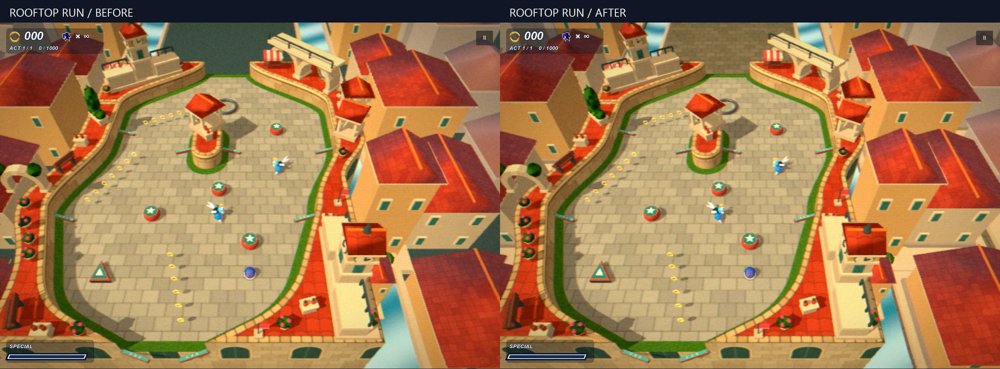
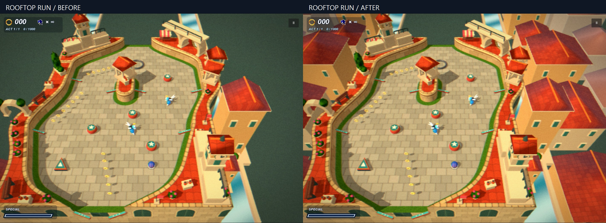
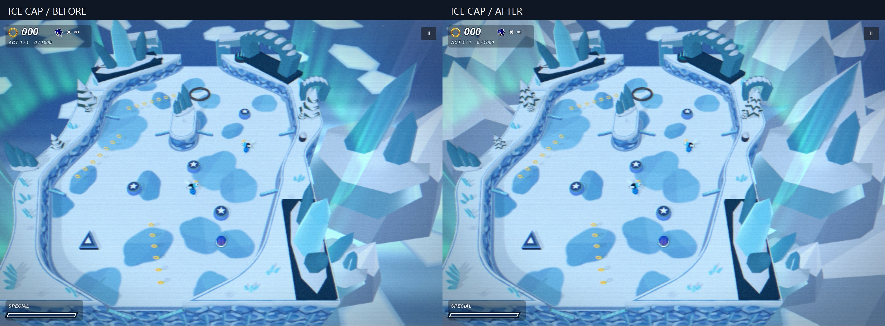

# Model and background depth pass — 2026-11-17

Alex asked for a fresh review of the textured models and larger-feeling environments, excluding Lava Reef. This reopens the background composition decision from the November 9 audit; that audit intentionally inspected views with little distant scenery exposed.

## Green Hill island and loop polish

Alex found the large palm island empty, the loop's green margin distracting and the textures distorted. The local headlands now use smaller footprints, with a visible textured rock pair and a low shrub beside the palm. A rock pair also sits behind the coastal loop opening. The coastal loop has shorter approaches and a slightly smaller scale; authored loop footprint envelopes stay unchanged.

The separate green face lips are removed. Loop grass now unwraps along the running surface, so upright sections no longer collapse under top-down projection. Checker faces use explicit UVs and the existing flat surface shader, preserving the production material policy and selected image pixels. Distant island cliffs wrap a continuous checker strip with whole repeats instead of blending three projections across their sloped corners. Shared terrain shaders, physics, camera defaults and atmosphere values remain unchanged.

Starting source: `6f9f5c5`. [Wide comparison](green-hill-polish-20261117/green_hill.jpg) and [normal-zoom edge comparison](green-hill-polish-20261117/edge.jpg) retain identical canonical Prototype state, Default atmosphere and production Retro. Before is left; after is right. The accepted final captures are `trial3-wide` and `trial3-edge` under local `test-results/green-hill-polish-20261117/`; each before/after set passed 26 authority/freshness checks. Earlier rejected trials remain local diagnostic history.

Validation: **16 Green Hill landmark, 23 geometry-density, 387 landmark-theme and 9,095 scenery checks passed**. All seven Green Hill Prototype and seven Endless variants were rebuilt. The final graphical Challenge run completed 3,600 input ticks; the seed-8 Endless tour crossed three Green Hill Acts and entered the next Zone. Both loaded disk resources with zero fallback rebuilds and zero boundary wait. Source tests retain selected-image export warnings, and graphical shutdown retains ObjectDB warnings. No script or engine errors occurred in the accepted captures, bakes or play runs. These are functional smoke checks, not performance or feel claims. [Verification receipts](green-hill-polish-20261117/verification.json).

The later Generations-inspired Chemical Plant request was cancelled before source changes. Chemical Plant remains at its existing factory-block presentation.

## Green Hill coastline follow-up

Alex asked for more variation in Green Hill's background and sides. Local headlands now alternate between coves, narrow points and broad bluffs, with different cliff heights and occasional raised palm terraces. Small flower islets also vary in elevation. Four separated offshore bluffs replace the matching pair of cone stacks; they use the existing checker and turf textures, muted colors, different shelf heights and elongated footprints. Their bases meet the ocean. The first offshore placement trial was too far outside the reference view, so two were brought into the exposed side background.

The existing loops, terrain textures, open ocean, cloud treatment and collision rules remain. Placement still uses the established deterministic scenery plans and conservative footprints; no gameplay RNG or terrain changes were introduced. The [wide comparison](green-hill-coast-20261117/green_hill.jpg) and [normal-zoom edge comparison](green-hill-coast-20261117/edge.jpg) start at `d110650`, with identical camera, Prototype state, Default atmosphere and production Retro on both sides. Before is left; after is right. Local originals and receipts live under `test-results/green-hill-coast-20261117/`.

Green Hill validation: **16 landmark, 21 geometry-density and 8,661 scenery checks passed**. The accepted before/after sets each passed 26 authority/freshness checks, for two matched camera views. All seven Green Hill Prototype and seven Endless variants were rebaked successfully.

A graphical Green Hill Challenge run completed 3,600 input ticks (approximately 30 seconds); a seed-8 graphical Endless tour crossed three Green Hill Acts and entered the next Zone. Both used disk resources with zero fallback rebuilds and zero boundary wait. Shutdown still reports one ObjectDB instance in Prototype and two in Endless; source scenery checks retain the existing selected-image export warnings. No script or engine errors occurred in the final captures or play runs. These runs verify startup/input/streaming, not feel or isolated performance. [Green Hill verification receipts](green-hill-coast-20261117/verification.json).

## Rooftop ridge follow-up

Alex flagged the thin orange lines along the roof peaks. They came from an untextured bright ridge beam in the shared roof constructor. Removing that beam lets the existing textured roof slopes meet directly, across both authored props and background houses. The selected tiles, pale eaves and roof silhouettes remain. [Matched edge-view comparison](rooftop-ridge-20261117/rooftop_run.jpg), before left and after right, starts at `7ab8f09` and retains the canonical Prototype camera, atmosphere and production Retro settings.

Ridge validation: 91 Rooftop decor and 387 landmark checks passed. Both canonical captures passed 26 authority/freshness checks each, with no script or engine errors. All seven Rooftop Prototype and seven Endless variants were rebaked successfully.

## Rooftop grounding follow-up

Alex found the new Rooftop district unconvincing against its dark green background, with buildings appearing to float. The earlier images below preserve that first pass. The corrected version replaces the `dark` prop-colored plane with warm, muted paving using the existing approved floor texture. Three solid land strips leave openings for recessed canals; stone banks meet raised sidewalks, continuous city blocks connect the houses, and broad masonry courses establish their feet. Local garden-house foundations now continue beneath canal water wherever their footprints overlap it. The backdrop remains shadowless, so these physical connections provide the depth cues without adding lights or changing rendering architecture.

Starting source: `f3604df`. Both before/after pairs use the same canonical Prototype state as the earlier pass: [wide comparison](rooftop-grounding-20261117/rooftop_run.jpg) at target `(400, 400)`, zoom `0.6`, and [edge comparison](rooftop-grounding-20261117/edge.jpg) at target `(570, 500)`, normal zoom. Before is left; after is right. Original PNGs and complete receipts remain under `test-results/rooftop-grounding-20261117/`. The normal camera, selected textures, atmosphere values, physics and other themes are unchanged.

Follow-up validation: **91 Rooftop decor, 8,403 scenery determinism/isolation and 2,842 geometry-bake checks passed**. Four accepted before/after captures passed 26 authority/freshness checks each. Rebuilt all seven Rooftop Prototype and seven Endless variants. The full Prototype audit passes 556 checks; the full Endless audit still reports only the same seven excluded stale Lava Reef Act receipts. A 30-second graphical Rooftop Challenge run and a seed-2 graphical Endless tour through three Rooftop Acts completed with zero fallback rebuilds and zero boundary wait. Both play runs report one ObjectDB instance at shutdown; source scenery checks retain the existing selected-image export warnings. The headless editor import is clean. Timing overlapped other checks, so this is not performance evidence. [Follow-up verification](rooftop-grounding-20261117/verification.json).

## Review and direction

The complete production catalogue contains 102 variants. The 89 non-Lava variants were inspected in seven individual sheets. Existing loops, palms, machinery, clocks, casino signs, sanctuary masonry, ice crystals and aquatic architecture already carry strong silhouettes. Preserve these and the selected texture sets. Target the weak supporting forms: truncated-cone Green Hill rocks, mechanically identical snow-tree tiers, and thin rectangular Aquarium coral.

Environment scale comes from overlapping near, middle and distant forms with different sizes and quieter distant colors. Keep recognizable gaps and the existing water/cloud/aurora effects. This is collisionless presentation, with deterministic construction and existing recipe batching; it does not change level layouts, physics, atmosphere presets, or the normal camera default.

Visual reference browsing informed the composition, without importing assets:

- [Rooftop Run daytime gameplay](https://en.sonicscanf.org/gallery/den-5/rooftop-run-14/): overlapping terracotta districts and large architectural spans.
- [Icecap gallery](https://sonic.fandom.com/wiki/Icecap_%28Sonic_Adventure%29/Gallery): broad angular snow masses and mountain-scale framing.

## Evidence protocol

Starting source: `2d2583b`. Existing untracked import/UID sidecars are outside this pass. Baselines live under `test-results/model-depth-20261117/`, with complete per-capture provenance and manifests.

All level comparisons use the actual disk-loaded Prototype session, current Default atmospheres, Forward+/Vulkan, production Retro, 4× MSAA, seed 18, a served Sonic, and fixed gameplay/shader time. Three matched framings use First Try Smooth Decor:

- `before` / `after`: ordinary camera, target at the served Ball.
- `before-upper` / `after-upper`: edge inspection at `(570, 500)` with normal zoom. The directory name is historical; this is a lateral view.
- `before-wide` / `after-wide`: target `(400, 400)`, zoom `0.6` through the existing production camera setting. This is explicitly a wide inspection view, not a new camera default.

The optional `-CameraZoom` capture argument accepts only the existing 0.6–2.5 camera range. Receipts record the resulting camera settings and transform. Original PNG pixels remain untouched; review sheets only label and uniformly resize them.

## Implemented changes

| Theme | Model review and retained change |
| --- | --- |
| Green Hill | Shared 36-triangle chipped rocks replace the straight truncated cones. Preserve the strong palm, flower, loop, coastal scenery and selected texture vocabulary. |
| Chemical Plant | Twelve low processing blocks with broad paired stacks extend the factory behind the existing hero vessels. Preserve the authored machinery library. |
| Rooftop Run | Two staggered rows on either side add 28 buildings. Near houses use the existing textured roof/shutter constructor; far houses reduce to three muted masses. Canals remain open. |
| Casino Night | Fourteen low hotel blocks use stepped roofs and sparse broad window bands. Existing signs, stars and reel towers remain the brighter focal objects. No new lights. |
| Sky Sanctuary | Six suspended islands use different scales and broken colonnade, arch and tower silhouettes. The first repeated-colonnade trial was rejected. Cloud gaps and existing cloud geometry remain. |
| Ice Cap | Twenty asymmetric 21-triangle peaks form two overlapping ranges. Outer snow and rock colors converge toward a quieter blue. Fir trees use shared 24-triangle notched boughs and smaller snow mantles instead of smooth cone tiers. The aurora shader, placement and strength are unchanged. |
| Aquarium Park | Six-sided tapered coral branches and short forks replace thin rectangular bars. Preserve the existing substantial park, palace, tank, fish and lantern compositions. |
| Lava Reef | No source, model, material, atmosphere or bake edits. |

All new distant geometry enters existing static recipes/batching. There is no new per-frame scenery traversal, scattering system, extra viewport or dynamic light. This adds geometry and some submissions; no FPS improvement is claimed.

## Comparisons

The wide pairs below use identical camera settings, simulation state, atmosphere and renderer on both sides. Before is left; after is right. JPEGs are lighter review copies; lossless PNG pairs and original frames remain in the local capture directories. Full-resolution gameplay pixels are copied 1:1 into the lossless pairs.

[All seven comparisons in one sheet](model-depth-20261117/all-seven.jpg).

| Theme | Wide level comparison | Supporting model comparison |
| --- | --- | --- |
| Green Hill | [Before / after](model-depth-20261117/green_hill.jpg) | [Chipped rocks](model-depth-20261117/models-green_hill.jpg) |
| Chemical Plant | [Before / after](model-depth-20261117/chemical_plant.jpg) | Existing machinery retained |
| Rooftop Run | [Before / after](model-depth-20261117/rooftop_run.jpg) | Existing authored library retained |
| Casino Night | [Before / after](model-depth-20261117/casino_night.jpg) | Existing authored library retained |
| Sky Sanctuary | [Before / after](model-depth-20261117/sky_sanctuary.jpg) | Existing authored library retained |
| Ice Cap | [Before / after](model-depth-20261117/ice_cap.jpg) | [Notched snow boughs](model-depth-20261117/models-ice_cap.jpg) |
| Aquarium Park | [Before / after](model-depth-20261117/aquarium_park.jpg) | [Tapered coral](model-depth-20261117/models-aquarium_park.jpg) |

The source catalogue is a silhouette diagnostic, not the authority for final lighting. All seven level pairs come from the real Prototype renderer. Small supporting-model changes naturally occupy few pixels in wide level views.

## Verification

- Targeted decor/landmark/geometry suites: **895 checks, zero failures**. New checks verify finite, nondegenerate clockwise faces, flat normals, compact geometry and shared bough meshes.
- Exact baked collision equivalence and stale-data rejection: **2,842 checks, zero failures**.
- All three seven-theme baseline sets: **140 authority/freshness checks each, zero failures**.
- Final normal, edge and wide sets: **21 captures / 420 authority/freshness checks, zero failures**. Matched-pair export verified camera, simulation, atmosphere, graphics, Act and disk-loading provenance before creating the comparison sheets.
- Rebuilt **49 Prototype and 49 Endless variants**, across all seven included themes and seven Acts in each pool. Derived bakes remain local and ignored by Git.
- Full Prototype disk audit: **56 variants / 555 checks, zero failures**, including the untouched current Lava Prototype recipes. The full Endless audit has **seven stale Lava Reef Act receipts**; all seven edited themes pass. Those excluded Lava bakes were not rebuilt, and no claim of a fully green eight-theme Endless audit is made.
- Rooftop and Ice each completed **3,600 physics input ticks / approximately 30 seconds** in a real graphical Challenge session, with three resident Acts, zero fallback rebuilds and zero boundary wait. Rooftop scored 0; Ice scored 1,475. These are startup/input-path checks, not a reachability or feel assessment.
- A graphical seed-18 Endless tour reached sequence 3 and crossed a Zone boundary with zero fallback rebuilds. Timing overlapped capture/bake work, so it is not isolated performance evidence.
- Shutdown warnings remain: one ObjectDB instance for Rooftop and two for Ice/Endless. The known threaded-loader lifecycle issue is documented separately in `LIFECYCLE_AUDIT.md`; this pass does not establish ownership of every leaked instance. Existing selected-image source/export warnings also remain. No script/engine errors occurred in the final captures or play runs.
- Final headless editor import exited successfully, with no script or engine errors. [Verification receipts](model-depth-20261117/verification.json) and [geometry counts](model-depth-20261117/density.json) accompany the images.

Human review remains useful for moving-camera composition, visibility of the aurora between ridges, and scenery density across other Acts and atmosphere variants. Scripted inputs and stills do not establish visual taste or controller feel.
