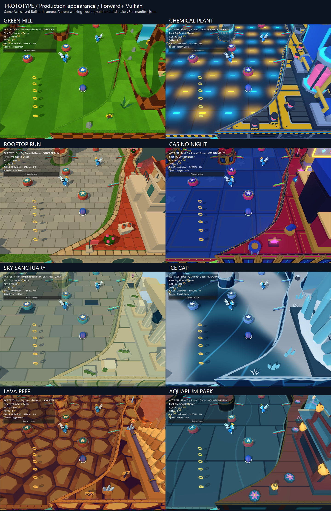

# Production appearance belongs to Prototype

When asking what the current game looks like, use **Prototype**. Visual Lab and Atmosphere Lab are source/authoring tools. Their screenshots do not validate the baked game, even when they use shared theme definitions. Endless is the separate streaming/presentation stress test.

## Canonical eight-theme comparison

The current snapshot includes the [geometric density pass](GEOMETRIC_DENSITY.md). Its before/after and 64/24/16 loop comparisons use this same production fixture.



[Capture receipts](production-appearance/manifest.json) — 2026-11-04, current working-tree art, Godot 4.7.2, Forward+/Vulkan on RTX 4060. This snapshot includes uncommitted selected artwork; rerun the command below to inspect newer source.

Run from the repository on Windows:

```powershell
./tools/capture_prototype_appearance.ps1
```

This runs the supported `scenes/act_baker.tscn -- --act=...` workflow for **First Try Smooth Decor**, across all eight registered themes, then opens the actual `scenes/prototype_run.tscn` session for each theme. Each session contains one Act, uses the normal disk-only `template_library.gd`, and retains the real Goal, character, HUD, composited backgrounds, atmosphere and camera. `single_act_use_bakes` is a run-local verification option; ordinary editor Play continues to rebuild source art in memory. Normal multi-Act runs are unchanged.

The fixture uses the same served Sonic Ball, zero score, locked Goal, seed 18, spawn framing, 1440 × 1000 window, normal Prototype camera settings, no retro filter, and each theme's published Default atmosphere. It holds game/shader time, hides the nonrepresentative startup FPS counter, and suppresses the pause-menu observer while capturing the play HUD. It does not select user-local Lab drafts. Atmosphere variants, other camera positions and motion still deserve their own production captures when relevant.

Output goes into a **new** timestamped `test-results/prototype-appearance/` directory:

- `eight-themes.png`: labeled comparison sheet, assembled from the eight full-size PNGs without changing their colors.
- `<theme_id>.png`: full-size Prototype screenshots.
- `manifest.json`: scene/library authority, exact Act state/camera, atmosphere values, renderer/device, source/pipeline/scenery fingerprints, disk bake paths and hashes, disk hits and zero fallback builds.
- `current_texture_matches` in each receipt: source PNG hashes and decoded RGBA pixel matches against textures referenced by the **loaded runtime Act bake**. Selected/approved art directories take precedence over older generated texture sets when present.
- `provenance.json`: HEAD and worktree status. Uncommitted art is explicitly part of working-tree captures; a commit alone cannot reproduce those pixels.
- `sources-before.json` / `sources-after.json`: byte hashes for authored Acts, scenery sidecars and published atmospheres; the runner rejects changes. Session preferences and telemetry are isolated, and verification does not archive a played run.
- Bake, capture and final regression logs. Nonzero exits or script/engine errors fail the runner before publishing a sheet.

Use `-ActPath` for another representative saved Act. Use `-OutputDirectory` to choose a new destination. `-SkipBake` is only for already-current sidecars: the same freshness checks still apply. Imported PNGs are also checked against their raw source pixels to reject stale import caches. Missing/stale bakes fail closed; there is no source reconstruction fallback in the production fixture. Existing output directories are rejected to prevent mixing runs.

For focused calibration, `-Themes green_hill` (or a comma-separated PowerShell array of registered themes) bakes/captures/checks only that subset. The default remains all eight. `-CameraTarget '570,500'` changes only the review camera target in Act coordinates; all compared frames must use the same target. It does not move the Ball or edit the Act. The manifest records the resulting camera transform, and the fresh-process regression receives the identical selection/target. These options extend this fixture rather than creating another renderer.

`tests/theme_capture.gd` and `tests/all_theme_texture_scene.gd` now delegate to `tests/prototype_appearance_capture.gd`. `tests/theme_runtime_regression.gd` delegates to `tests/prototype_appearance_regression.gd`. Run them graphically/headlessly as appropriate after baking. The runner also checks the entire capture manifest against a fresh process at the end, so an intervening source/bake change cannot quietly leave earlier frames certified.

## Audit: paths and actual purpose

Inventory covers current tracked tests/scenes/tools, inherited fixtures and local art-study scripts. Files under ignored `test-results/` include old verification checkouts and ad hoc probes; those are historical evidence, not maintained entry points.

| Paths | Classification and decision |
| --- | --- |
| `scenes/prototype_run.tscn`, `scripts/prototype/session.gd`, `zone_run.gd`; Play Prototype, Play Act, F5, editor Play and Atmosphere Lab Play Prototype | Production session. Editor/Lab single-Act Play builds current source through the shared builder; ordinary runs load disk recipes. Canonical captures explicitly require disk recipes. |
| `tests/prototype_appearance_{fixture,capture,regression}.gd`, `theme_capture.gd`, `all_theme_texture_scene.gd`, `theme_runtime_regression.gd` | Canonical production appearance and authority guard. Previously the last three used Visual Lab while claiming actual/normal/production game validation. |
| `tests/prototype_play_profile.gd` | Real session, input-only Challenge performance evidence. Dynamic run, not a matched theme sheet. |
| `tests/render_cost_profile.gd` | Prototype by default. `--profile-mode=act` explicitly means Visual Lab source-construction diagnostic; `endless` is streaming stress. Ablations are specialized measurements. |
| `tests/theme_prepare_profile.gd`, `buzz_death_profile.gd`; `tools/buzz_death_diagnostic.ps1` | Prototype runtime startup/warm-up and first-kill diagnostics; narrowly scoped performance evidence. |
| `tests/prototype_act_playtest_regression.gd`, `atmosphere_playtest_regression.gd` | Real single-Act session and Lab-to-Prototype handoff. Source-builder/preview validation, not proof of disk bake freshness. |
| Other `tests/prototype_*`, `enemy_stream_regression.gd` | Prototype rules, streaming, packaging, setup and telemetry diagnostics. Occasional screenshots prove those scenarios, not a canonical theme baseline. |
| `tests/endless_scene_smoke.gd`, `endless_stream_profile.gd`, `endless_scoring_regression.gd`; `atmosphere_runtime_regression.gd` and streamed branches of glow/fog tests | Separate Endless streaming/atmosphere diagnostics. Shared production infrastructure, different run/HUD/framing. |
| `tests/endless_bake_audit.gd`, `geometry_bake_regression.gd`, `endless_*` recipe/cache/border/batch/manifest/detail/reuse/retirement checks | Exact shared bake infrastructure diagnostics. Useful freshness/geometry/resource evidence, not screenshots of Prototype. |
| `experiments/visual_lab/visual_lab.tscn`, Play Green Hill; `visual_lab_smoke.gd`, `special_visual_smoke.gd` | Source/character authoring preview. Preserved. The obsolete smoke assertion that F5 should open Visual Lab now expects Prototype. |
| `experiments/lighting_lab/lighting_lab.tscn`, Atmosphere Lab and Lighting Lab; `lighting_lab_smoke.gd`, `portable_atmosphere_smoke.gd`, `atmosphere_profile.gd`, `scenery_profile.gd`, `scenery_regression.gd`, `foliage_regression.gd` | Atmosphere/scenery authoring and specialized Lab benchmarks. Play Prototype hands off to the real session; the preview itself is not production evidence. |
| `tests/atmosphere_{defaults,glow,lab,picker,surface,variants}_regression.gd`, `fog_regression.gd` | Authoring controls/persistence or component-level atmosphere diagnostics; some also inspect shared streaming. Not a substitute for Prototype captures. |
| `scenes/theme_examples/*_{curves,terraces}.tscn`, `scripts/themes/theme_example.gd` | Visual Lab examples for Green Hill, Chemical, Rooftop, Casino and Aquarium. Authoring preview, explicitly labeled. |
| `tests/{aquarium_park,casino,rooftop,ice_cap,lava_reef,sanctuary}_capture.gd` | Visual Lab source-theme/decor/water/animation studies. These also had misleading production/main-engine descriptions. Preserved and explicitly labeled SOURCE_LAB. |
| `tests/{green_hill,rooftop}_texture_scene.gd`, `casino_emitter_capture.gd`, `ice_aurora_benchmark.gd` | Visual Lab material/reference close-ups, emission inspection and aurora A/B. Previously “actual game”/“production-game” wording was misleading. Remain source diagnostics. |
| `tests/source_theme_runtime_regression.gd` (formerly the body of `theme_runtime_regression.gd`) | Live Visual Lab theme switching, state preservation and deterministic prop variants. Retained with a source-specific name, log and manifest. Prototype does not expose the same theme-switching HUD. |
| `tests/authored_main_game_regression.gd`, `decor_runtime_smoke.gd`, `composite_terrain_regression.gd` | Visual Lab source replacement, slot placement, terrain topology and collision separation. Historical “main_game” filename is now explicitly documented as source diagnostics. |
| `tests/act_game_fixture.gd`; inherited `character_lab_regression.gd`, `scorecraft_regression.gd` | Visual Lab fixtures for controlled shared physics/character/scoring checks. Screenshot prefix is now `source-lab-authored-`. |
| Inherited `authored_gimmick_regression.gd`, `gimmick_batch_regression.gd`, `act_reload_workflow.gd`, `pinball_mechanics_regression.gd`, `scoring_flow_regression.gd`, `soft_retry_regression.gd`, `candidate_acts_regression.gd`, `act_theses_regression.gd` | Source mechanism/content/lifecycle diagnostics through `authored_main_game_regression.gd`. They do not test Prototype presentation authority. |
| `tests/gimmick_{presentation,batch}_capture.gd`, `pinball_study_smoke.gd` | Inherited Visual Lab hardware galleries/studies, relabeled accordingly. |
| `tests/character_motion_smoke.gd`, `player_view_smoke.gd`, `portable_editor_smoke.gd`, `render_transition_smoke.gd`, `retro_filter_smoke.gd`, `retro_physics_regression.gd`, `scoring_presentation_smoke.gd` | Visual Lab character, viewport, portability, retro and scoring diagnostics. Not production appearance claims. |
| `tests/all_theme_texture_review.gd`, `green_hill_texture_review.gd`, `rooftop_texture_review.gd`, `border_path_review.gd`, `theme_surface_capture.gd` | Direct theme/material/geometry inspection. Close-up lights/cameras and sometimes unshaded copies are intentional. Historical texture-conversion sheets are source studies. |
| `tests/all_decor_capture.gd`, `*_library_capture.gd`, `pinball_models_capture.gd` | Direct prop/hardware galleries. Component inspection; no run, atmosphere stack or production camera. |
| Theme texture/decor/landmark/ramp-height/terrain-border regressions | Direct theme resource and geometry assertions. Source/bake component checks, not whole-game render claims. |
| `tools/bake_{green_hill,rooftop,theme}_textures.gd`, `tools/texture_sources/` | Historical source-texture generation. Do not run to “refresh” current selected artwork: these can overwrite painted edits. |
| Local `experiments/{casino,chemical,green_hill}_texture_{choices,refined}/`, `experiments/rooftop_lighting/{selected,refined}_texture_preview.gd` | Uncommitted art-choice/source previews. Inspected as local context; preserved and excluded from this commit. |
| `scenes/authored_act_playtest.tscn`, `scripts/authored_act/{authored_act_playtest,playtest_presentation}.gd`, `launch.ps1`, Authored Act Playtest.cmd | Retained specialist geometry/lifecycle diagnostic: 2D/3D toggle, collider dimensions, swept entry/activation/exit, markers, file reload and simplified reset. UI now says ACT GEOMETRY / DIAGNOSTIC. Not an alternative production game. |
| `tests/authored_act_runtime_regression.gd`, `authored_act_scene_smoke.gd`, `authored_green_hill_smoke.gd` | Real consumers of that standalone diagnostic: loader/lifecycle, diagnostic toolbar and shared visible/collision dimensions. Preserve these tests. |
| `experiments/visual_lab/green_hill_presentation.gd` | Two-line compatibility alias extending current `themed_presentation.gd`; no frozen old material implementation. Still used by standalone/topology tests. Retained and explicitly labeled diagnostic. |
| `scenes/playground.tscn`; `presentation_smoke.gd`, `ring_presentation_smoke.gd`, `steering_ui_smoke.gd`, physics/ring/rack/enemy regressions | Bare shared-engine diagnostic, directly using `scripts/game.gd` and the base presenter. Camera geometry, ring lifecycle and physics checks; not production theme evidence. |
| Act editor smoke/regression tools, authoring trial/thesis overview builders | Editor UI/content previews. They validate authoring, not the final game appearance. |

No standalone path was deleted: the remaining Green Hill alias and diagnostic player still have concrete low-level test coverage. The redundant production-capture implementations were replaced with small canonical delegates.

## Material and bake findings

1. Visual Lab constructs `themed_presentation.gd` directly. Prototype consumes visual recipes, batching, warm manifests, streamed atmosphere/backgrounds and the production camera. Lab close-ups can also override lights, projection and reference materials.
2. The shared bake path applies `flat_surfaces.gd`: recognized relief/normal mapping is removed while current albedo, emission and surface maps remain. This intentional production policy explains some source-versus-baked differences; this consolidation does not change it or the art direction.
3. `geometry_bake.gd` already hashes theme scripts, referenced shaders/includes and asset directories, plus Act/scenery receipts. Generated images are content-addressed by their pixels in `bake_assets.gd`. The comparison reuses these mechanisms, rather than adding another cache.
4. The initial 40-combination audit found Green Hill and Chemical current, with all five Acts plus shared backgrounds stale for the other six themes (36 freshness failures). The selected Act was rebuilt in all eight themes through the supported baker. Other Acts are outside this comparison; run Bake Prototype before using a full stale pool.
5. Historical `docs/all-theme-textures/` images and older Compatibility/ANGLE commands are not current production baselines. Current selected art for Green Hill, Chemical, Rooftop and Casino exists as uncommitted work; captures include it without committing or replacing it.
6. No separate old Green Hill implementation was found behind the legacy alias. No missing-texture fallback was accepted in the canonical capture. Pixel receipts verify current source artwork in loaded bake resources rather than assuming a successful scene launch proves freshness.

## Verification record

Executed on 2026-11-04:

- Supported single-Act offline bake: eight variants completed.
- Forward+/Vulkan capture: eight images, zero failures; all eight inspected in the final sheet, plus full-size Green Hill inspection. No pause/loading overlays, missing surfaces or misplaced camera were accepted.
- Final authority/freshness regression: **126 checks, zero failures**, including a deliberately stale isolated disk receipt rejected before session construction, all eight runtime paths, and final manifest comparison in a fresh process.
- Source-Lab theme switching: **675 checks, zero failures**, including its separate-process determinism check.
- Prototype planning: **41 checks, zero failures**. Real editor single-Act Prototype playtest: **12 checks, zero failures**.
- Retained standalone geometry/lifecycle regression: **151 checks, zero failures**. Visual Lab smoke: **13 checks, zero failures**.
- Headless Godot editor scan/import: exit 0, no reported script/engine errors.
- **146** source PNG pixel matches in loaded Act recipes. All imported PNG dependencies checked against source pixels. **47** Act/scenery/atmosphere source files remained byte-identical during the capture workflow.

Logs/full-size captures remain under `test-results/prototype-appearance/canonical-final/`; the offline bake log is in `canonical-v1/`. Initial exploratory captures are superseded by `canonical-final`. Current art emits pre-existing source-image/export warnings during authoring baking; the final baked runtime capture and regression error logs are empty. No external artwork was downloaded.

That initial appearance milestone left other Acts stale. The subsequent [geometry pass](GEOMETRIC_DENSITY.md) rebuilt all 40 Prototype and 56 Endless variants; their disk audits passed 425 and 489 checks. The image/manifest at the top now comes from `test-results/geometry-density/after/`, with 135 final authority/freshness checks. The original verification record above is historical. Human review still owns motion readability, flipper timing and art polish; a matched screenshot does not certify every Act/atmosphere combination.
