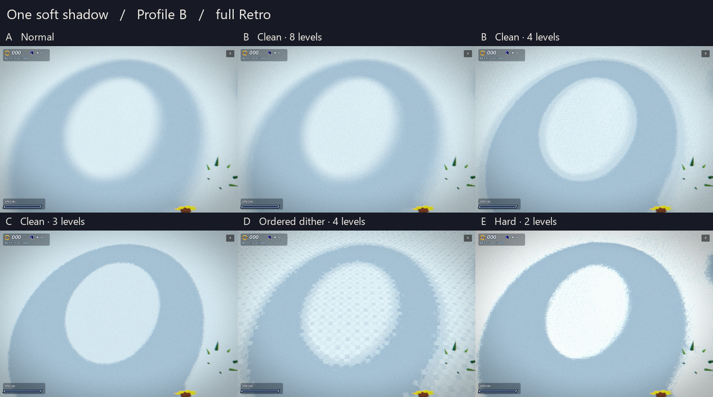

# Retro Shadow Lab

**Production selection, November 20.** The game uses native shadows with authored terrain faces and full Retro. Clean 8 is the optional device setting. The comparisons below record the earlier art study. [Gameplay captures and settings](TERRAIN_FACE_SHADING.md)

**Clean four-level shadows are the strongest art-direction candidate.** On a broad penumbra they give the shadow a deliberate contour and retain a soft outer shoulder. Eight levels give a quieter, low-precision gradient. Switching between them on ordinary Green Hill terrain takes a close look. The neutral card makes the distinction easy to see. The four-level ordered pattern is a separate modern Saturn/Dreamcast-inspired treatment. Historical hardware fidelity was outside the scope of this experiment.

## Review in the native Lab

1. Extract **Retro Shadow Lab.zip** to a writable folder. Double-click **Retro Shadow Lab.cmd**. A regular session opens Green Hill, First Try, Profile B, full Retro, Normal. The Lab locks the N64-ish, VHS and CRT passes on across shadow modes, gameplay, camera changes, profiles, streaming and captures. The package includes the qualified Godot 4.7.2 Windows runtime, imported assets and disk recipes. The launcher creates a fresh Results folder for each run.
2. Choose **Penumbra study** and **Native range**. Compare Normal, Clean 8, Clean 4, Clean 3, Ordered dither 4, then Clean 2. Keep the camera still for the first pass. Select **Pan + spin** for the second. F1 hides the controls. From CMD, `"Retro Shadow Lab.cmd" bands` opens the card directly at eight levels.
3. Select **Launch Tube** in Rooftop Run. Inspect the barrel shadow beside the dock, the edge under the raised platform, and the texture in the tube itself. Return to **First Try** and compare Green Hill, Sky Sanctuary and Ice Cap. Use the four camera presets, focus or zoom to inspect elevation. **Play Act / tour** returns control to the running fixture.
4. Select **Ring row** in Green Hill. Toggle **Ring shadows** at Profile B, then Profile C. In Ordered dither, compare **Screen**, **Object** and **World** at the same scale, then try the 2×2 and 4×4 matrices. World, 4×4, cell 0.035 and width 0.70 are the starting pattern settings.
5. **Starting tones** restores the original art palette, including the dither candidate. The two-level response starts at 1.00/0.50 and the four-level response at 1.00/0.75/0.50/0.25. **Deeper tones** changes them to 1.00/0.32 and 1.00/0.67/0.30/0.08. Individual stops are editable. Choose **Native range** again to preserve the atmosphere's existing shadow endpoints. The card uses a 4° physical sun to expose a broad edge. Ordinary Act comparisons use the theme's own defaults.
6. For automated evidence, run `"Retro Shadow Lab.cmd" evidence` in the extracted folder. Use `smoke` for the short UI and GPU test. Results include the native engine log, PNGs and a JSON receipt. Each launch isolates application data, graphics, archives and telemetry inside its own folder. From a source checkout the launcher can use the installed engine and offers locally baked fixture/theme combinations. [Native controls screenshot](retro-shadow-lab/controls.jpg)

| Device profile | Atlas / cascades | Filter | FXAA | MSAA | Native 3D scale |
| --- | --- | --- | --- | --- | --- |
| A · production reference | 8192 / 4 | Medium | Off | 4× | 100% |
| B · primary art review | 4096 / 4 | Medium | On | 2× | 85% |
| C · lower-cost comparison | 2048 / 1 | Medium | On | 2× | 85% |

## What to look for

| Candidate | Behavior under full Retro |
| --- | --- |
| A · Normal | Continuous native reference. On the card, the shadow fades through a wide shoulder into the receiver. |
| B · Clean 8 and 4 | Eight levels are close to Normal at play distance. Four expose readable bands along the same curved edge. Both preserve the native lit and fully shadowed endpoints. |
| C · Clean 3 | The middle tone survives where the penumbra is broad enough. The interior reads as a more uniform graphic shape. |
| D · Ordered 4 | Adjacent tones alternate over the transition. The deliberate pattern survives CRT at close range. It offers a distinct art choice for a surface or theme that can carry it. |
| E · Clean 2 | A single threshold follows the filtered shadow's mid-contour. Intermediate softness disappears. Small irregularities in the shadow samples become visible on a wide, pale receiver. |

The tone count applies to directional diffuse visibility. Texture, normals, specular highlights, other lighting, AA and the full N64-ish + VHS + CRT presentation still contribute to the final pixel. The clean shader reads a scalar and rounds to the nearest level. It samples no screen, object or world coordinate when choosing a band. Its boundaries therefore follow the filtered shadow's own contours. Moving a caster, changing the filter or zooming can still move a contour across a pixel.

| Evidence | Subject |
| --- | --- |
| [Penumbra](retro-shadow-lab/penumbra.jpg) | Matched depth, angle, sun, exposure and receiver across all six treatments. |
| [Green Hill](retro-shadow-lab/green_hill.jpg) · [Sky Sanctuary](retro-shadow-lab/sky_sanctuary.jpg) · [Launch Tube](retro-shadow-lab/tube.jpg) | Real disk-loaded Prototype geometry with the ball, bright materials, elevation and casters in view. |
| [Eight themes](retro-shadow-lab/eight-themes.jpg) · [raised, emissive and transparent scenery](retro-shadow-lab/raised-and-emissive.jpg) | All eight at clean four. Paired native/four close-ups include Chemical, Casino, Aquarium and Rooftop. Lava receives smoke coverage. |
| [Palette study](retro-shadow-lab/tone-study.jpg) · [blur and sun angle](retro-shadow-lab/blur.jpg) | Native range, original and deeper art palettes. Cheap blur at 0.5 and 2.0 with sun 0°, then blur 1.0 with physical sun 3°, under Green Hill and Ice Cap light. |
| [Pan and zoom](retro-shadow-lab/pan.mp4) · [ordered anchors](retro-shadow-lab/anchors.mp4) · [spinning Rings](retro-shadow-lab/rings.mp4) | Matched camera samples on the card, then gameplay. Ring crops use 16 distinct real collectible poses with paired casting-on/off images. |
| [Moving gameplay fixtures](retro-shadow-lab/moving-fixtures.jpg) | Rooftop snapshots of the flipper, bumper, score chute and charged Launch Tube exercises. |

## Engine signal and receiver design

Godot 4.7.2 Forward+ supplies `LIGHT_IS_DIRECTIONAL`, `LIGHT` and read-only scalar `ATTENUATION` to a custom spatial `light()`. For the ordinary directional sun, Godot filters its shadow map, applies shadow opacity and packs visibility in an eight-bit-per-light intermediate. “Continuous” in the Lab means that native renderer response. Omni and spot attenuation includes distance and shadow together. The shader does not expose a per-light instance ID, a writable attenuation value for the native BRDF, or the native shadow-map UV for anchoring an ordered pattern. A custom light processor takes responsibility for its lighting contribution. A public compositor effect has scene buffers after lighting, without the isolated per-key diffuse shadow term needed here. [Forward+ renderer](https://github.com/godotengine/godot/blob/4.7.2-stable/servers/rendering/renderer_rd/shaders/forward_clustered/scene_forward_clustered.glsl) · [native lighting equations](https://github.com/godotengine/godot/blob/4.7.2-stable/servers/rendering/renderer_rd/shaders/scene_forward_lights_inc.glsl) · [spatial shader reference](https://docs.godotengine.org/en/stable/tutorials/shaders/shader_reference/spatial_shader.html) · [compositor interface](https://docs.godotengine.org/en/stable/classes/class_compositoreffect.html)

**Approach A worked as a signed diffuse correction.** A conventional shadow-to-opacity overlay would blend into an image that already contains the native shadow, emission and fill. This Lab attaches a low-priority premultiplied material overlay to the same real opaque triangles. It uses the original material parameters and vertex program, performs the ordinary depth test, writes no depth and needs no polygon offset. Its alpha is zero. Signed HDR RGB adds the difference between the selected response and the actual key attenuation, multiplied by the supported terrain's Burley diffuse term. A zero difference contributes zero. This preserves the existing caster geometry and silhouette at each elevation. Native key specular stays continuously shadowed. The correction reuses the source roughness, normals and albedo, suppresses its own emission and ambient, and scales its contribution by foreground fog transmission.

Eligibility is intentionally narrow. The resolver accepts supported single-material opaque ground, upper terrain, walls, borders, ledges and ramps. Original materials own all other shading. Existing overlays, custom light processors, unsupported render modes, multi-surface assets, alpha materials, shadow-only geometry, water, glass, backdrop worlds and volumetric-fog lighting fall outside the treatment. The scene guard checks the foreground directional when registering receivers. A different same-world multi-sun rig would need its own qualification. An overlay can cost another visible draw on the existing mesh. Its geometry has no new caster node or shadow pass. As with any transparent render pass, coincident/intersecting transparent content and unsupported renderer changes warrant review if the eligible set grows.

**Approach B stayed a design alternative.** Replacing the central terrain material could save the extra submission, but would move responsibility for the native direct diffuse and specular BRDF into production material generation. Approach A already proved the art question while preserving the production creators and exact Normal pixels. A separate replacement material benchmark and custom caster implementation were unnecessary for this Lab. The neutral card is an additional controlled fixture inside Approach A.

Each resident Act owns private overlay materials. Identical source shaders share compiled programs within a review case. Returning to Normal detaches all overlays and retains warm materials only while their Act lives. Retirement clears ownership, and closing the case clears its program cache. The review scene has no production call site. The distributed package adds the seven missing Side to Side review recipes from the normal baker to the previously qualified portable payload.

## Light, motion and surface findings

On Green Hill, clean 8 changed 0.16% of the full-resolution gameplay image by at least 3/255 in any channel. Clean 4 changed 0.54%, ordered 4 changed 0.72% and hard 2 changed 1.44%. The corresponding values for Rooftop were 0.38%, 0.88%, 1.11% and 1.83%. The neutral card deliberately occupies more of the frame with partial shadow. It illustrates the response clearly and exaggerates its share of ordinary gameplay.

Screen anchoring holds pattern phase against the viewport as geometry moves underneath. Object and world anchoring follow the receiver. The two produced identical images at each of the 24 sampled Green Hill camera positions. The world grid avoids restarting the phase for adjoining static pieces, while object anchoring moves a pattern with its mesh. A rotating caster moves its shadow across the receiving surface in both cases. Dominant-axis projection can still change phase at a change of face orientation. The live controls and motion plates expose that tradeoff. Clean 8 has the least conspicuous transition during pan or zoom. Clean 2 makes a moving sampling threshold easiest to see. Ordered 4 can give a broad, pale edge a visible textile-like texture even after CRT.

Plotting actual Ring casting on/off in a fixed Green Hill crop gives the following **largest adjacent change in summed positive shadow darkness, divided by mean darkness**. Rotation changes projected area, so the measurement includes real silhouette motion. The clip is the better guide to how a flicker feels.

| Profile | Normal | Clean 8 | Clean 4 | Ordered 4 |
| --- | ---: | ---: | ---: | ---: |
| B · 4096 / 4 | 18.6% | 18.6% | 19.8% | 20.2% |
| C · 2048 / 1 | 39.1% | 39.0% | 38.8% | 37.4% |

At B, eight levels tracked native Ring variation closely. Ordered dither changed the texture of the edge and did little for temporal variation. The larger change came from the atlas/cascade profile. Tiny spinning Rings remain a reason to review Profile C in motion. Casting can be turned off locally to isolate that contribution and restored per collectible.

Shadow Blur changes the native filtering footprint feeding every mode. At a 0° sun angle, raising cheap blur is a useful first adjustment for a hard daylight edge. The physical sun produces a broader, caster-distance-dependent penumbra, which gives four or eight levels more space to read. Blur and physical sun are independently adjustable. The PCSS card is a magnified reference, and the ordinary theme comparisons retain their authored light.

With foreground key energy set to zero, the ordered and native frames matched byte-for-byte in Green Hill, Casino Night, Chemical Plant and Aquarium Park. Local pools, emission and backdrop lighting therefore retain their native image in that isolation test. In a separate full-Retro Ring diagnostic, forcing fully lit diffuse across the shadow left 3.35% of the native on/off contrast in the crop. The native specular term and surfaces outside the eligible set still contribute. This measures how much of that particular shadow is actually controllable through the diffuse receiver.

The Aquarium inventory found 20 transparent surface slots, zero treated transparent slots and zero overlays in a backdrop. The same-geometry overlay follows the real floor, ramps and raised faces. The matched views show no second silhouette or visible depth offset in the tested camera presets.

## RTX 4060 cost

Godot 4.7.2 Forward+/Vulkan, 1280 × 900, Profile B, full Retro, uncapped. Single disk-backed Prototype fixtures. Each static cell summarizes 180 wall-clock frame intervals per theme. The table reports the median of the eight theme medians and the median of their P95s. Green Hill pan is a separate 120-frame camera sweep. Read back and encode the stills outside these timing windows. A single ordered sweep per theme supports a gross cost comparison. Sub-millisecond differences can include host and driver noise. [All 56 theme/mode rows](retro-shadow-lab/rtx4060.csv)

| Response | Static median, ms | Static P95, ms | Green Hill pan median / P95, ms |
| --- | ---: | ---: | ---: |
| Native | 2.45 | 3.30 | 2.59 / 3.68 |
| Zero-difference overlay | 2.48 | 3.24 | 2.78 / 4.30 |
| Clean 8 | 2.47 | 3.36 | 3.16 / 4.29 |
| Clean 4 | 2.42 | 3.07 | 2.68 / 3.58 |
| Clean 3 | 2.41 | 3.19 | 2.49 / 2.89 |
| Ordered 4 | 2.36 | 3.14 | 2.68 / 3.81 |
| Clean 2 | 2.41 | 3.02 | 2.57 / 3.05 |

* **Integration cost.** Seven eligible receivers, four private materials and two to four unique shader programs per theme. All treated modes added six visible draws and 4,896–6,838 reported visible primitives. The zero-difference overlay pays that same submission cost. The following modes reuse geometry, materials and pipelines. The steady-state measurements show similar costs for clean and ordered math.
* **Shadow cost.** Actual foreground shadow draw and object counts matched Native. Godot's reported candidate shadow primitives increased by 5,184. The renderer increments that primitive counter while scanning surfaces, before it checks the surface shadow-pass flag. The transparent overlay without a depth prepass never enters the shadow draw list. This distinction accounts for both counters. [Godot 4.7.2 render-list construction](https://github.com/godotengine/godot/blob/4.7.2-stable/servers/rendering/renderer_rd/forward_clustered/render_forward_clustered.cpp#L1109-L1184)
* **Warm-up.** Opening the ordinary held Act in Native took 4.26–12.43 s across the eight cases. Registering the first overlays took 24–88 ms on the calling thread. The following 24 frames took 1.47–2.38 s total, including shader/pipeline preparation, versus 52–64 ms for Native. Six to eight Godot pipeline compilation events were recorded on first attachment. Subsequent tone switches compiled zero additional pipelines, with median control-call times around 0.2 ms. These are distinct phases. The 24-frame total is not the duration of one frame.
* **Memory and overdraw.** The ordinary resource monitor rose by two. The process-wide graphics-memory counter changed by only a few KiB at the sampled points. Those aggregate counters are too coarse to estimate private shader or driver memory. The new transparent pass shades the visible eligible receiver footprint again. Exact fragment counts, per-pixel overdraw and GPU pass times were unavailable from these viewport counters.

### Endless streaming

The real Rooftop Run → Chemical Plant course waits for the next Zone and first Act to be ready, then times the moving crossfade. Startup here ends at runtime ready, before the Lab applies the initial treatment. Each mode ran once, sequentially, in the same process. The shorter second startup/preparation has shared-cache and run-order effects.

| Mode | Startup | Next Zone prep | Crossing median / P95 | Worst frame | Boundary waits / fallback builds |
| --- | ---: | ---: | ---: | ---: | ---: |
| Normal | 3.34 s | 2.38 s | 5.64 / 9.25 ms | 26.2 ms | 0 / 0 |
| Ordered 4 | 2.24 s | 1.66 s | 6.09 / 9.53 ms | 221.8 ms | 0 / 0 |

At the treated crossing, seven resident Acts owned 69 eligible receivers, 43 private materials and eight cached programs. One frame exceeded 100 ms. The sampler does not attribute that frame to a specific driver or streaming job. The full crossing exercise used the patterned path. Clean candidates share receiver registration, material lifetime and filtering with it, but have no separately timed crossing. Weak-reference checks covered retired games, libraries, presentation nodes, visuals and private materials. Both crossings released the watched owners. Final orphan-node count was zero. [Crossing measurements and shadow motion data](retro-shadow-lab/measurements.json)

## Verification and disposition

* The supported baseline ran once. Thirty of 32 suites passed on the first invocation. Pinball Mechanics lost the native Vulkan device and passed all 58 checks on an unchanged retry. Traversal Prototype rejected an existing stale test-only Green Hill bake. The ordinary Act baker regenerated that one recipe privately. The identical test then passed all 20 checks against the checkout's scripts, assets and shared bakes. One intermediate isolated rerun lacked the visual-presenter directory and was stopped; the verified view included it. The original checkout fixture and production bakes were preserved. All 32 suites have passing results under those conditions. [Per-suite exits and retry disposition](retro-shadow-lab/baseline.csv)

* The ZIP passed CRC verification and was freshly extracted before both CMD runs. The full run passed **433 checks**, with 56 single-Act timing rows and two Endless crossings. The separate short run passed **40 checks**, including native menu interaction. Both exited successfully with zero orphan nodes. Every captured world frame was checked for the active production Retro stack, including both streamed boundaries. The final full Lab engine log contained no errors or warnings. The existing canonical Prototype appearance regression also passed all **70 checks** with full Retro after the fixture gained explicit stack selection.
* The GPU rendered the shared clean transfer function across a scalar ramp. It produced exactly 8, 4, 3 and 2 monotonically ordered levels and retained both native endpoints. Rendered card frames were byte-identical when changing all four pattern controls in every clean mode, with the entire production Retro stack active. The continuous, 8, 4, 3 and 2 level images were visibly distinct on the same soft edge. The ordered four-level image also differed from clean four.
* In every theme the zero-difference overlay and restored Normal images matched the original native pixels. Held gameplay and camera state matched. The graphics preference file stayed absent. Additional fixtures exercised the moving ball, flipper hold, moving bumper, score chute, charged Launch Tube, four camera presets and real Theme Life updates. The streaming course reached and crossed the next Zone using disk recipes. Ring restoration and teardown passed.
* Package provenance starts at pushed main `e2f078e310aa8a2330885f2669d65c3e2e053102`. The portable ZIP is 185,823,694 bytes, SHA-256 `625905333b6eeb400506493df4d5d513c22571a62c3abd5f9c5e98e54fa1d01e`. Its bundled runtime has SHA-256 `ab1824f85bfd8e0e4128182c000c4003a3e042245b2967848d089b2a04b22424`. The inherited shared bake payloads come byte-for-byte from the verified previous shadow review. New Side to Side recipes exist only in the private package.

**Recommendation B — visually strong but expensive on first use.** Keep clean 4 and clean 8 as optional candidates. Four gives the more recognizable remembered-era silhouette on wide gradients, eight preserves the more understated character of ordinary play, and the patterned candidate remains available for a deliberately graphic look. First-use hitching and long-frame behavior during streaming need another engineering pass before promotion. No UHD 620 measurements were made for this iteration. Alex's remaining art call is which of four or eight reads better through a whole moving Act on the intended display.

The changes live in [the native scene and receiver shaders](../experiments/retro_shadow_lab), the [appearance fixture’s explicit stack selection](../tests/prototype_appearance_fixture.gd), the [CMD launcher](../Retro%20Shadow%20Lab.cmd), the [evidence summarizer](../tools/summarize_retro_shadow_lab.py), this report, its compact media and the [shared project brain](PROJECT_BRAIN.md). Ordinary gameplay continues to enter through its established scenes.
