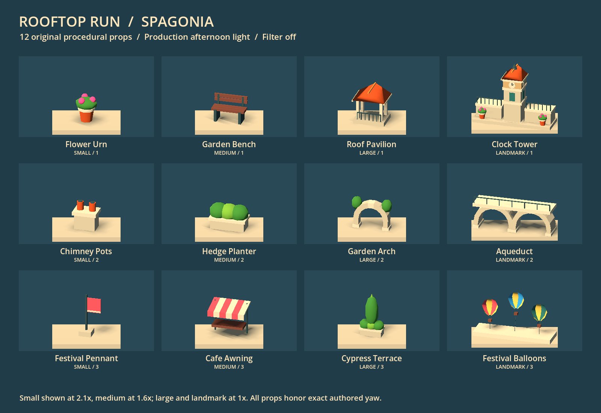
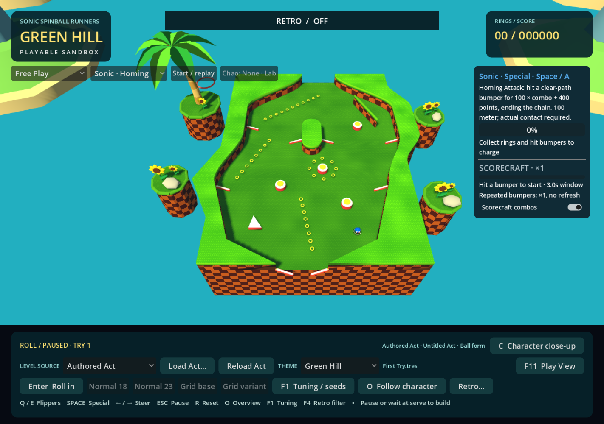
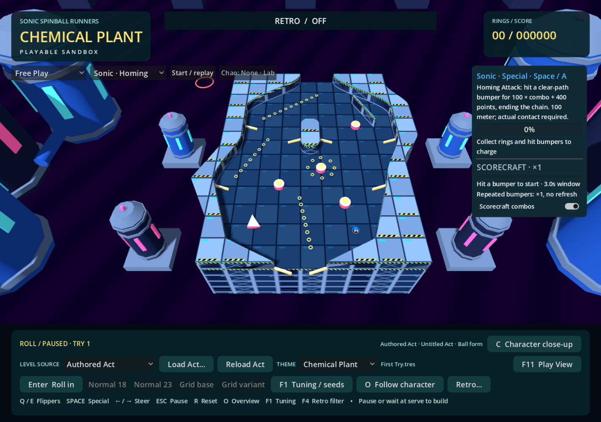
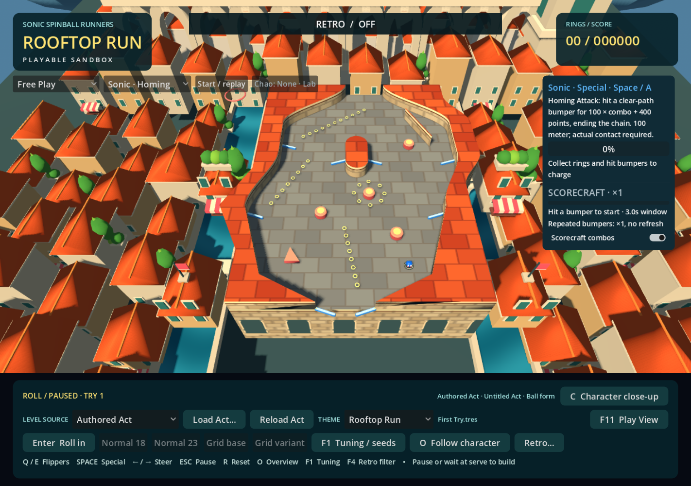
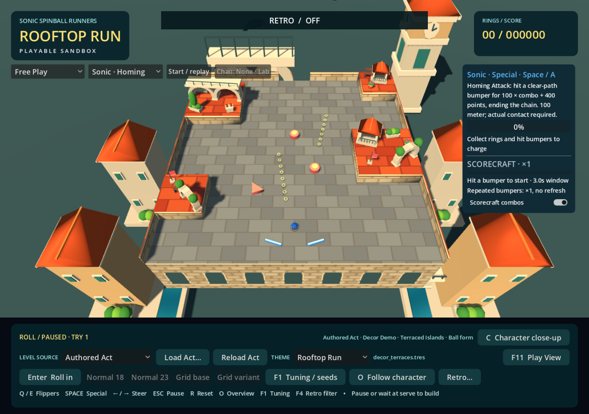
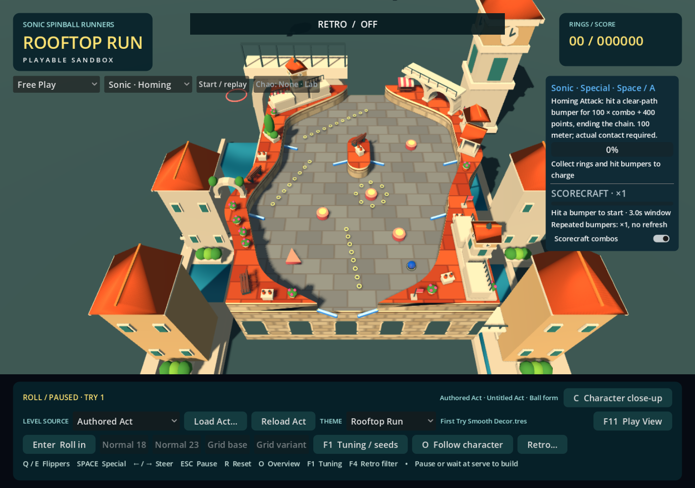
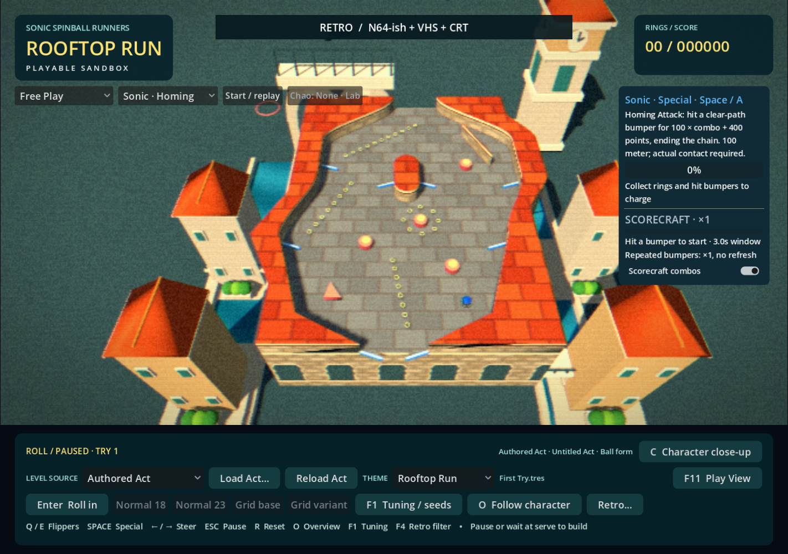
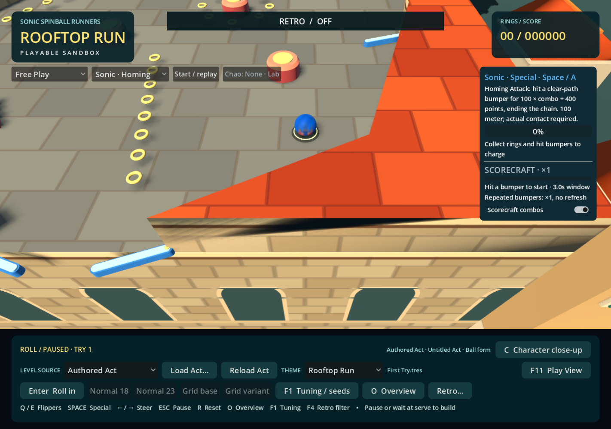

# Rooftop Run / Spagonia

Rooftop Run is the third visual skin in the existing main game. Open **Play Green Hill.cmd**, load an authored Act, and choose **THEME → Rooftop Run**. The same selector also works on generated playfields. For direct launch, add `-- --theme=rooftop_run` to the normal Godot command. Theme choice is session-only.

The theme changes materials, decor, lighting and scenery through the existing presentation rebuild. It does not reload or regenerate the Act. Physics bodies, terrain outlines, flippers, bumpers, rings, character, steering, scoring, abilities, lifecycle and camera remain owned by the shared engine. No enemies, boost, moving platforms, balloon targets, barrels or new Act rules are introduced.

## Visual research and interpretation

Research began before implementation. Five full-size game screenshots were inspected in the browser, spanning Unleashed's close architecture and Generations' street, roof-garden and high-city views. These were visual references only: no Sega textures, models, image crops or extracted assets were downloaded into the project. All new meshes, colors and shaders are original code.

| Reference | Observed visual language | Low-poly interpretation |
| --- | --- | --- |
| [Unleashed: clock tower, bridge and street frontage](https://www.italyformovies.com/film-serie-tv-games/detail/6393/sonic-unleashed-game) | Orange pitched roofs, pale masonry and ochre plaster, dark shutters, flower pots, ornate railings, strong architectural shadows | Broad gable roofs and eaves, two-tone stone, single green shutter panels, simple rail bars and faceted planted urns |
| [Unleashed: shaded balcony and narrow alley](https://en.sonicscanf.org/gallery/den-16/spagonia-12/) | Deep window recesses, projecting ledges, stacked balconies, roof chimneys, hanging flowers; bright sky above shaded walls | Dark facade inserts, pale cornices, paired chimney pots and compact rooftop details |
| [Generations: dense city and roof gardens](https://store.steampowered.com/app/71340/Sonic_Generations_Collection/) — screenshot `ss_f25e6c424073bac81756fe00bdac2b9dba216e89` | Repeated terracotta roofs at several depths, garden terraces, monumental arcade, clock tower and colorful hot-air balloons | Four isolated terracotta townhouses, planted terraces, one short arcade and a skyline clock |
| [Generations: clock-tower descent](https://store.steampowered.com/app/71340/Sonic_Generations_Collection/) — screenshot `ss_b678e5f9b8f9aced858c690ad1b87605f0fd2271` | Very dense city viewed from above, clear tower silhouette, brightly striped balloons | A high rooftop table, quieter distant colors and three background balloons, with no balloon collision |
| [Generations: flower-shop awning and street masonry](https://en.sonicscanf.org/gallery/sonic-generations/rooftop-run-retro-sonic/) | Large awning, shuttered stone frontage, potted flowers, sparse colored confetti | A compact striped café canopy, flower urns and flags; airborne confetti omitted to protect ring readability |

The recurring identity is architecture at different scales: small shutters and pots, medium roofs and gardens, and large arches and towers. Unleashed's inspected images emphasize layered masonry and sun/shade depth. Generations keeps that foundation and emphasizes a festival above a much denser visible city.

The [Rooftop Run environment description](https://sonic.fandom.com/wiki/Rooftop_Run) also identifies canals and park areas in the Wii/PS2 version. A clear canal screenshot was not obtained, so the two background waterways are our own restrained interpretation of that motif and the requested direction, not a reconstruction of a particular scene. Their wide teal strips, pale banks and short bridges remain far below gameplay.

The bench, miniature garden pavilion, cypress terrace, twin-span aqueduct and tethered three-balloon plinth are invented arrangements of these motifs. The red-and-cream canopy is an original festival palette choice; the inspected flower-shop awning is green. Detailed Gothic ornament, tiny roof tiles, window slats and ornate ironwork are simplified into large readable shapes.

## Materials, light and background

- **Playable floor:** independent procedural staggered limestone slabs with restrained color variation and derivative-filtered mortar. Slightly cool stone under warm light helps gold rings remain distinct. This does not reuse or recolor the grass shader.
- **Raised terrain:** saturated terracotta slab caps and pale masonry sides distinguish obstacles from playable paving. Shared extrusion retains every original contour, including open paths and smoothed composites.
- **Vertical facade:** world-projected staggered blocks, a pale cornice, dark trim and arched recesses below the deck. Normal-weighted projection works on arbitrary silhouettes without changing vertices or colliders. The recesses are surface shading, not physical openings.
- **Afternoon light:** warm directional sun, blue ambient fill, directional shadows and a saturated blue procedural sky. Material values were reduced after visual review to avoid blown cream highlights. No bloom, imported environment map or theme-specific camera is required.
- **City:** at most four spaced townhouses, one short arcade and one clock tower, with three low hills, three static hot-air balloons and two canals with one bridge each. The sparse composition follows the user's preference for scenery density similar to Green Hill and Chemical Plant. A quiet plaza grounds the architecture below the board; far colors suggest haze without changing global fog state.
- **Facades:** townhouse window rows scale with wall height and remain below the eaves. Frames and shutters occupy separate depth layers. Clock faces and shutters account for the tower's rectangular footprint. Planted terraces sit beside houses, clear of roofs and windows.
- **Cost:** shared primitive meshes/materials and background MultiMeshes reduce scenery draw calls. Individual authored props retain their roots and metadata. No per-frame scenery script, physics simulation or particle emitter is added. This is a Windows prototype; Android performance is unmeasured.

Normal follow view intentionally prioritizes the ball and immediate terrain. Overview reveals more of the city. The optional city-study capture uses a review-only camera position; gameplay camera settings are unchanged.

## Stable generic decor pools

All `surface`, `edge` and `either` hints have these three ordered variants. Numbered values are the editor's one-based labels; saved indices remain zero-based.

| Size | Variant 1 | Variant 2 | Variant 3 |
| --- | --- | --- | --- |
| SMALL | Flower urn | Chimney pots | Festival pennant |
| MEDIUM | Garden bench | Hedge planter | Café awning |
| LARGE | Roof pavilion | Garden arch | Cypress terrace |
| LANDMARK | Clock tower | Aqueduct | Festival balloons |



The existing editor preview selector gains Rooftop Run from the registry. Small, medium and large Auto choices remain deterministic per Act seed, slot and skin. Landmark Auto shares upright/span choices with Green Hill and Chemical Plant. Fixed variants use the existing override implementation; unavailable indices warn and fall back to Auto without rewriting the Act. Published pool order remains stable; the balloon terrace is available as fixed Landmark Variant 3.

The common placement path applies the exact authored anchor, arbitrary yaw and scale. No 90-degree snapping or terrain-dependent reorientation is introduced. A bench's long axis and an arch's opening follow the slot rotation. Unsupported anchors retain the existing skip behavior. Authored landmarks now share an approximately 3-by-1-cell footprint with the other themes: a clock tower with side terraces, a wider aqueduct, or a long balloon terrace. The tower remains approximately 2.36 cells tall. Background towers and aqueducts retain their compact scenery proportions. See [matched landmark compositions](DECOR_SLOTS.md#consistent-landmark-footprints-across-themes); overhang and occlusion remain authoring considerations.

## Same Act, three identities

The following captures use the user's local `data/acts/First Try.tres` (the available filename corresponding to the requested FirstTry example). It was read without edits or Git staging. Each three-theme group has the same Act fingerprint, camera transform and ball position. All three images use filter OFF.







The existing checked-in Acts remain reproducible examples: run `scenes/theme_examples/rooftop_terraces.tscn` or `rooftop_curves.tscn` with F6. Both configure the ordinary main game and start in overview with filter OFF. They add no separate gameplay loop or altered Act data.





The preferred **N64-ish + VHS + CRT** stack was also captured using current production defaults. Broad paving and roof silhouettes remain readable; the native HUD stays unfiltered. Fine tile noise was deliberately omitted from the materials.





## Verification

Initial theme verification used Godot **4.7.2**, Windows, graphical **GL Compatibility / ANGLE / RTX 4060**:

| Check | Result |
| --- | --- |
| `tests/theme_runtime_regression.gd` | 302 checks, zero failures; three themes, both checked-in authored examples, generated source and fresh-process variant verification |
| `tests/rooftop_decor_regression.gd` | 91 checks, zero failures; twelve props, all size/hint pools, fixed indices, fallback, collision isolation, shared roof mesh and exact 37.125-degree placement |
| `tests/authored_main_game_regression.gd -- --theme=rooftop_run` | 70 checks, zero failures; shared abilities, scoring, rings, pause, source changes, replay, lifecycle and camera |
| `tests/decor_editor_smoke.gd` | 28 checks, zero failures; existing placement, inspector, manual variant, save/reload and undo workflow |
| Graphical captures | 33 main-game captures across two checked-in Acts and two untouched local Acts, plus the twelve-prop sheet |

The capture manifests verify identical fingerprints, camera transforms and ball positions across all eight normal overview/follow comparison groups. Capture scripts also verify source file bytes are unchanged. Selected final captures were visually inspected, including filter OFF and the preferred retro stack. Initial parser and contact-sheet layout issues were corrected before these results. Sandboxed Godot runs reported host certificate/cache-access diagnostics; the final graphical runs outside that restriction reported no shader or script errors.

An isolated copy of committed baseline `b6b6e08` plus only this theme's source changes also completed a clean headless editor import and passed all 302 theme and 91 decor checks. This verifies that the theme does not depend on another chat's uncommitted character or project-setting changes.

The sparse scenery revision reran all 302 theme and 91 decor checks with zero failures. Updated graphical captures cover overview, follow and the preferred retro stack, including an angled view to inspect building bases and facade layering. The selected images above show this revision. Authored decor slots and local Act files remain unchanged.

Run from the repository:

```powershell
& 'C:\Program Files\Godot\Godot.exe' --headless --path . --script tests/theme_runtime_regression.gd
& 'C:\Program Files\Godot\Godot.exe' --headless --path . --script tests/rooftop_decor_regression.gd
& 'C:\Program Files\Godot\Godot.exe' --headless --path . --script tests/authored_main_game_regression.gd -- --theme=rooftop_run
& 'C:\Program Files\Godot\Godot.exe' --path . --rendering-method gl_compatibility --rendering-driver opengl3_angle --script tests/rooftop_capture.gd
& 'C:\Program Files\Godot\Godot.exe' --path . --rendering-method gl_compatibility --rendering-driver opengl3_angle --script tests/rooftop_capture.gd -- '--act=res://data/acts/First Try.tres'
& 'C:\Program Files\Godot\Godot.exe' --path . --rendering-method gl_compatibility --rendering-driver opengl3_angle --script tests/rooftop_library_capture.gd
```

Generated output and full manifests are under ignored `test-results/rooftop-review/`; selected images are checked in here. Local First Try files remain user-owned and untracked. Concurrent character, Green Hill and editor work was preserved.

Manual review remains: fast-ball and ring contrast in all four character colors, tall landmark overhang near tight lanes, and shadow strength. Automated checks do not establish final feel or visual polish.
