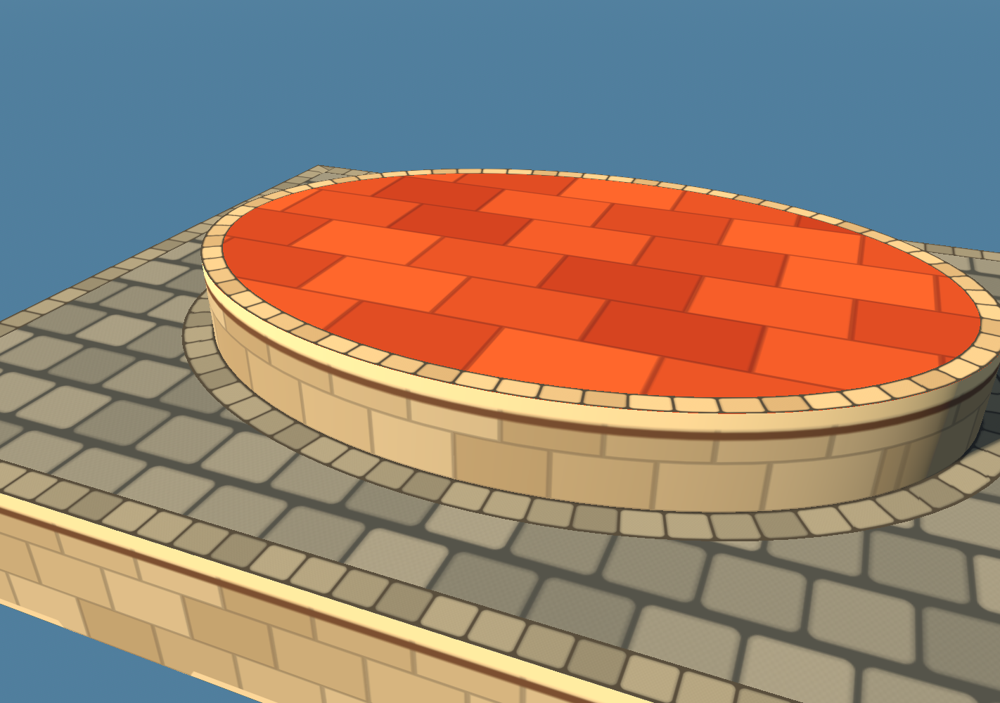
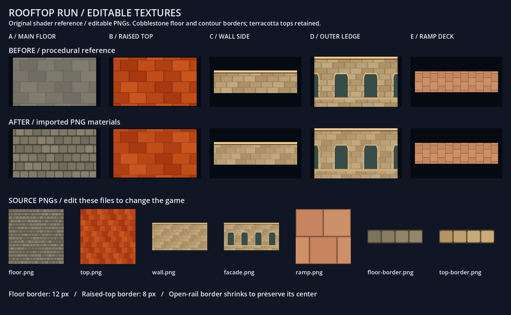
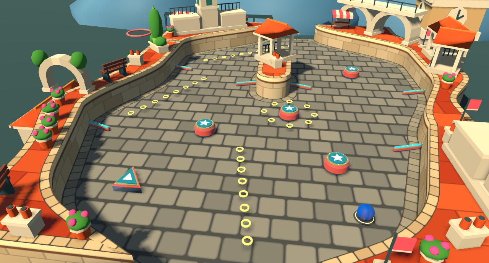

# Rooftop Run textures and curved cobblestone borders

Rooftop Run now uses seven editable PNGs for its terrain surfaces. The playable floor has warm, rounded cobblestones; raised surfaces retain terracotta tiles. Separate stone courses follow the floor route and the raised-top perimeter, including authored curves. Lighting, scenery, decor, physics and saved Act geometry retain their existing responsibilities.

## Editable files

All files live in `assets/textures/rooftop_run/`. Changing these PNGs and letting Godot reimport them changes the next game launch.

| Image | Use and mapping |
| --- | --- |
| [floor.png](../assets/textures/rooftop_run/floor.png) | 1024², sixteen staggered stone rows across a 4 × 4 world-unit repeat. Interior paving stays world-aligned. |
| [top.png](../assets/textures/rooftop_run/top.png) | 1024² terracotta tiles, 5 × 3.125 world-unit repeat. |
| [wall.png](../assets/textures/rooftop_run/wall.png) | 1024 × 512 sandstone and cornice; horizontal repeat spans 3.4 world units and the vertical strip spans 1.45 units downward from the cap. |
| [facade.png](../assets/textures/rooftop_run/facade.png) | Same layout with four arched bays, used below the deck. Brick spacing was adjusted slightly to make the bays and masonry share a seamless repeat. |
| [ramp.png](../assets/textures/rooftop_run/ramp.png) | 256² terracotta paving; existing route UVs repeat at 0.48 × 0.44 world units. |
| [floor-border.png](../assets/textures/rooftop_run/floor-border.png) | 512 × 128, four gray-tan stones along the contour; provisional width 12 physics pixels. |
| [top-border.png](../assets/textures/rooftop_run/top-border.png) | 512 × 128, four pale coping stones along the contour; provisional width 8 physics pixels. |

Borders bend their texture coordinates with the path. They fit a whole number of repeats around each closed contour, with a target repeat length of 48 physics pixels. Width is independent of length. Thin rails keep the existing reduced-width rule. Sharp corners use mitered/cut courses, and narrow junctions use a local tangent rather than stretching many stone repeats across a triangle. Colors, stone size, mortar contrast and border widths remain provisional art tuning.

The interior floor intentionally retains a flat world projection. Only the border courses turn along the path; the wall/facade uses normal-weighted world projection. No colliders, corner shapes, heights, routes or Act data are changed.

## Green Hill artifact fix

The reported dotted horizontal line was reproduced in the curved-wall study. The grass fringe's sampler repeated vertically as well as horizontally. Filtered samples could therefore pull the transparent bottom of the PNG into its bright top edge, despite clamping the coordinates before sampling.

The sampler now clamps at every mip level, repeats horizontally explicitly, and uses derivatives from unwrapped coordinates. The same sampling rule applies to the horizontal border textures and Rooftop facade strips. The cap-border mesh also subdivides long strips before assigning path coordinates and unwraps each closed contour seam locally. This removes interpolation through an entire perimeter and limits streaking where nearby branches meet. The fix did not require moving the border mesh or changing the physical surface.

[Before the fringe fix](rooftop-textures/green_hill-curve-before.png) · [After the fix](rooftop-textures/green_hill-curve.png) · [Shallow-angle check](rooftop-textures/green_hill-grazing.png)

## Actual game captures

The user's smoothed decorated Act was loaded from an isolated copy, with retro effects disabled and identical gameplay state preserved across theme switches. The source file was checked byte-for-byte after capture and was not rewritten or added to Git.

[Green Hill on the same Act](rooftop-textures/local-act-green_hill-detail.png) · [Rooftop overview](rooftop-textures/local-act-rooftop_run.png)

## Reproduce

Use the installed Godot 4 executable with `--path .`. Graphical tools need `--rendering-method gl_compatibility --rendering-driver opengl3_angle`.

- `--script res://tests/border_path_review.gd`: curved production-mesh study from close, overhead and shallow angles.
- `--script res://tests/rooftop_texture_review.gd`: original shader/material swatches plus the editable PNG sheet.
- `--script res://tests/rooftop_texture_scene.gd`: actual game, defaulting to the committed terraced Act. Append `-- --act=res://data/acts/YourAct.tres` for another saved Act.
- `--headless --script res://tests/terrain_border_regression.gd`: border area, containment, narrow rails, overlapping obstacles, clipping, closed-curve UV continuity and unchanged input geometry.

`tools/bake_rooftop_textures.gd` regenerates the initial PNGs only when explicitly run graphically with `-- --overwrite`. It overwrites painted edits, so ordinary tuning should edit the PNGs directly. Original recipes remain under `tools/texture_sources/`; no external assets were downloaded.

Border generation happens when loading or rebuilding presentation, not every frame. Dense smoothed Acts can still take several seconds to rebuild. The builder limits intersection searches to overlapping edge bounds, retains only active scanline edges, and removes redundant collinear samples from a private copy at its existing 0.0001-pixel numerical tolerance. Stored outlines and physics retain their original vertices. Further optimization of dense layouts remains separate from art tuning; no frame-rate improvement is claimed.

## Verification

Godot 4.7.2 on Windows: isolated editor import passed; border regression passed **226 checks**; theme runtime regression passed **716 checks** across seven committed themes; Rooftop authored-game integration passed **70 checks**. The material sheet, six-angle curved-surface study and actual-game captures completed without script/shader errors and were visually inspected. Theme changes preserve physics identities, scoring, camera and authored geometry; the local source Act remained byte-identical.

Final local-Act capture measured presentation switches at approximately **3.30 seconds for Green Hill** and **3.75 seconds for Rooftop Run**. These are rebuild timings on a heavily smoothed Act, not frame timings or cross-machine benchmarks. Tests used an isolated copy based on commit `9050ade` plus this change, preserving other chats' unfinished work. Local logs are under `test-results/rooftop-textures/`.
