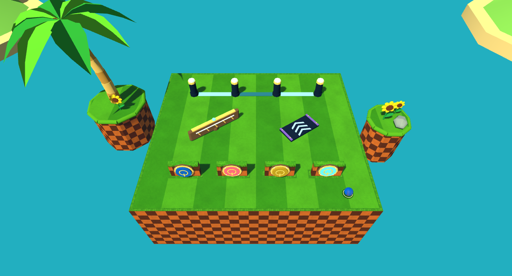

# Authored routing mechanics

Implemented 2026-10-27 in the existing Act Editor, authoritative 2D engine and themed presentation. Lane Barrier, Wall Switch, Diverter and Dash Panel use ordinary gameplay objects, stable IDs and per-object properties. Meshes remain collisionless; themes do not change behavior.

## Play and edit the sandbox

Load [Routing Mechanics — Switch, Divert, Light, Dash](../data/acts/routing_mechanics_sandbox.tres) through **Act Geometry Editor → Load** or the main game's **Load Act**. Save changes, then use **Reload Act / F5** in the main game. The same saved document works in both applications.

The lower court has two floor switches and a green wall switch on the left wall. Completing their bank awards 250 points and sets the routing arm to B. State A returns an upward shot toward the lower court; B redirects it toward the upper left. A center spring supplies a stronger climb alongside the ordinary flippers. Above the arm, four physical posts define three passing gaps. Each clean shot earns 100 points; lighting all three awards 750, then clears the lights after 0.5 seconds. The cyan dash panel accelerates the upper left lane toward the exit and ring trail.

This is an editable verification playground. Regression shots place the real ball at controlled starting positions to exercise each objective and compare the two routes. They do not establish that an unaided human can complete the entire layout; flipper timing, recovery shots and route difficulty still need playtesting.

## Authoring

Act width and height are editable in the **Cells** fields beside the Act name. Click **Resize** to apply both dimensions as one undoable edit. Existing terrain, objects, rings and decor retain their coordinates and scale; entry stays on the new bottom edge. A resize that invalidates terrain frames, connector spans, spawn or activation markers is rejected without deleting content. Gameplay objects remain permitted outside the terrain grid, as before. Save/reload preserves the dimensions.

The laptop build uses steering strength **0.05**, reduced from **0.10**, for Balanced, Floaty, Tails, Knuckles and Shadow. This halves acceleration and counter-steering rates before saturation; contribution limits and neutral momentum behavior are unchanged. **Light / half strength** reproduces the Balanced/Floaty default in the session preset menu; earlier comparison presets remain available.

All four palette entries use default grid snapping, **Alt** for free coordinates and exact numeric rotation. Rotation 0° faces up; 90° faces right. Moving or rotating a chain preserves its local post positions. Duplicating creates a fresh object ID.

| Tool | Controls and inspector |
| --- | --- |
| Lane Barrier | Click 2–12 posts, then **Enter**. **Escape / right-click** cancels the unfinished chain. Select the chain and enable **Edit posts**: drag a post; click appends; Shift-click inserts between the nearest neighboring pair; right-click removes a post while retaining at least two. Alt frees each placement or drag. One chain creation or post edit is one undo action. |
| Wall Switch | Place its anchor on the wall face. Point the arrow out into the playable space. It shares floor-switch colors, labels, score rewards, stable IDs, activation and banks. Only an approaching exposed-side contact presses it. |
| Diverter | Set length, base rotation, A/B angles and initial state. The two faint editor arms show possible routes; the solid arm shows initial state. It is level machinery rather than a player flipper. |
| Dash Panel | Set width, rotation, boost strength, directional influence (percent) and total speed cap. Cyan chevrons and a selected direction guide distinguish it from the circular spring. |

For banks, Ctrl-select floor and/or wall switches, then **Create Switch Bank**. The bank picker exposes each gate or diverter with explicit actions: **Open**, **Set A**, **Set B**, or **Toggle**. A target has one action per bank. Several banks may control the same target. The canvas draws these links. Deletion prunes links; undo restores the relationships.

Bank **Bonus** is a fixed score award. New banks default to 500 points and **Reset seconds = 0.75**; already-authored settings are preserved. Zero keeps one completion per attempt; a positive value clears member switches and rearms the bank after completion. A switch still overlapping the ball must be left before another press. Gates retain their open state, and diverters retain their selected state, until the ordinary run reset. Repeating a Toggle bank changes its arm each completion. This is a feature reset delay, not a scripting or timed-puzzle system. See [Act scoring](ACT_SCORING.md) for rack bonuses, Spinner Goals, traversal support and optional Act targets.

## Runtime behavior

`pinball_mechanics.gd` remains the single mechanic manager driven by the authoritative ball at 120 Hz. The existing analytic circle/capsule contact queries resolve front-facing wall switches and routing arms alongside gates and springs. Contacts are clipped by native terrain and processed in travel order. Diverters reflect the incoming normal with the shared wall restitution and retain tangential momentum.

### Passing lanes

Each post compiles into a real `CircleShape2D` on a native `StaticBody2D`. There is no invisible wall connecting posts. N ordered posts produce N−1 adjacent passing lanes, even when the chain bends or rotates. Posts may not overlap; gap width is an authoring/difficulty choice, not an automatic geometry repair.

`passing_lanes.gd` tracks actual travel between consecutive integration samples. It narrows the gap by post radius + ball radius + 0.5 px. A valid passage must enter from one side, remain clear of both posts through a 12 px deep strip, and leave the opposite side with the entire ball clear. High-speed segments can cross the whole strip in one step. Side entry, post clipping, spawning inside, resting and boundary vibration do not count. Teleports and rail travel clear the travel sample, preventing artificial connecting segments.

A successful lane latches until full departure. Either direction is valid. Each clean passage awards the configured integer score or ring amount (numeric authoring values are truncated to integers). With **Light All**, unique lane lights accumulate across separate shots and combos. Completing all lanes emits one fixed score bonus and a completion notification, flashes the chain, and suppresses further rewards during its reset delay. Lights then clear; departure latches remain effective. **Off** keeps per-passage rewards without a set bonus. Ring rewards add the configured ring quantity without clearing a ring rack, advancing a combo or charging a character special.

### Safe diverters

The arm is a swept capsule centered on the authored anchor, using the same free-flight response as the existing gate. A state request remains pending until the ball and its next motion segment clear a circle enclosing the arm's entire rotation sweep, plus the ball radius. Only then does the arm change state. The ball is never carried, teleported or given an extra launch impulse by a state change. A pending indicator turns amber. Repeated requests resolve against the latest requested state; two pending Toggles cancel.

### Dash velocity

Dash panels detect real swept entry into a rounded footprint. They modify velocity on the same ball without capturing it or changing its position. A 0.18-second cooldown and full-departure latch prevent overlap farming. Starting inside a panel does not count as an entry. A fast segment that enters and leaves between samples still registers.

Let `s` be incoming speed, `b` boost strength, `c` cap and `u` influence / 100:

```text
new_speed = min(s + b, c)
new_direction = incoming_direction rotated through u × shortest_angle_to_facing
new_velocity = new_direction × new_speed
```

Zero speed falls back to the panel's facing. At 100% influence the exact facing vector is used. Rotation on the unit circle avoids cancellation for opposite incoming directions. Below the safety cap, a faster aligned ball never loses speed. Default influence is 70%; default added speed is 350 px/s and cap is 2400 px/s. These remain provisional feel values. Subsequent gravity and shared collision responses still apply.

### Typed awards and feature completion

The old shared `scoring_tick(object_id, points)` signal is replaced by:

```gdscript
signal mechanic_score(kind: StringName, object_id: String, points: int)
signal mechanic_rings(kind: StringName, object_id: String, amount: int)
signal feature_completed(kind: StringName, object_id: String, bonus: int)
```

Current score kinds are `spinner`, `switch`, `lane`, `lane_set` and `switch_bank`. `Scorecraft.award_mechanic` preserves the source ID and kind in award details. Spinner alone retains its 25-point tick limit. Switches and feature bonuses receive their configured fixed awards, without combo refresh or special charge. `complete_feature` emits the score once and a separate notification, providing the same hook for future repeatable features. No future Buddy system or event graph is implemented.

Reset, drain, serve and reload restore authored diverter/gate states, clear switches and bank completion, clear lane progress, and reset dash latches. Pause freezes motion and feature timers. Reskins retain live state. Endless copies the physical posts with the Act offset, samples actual travel for every resident manager, and binds baked animation to that resident's state. Mutable light materials are private to each visual instance.

## Format 14

Objects retain `{object_id, type, position, rotation_degrees, properties}`.

| Type | Properties |
| --- | --- |
| `lane_barrier` | `points`: 2–12 ordered local `Vector2` positions; `post_radius`: 5–25 px; `reward_type`: `score` / `rings`; `lane_reward`: 0–1000; `completion_mode`: `off` / `light_all`; `completion_bonus`: 0–100000 score; `reset_delay`: 0.2–10 seconds. |
| `wall_switch` | Same `scale`, `color`, `label`, `score_reward` as floor switches. Rotation defines the exposed normal. Bank membership uses its stable ID. |
| `diverter` | `length`: 24–400 px; `state_a_angle` / `state_b_angle`: −180° to 180° relative to base rotation; `initial_state`: `a` / `b`. Capsule radius is 4 px. |
| `dash_panel` | `width`: 40–200 px; `boost_strength`: 0–2400 px/s added speed; `directional_influence`: 0–100%; `speed_cap`: 100–3000 px/s. |

Banks retain required `{bank_id, label, members, gates}` for legacy compatibility and may add `actions`, `completion_bonus` and `reset_delay`. Each action is `{object_id, action}` with a type-checked target and supported action. Legacy `gates` become `open` actions in the same runtime dispatcher. Duplicate action targets and arbitrary actions are rejected.

Formats 2–13 migrate in memory without rewriting source Acts. Older versions cannot silently contain new types or bank-action fields. Numeric scalars, angles and packed post positions use the existing exact byte-payload storage. Bank action fingerprints explicitly order their fields so text resource dictionary ordering cannot alter save validation. Save stages, reopens, validates and compares exact fingerprints before replacing a file. Runtime lights, progress, pending states and cooldowns are not persisted.

Derived Endless bakes from the previous pipeline become stale and require **Bake** again. This does not change the editable source geometry or automatically publish an Act to the Endless pool.

## Visual references and original models

Research used the [Dash Panel reference](https://sonic.fandom.com/wiki/Dash_Panel), including its Frontiers description of purple edging and cyan arrows, and [SEGA's Frontiers site](https://sonic.sega.jp/SonicFrontiers/). The [Sonic Adventure reference](https://sonic.sega.jp/SonicChannel/gametitle/SonicAdventure.html) supplies game context. No reference image was included with the pasted request; the lane interpretation follows its written post/gap description. No Sega assets or textures were downloaded or imported.

The original dash model has a dark inset chassis, violet side rails, bolts and three cyan chevrons. Barrier posts have octagonal mechanical feet, tall dark shafts and luminous crowns. Gap inlays distinguish inactive, lit and completed states. Wall switches reuse the existing colored plunger, power mark and activation glow, mounted vertically. Routing arms use timber/brass, industrial, chrome/neon, pale relic, icy metal or forge palettes and trim; their physics is identical.



[Chemical Plant](routing-captures/chemical_plant.png) · [Rooftop Run](routing-captures/rooftop_run.png) · [Casino Night](routing-captures/casino_night.png) · [Aquarium Park](routing-captures/aquarium_park.png) · [Sky Sanctuary](routing-captures/sky_sanctuary.png) · [Ice Cap](routing-captures/ice_cap.png) · [Lava Reef](routing-captures/lava_reef.png) · [Completed lane set / state B](routing-captures/complete.png).

## Verification

Godot 4.7.2. Commands below use `godot` as shorthand for the installed executable.

```text
godot --headless --path . --editor --quit
godot --headless --path . --script tests/gimmick_batch_regression.gd
godot --headless --path . --script tests/gimmick_batch_editor_regression.gd
godot --path . --script tests/gimmick_batch_regression.gd
godot --path . --script tests/gimmick_batch_editor_regression.gd
godot --path . --script tests/gimmick_batch_capture.gd
```

The batch suite covers lane counts, native post rebound, complete swept passages and rejection cases, repeated set/ring rewards, paused timers, front/back wall impacts, all bank routing actions, both arm collisions, overlap/incoming-sweep transition deferral, dash blending/latching/high-speed entry/caps, exact save/reopen in a fresh process, reset/reload, all eight themes, streamed colliders/offsets, private baked light materials and the sandbox route. Editor checks cover gestures, undo, persistence, relationships and deletion cleanup.

Results: **100 batch runtime checks**, **19 batch editor checks**, **90 earlier gimmick runtime checks**, **25 earlier editor checks**, **29 Scorecraft checks**, **788 Endless planning/compiler checks**, and **127 warmed-node reuse checks** passed. The batch runtime/editor suites were run both headless and graphically; the final graphical runtime run includes the two explicit sandbox route comparisons. Headless editor import and main-game startup with the saved sandbox succeeded. All eight hardware galleries and the completed-state capture were rendered and inspected. Godot MCP's launch did not retain a process; the graphical verification used the installed local executable instead.

The existing pinball composition suite has one failing ordinary flipper-route check; the same failure and ball position reproduce on an isolated untouched `HEAD`. Its other 41 checks pass. It is a pre-existing layout/tuning issue; tests and physics were not weakened to hide it. Concurrent art work emits raw texture-loading export warnings in the working tree; this batch does not alter that work.

Manual checklist: judge flipper recovery and access to every gap; inspect wall-facing readability under the preferred camera/filter stack; tune dash influence and route speeds; confirm the sandbox's full objective feels fair with ordinary controls.
