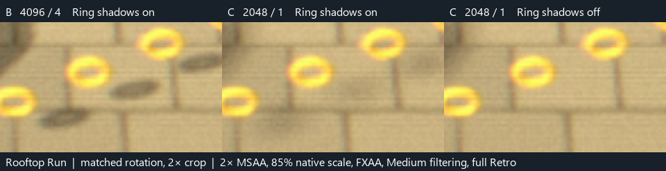

# Directional shadows on UHD 620

Use **B** for the next UHD 620 review. It combines the human-approved Retro presentation with denser shadows for small moving casters. **C** is the lower-cost comparison. These measurements used the earlier A production profile. The current defaults use a 4096 atlas, four cascades, FXAA, 2× MSAA and 100% scale. [Current settings and comparison](DEVICE_SHADOW_QUALITY.md) The outstanding decision is whether B meets the laptop's Endless preparation and transition requirements.

## Evidence from the frozen build

Alex supplied these UHD 620 measurements and visual observations. The automated runs and interactive Lab used different workloads.

| Automated Forward+/Vulkan case | Stationary | Movement and preparation |
| --- | --- | --- |
| Production, 8192/4, 4× MSAA, 100% | Prototype 38.2 ms, Endless 37.8 ms | Endless tour about 40–41 ms. Next-Zone preparation could miss its deadline. |
| Shadow-light, 2048/1, 4×, 100% | About 40–50 FPS depending on phase | Lower shadow cost alone left substantial frame time. |
| Balanced, 2048/1, 2×, 85%, full Retro | About 16.3 ms steady | Transition preparation succeeded. Disabling Retro was markedly slower. N64-only performed similarly to full Retro. |

Human review passed Balanced in motion. Tiny rotating Ring shadows occasionally shimmered. A separate single-Act Lab trial reached about 50–60+ FPS at 4096/4, 2×, 85%, FXAA on, Ultra off. Mobile retained preparation failures. Compatibility had severe warm-up stalls. The new matrix keeps Forward+/Vulkan and the full N64-ish + VHS + CRT stack in every case.

## Matched desktop benchmark

Godot 4.7.2, RTX 4060, Vulkan, uncapped 1280 × 900. The canonical Prototype loads one disk-baked Act. Endless uses its normal streaming implementation with a deterministic Rooftop Run → Chemical Plant course. All cases use the same seed, Act, camera path and Default atmosphere within each runtime.

Each cell gives **first / repeat**. Each pair starts a new process twice. The first has a fresh Godot user cache. Its repeat reuses that cache. Windows and NVIDIA driver caches were available throughout. Startup measures scenario opening to runtime readiness. Stationary and movement are median wall-clock milliseconds per frame after preparation. Prototype sweeps its camera through the Act. Endless tours at 100 table pixels/s. The CSV also includes the 400 px/s tour, P95 timings, overlap, shader-phase peaks, fallback and teardown results. [All 18 case rows](shadow-review/rtx4060.csv)

| Runtime | Profile | Startup, s | Stationary, ms | Moving, ms | Next Zone ready after startup, s |
| --- | --- | ---: | ---: | ---: | ---: |
| Prototype | A · 8192/4, 4×, 100%, Medium | 7.35 / 5.14 | 2.35 / 2.65 | 2.27 / 2.46 | Single Act |
| Prototype | B · 4096/4, 2×, 85%, Medium + FXAA | 7.04 / 5.15 | 2.19 / 2.34 | 2.20 / 2.32 | Single Act |
| Prototype | C · 2048/1, 2×, 85%, Medium + FXAA | 7.28 / 5.21 | 2.03 / 2.08 | 2.01 / 2.10 | Single Act |
| Endless | A | 6.06 / 4.02 | 3.27 / 3.24 | 4.52 / 4.50 | 3.08 / 2.66 |
| Endless | B | 5.96 / 4.32 | 3.36 / 3.87 | 4.57 / 4.76 | 3.31 / 2.67 |
| Endless | C | 5.86 / 4.14 | 2.75 / 3.00 | 4.13 / 4.27 | 2.85 / 2.22 |

### Isolated filter and FXAA comparison

Endless at 4096/4, 2× MSAA and 85% for every row. B also serves as the FXAA-only cell.

| Directional filter | FXAA | Startup, s | Stationary, ms | Moving, ms |
| --- | --- | ---: | ---: | ---: |
| Medium | Off | 5.73 / 3.81 | 3.19 / 3.17 | 4.52 / 4.48 |
| Medium | On | 5.96 / 4.32 | 3.36 / 3.87 | 4.57 / 4.76 |
| Ultra | Off | 14.61 / 3.90 | 3.30 / 3.11 | 4.57 / 4.42 |
| Ultra | On | 5.95 / 4.28 | 3.26 / 3.70 | 4.49 / 5.07 |

The Ultra-only first run was the outlier. It also took 8.39 s after startup to prepare the next Zone, versus 2.23 s on repeat. Every pair started faster on repeat. Across A/B/C in Endless, maximum observed startup frames during shader warm-up fell from 14.6–28.2 ms on first runs to 9.4–11.7 ms on repeats. These are frame intervals during an instrumented stage. Other work can share a frame. One pair per configuration cannot establish a stable UHD filter cost.

All 12 Endless runs prepared the next backdrop and entry Act within the 180 s limit and crossed the first Zone boundary with zero boundary-wait frames. Overlap P95 was 5.42–7.35 ms across the twelve crossings. This test waits for preparation before timing the crossing. Each of the 18 runs reported zero runtime fallback builds, zero surviving watched project owners and zero orphan nodes after teardown.

## Ring shadows in motion

The diagnostic toggles casting on the actual collectible mesh instances and restores their individual casting modes. Ordinary play keeps the original casters. The animation below uses 24 evenly spaced poses over half a rotation from disk-loaded Prototype. A fixed camera, lighting and Retro stack isolate the change. The third panel shows the same C image with collectible casting off.

For the row of seven Rings, the largest adjacent-pose change in total shadow darkness was **12.0%** of mean darkness at B and **19.1%** at C. The calculation sums positive off-minus-on 8-bit luminance in the same rectangle (x 620–999, y 350–519) of each 1280 × 900 image. Rotation itself changes projected area. This measures visible changes in shadow strength, including that real motion. B reduced the fluctuations in this view. A live UHD comparison is still needed to judge occasional flicker under a moving camera.

## Running the portable review

1. Extract the complete ZIP to a writable folder. Double-click **Shadow Review.cmd** and choose **1**. The bundled executable opens the live Shadows tab at B with the theme's Default loaded.
2. Keep the same Act, camera and atmosphere. Zoom onto a Ring row, switch B/C, then toggle **Ring shadows (review only)**. The Rings continue rotating. Scroll down to switch **FXAA** and **Ultra shadow filter** independently. The status gives actual viewport AA/scale and light cascades, plus the atlas and filter submitted to Godot.
3. Use **Shadow blur** at 1.00, 1.25 and 1.50 with sun angular size at 0°. Try direct sun and a diffuse theme. Use **Save Variant** only to author a change in the extracted copy. Regular device controls save to the machine profile in the ordinary Lab. The review's device changes last for the live session.
4. Close the Lab. Choose **2** for the paired Prototype and Endless matrix. Send the case folders and `status.txt` under **Results/Shadow-…**. The `cache-*` folders contain local caches and can be omitted. Each case retains its engine log, effective settings, per-phase frame distributions, pipeline counters, startup checkpoint and teardown. A failed case remains visible.

The launcher uses CMD and the bundled engine. The developer-side `tools/summarize_shadow_review.py` reads a returned Results folder and writes the comparison CSV. [Device settings, migration and engine API](DEVICE_SHADOW_QUALITY.md)

## Regression verification

The device suite passed 164 checks on Vulkan, two fresh-process persistence checks and eight live review checks, including rotation and Ring caster restoration. The all-theme Lab passed 1,176 checks. Other passing suites covered 672 atmosphere-default checks, 461 variant checks, 90 runtime checks, 21 Lab-to-Prototype checks, 71 pixel-quality checks and the packaged atmosphere registry.

Prototype passed 162 run checks, 258 variable-run checks and 264 rendered checks across three atmosphere transitions. The initial run encountered a busy Windows clipboard during its telemetry-export assertion. The same test passed on retry. Endless passed 845 core checks, 72 retirement checks and 30 manifest checks. Both eight-theme bake audits passed 566 checks across 56 variants each. The extracted review package passed all 98 bake-freshness checks for the seven grounding-review themes.

Grounding controls and the streaming lifecycle exercise both passed. Several standalone regression processes reported an ObjectDB warning at engine shutdown, including the grounding lifecycle exercise. Its explicit teardown recorded one root node before and after, zero orphans and zero surviving watched owners. All 18 benchmark processes exited without an engine error or warning.

The Windows review ZIP passed CRC verification and all 4,166 extracted files matched the staged build byte-for-byte. The extracted CMD launcher opened the live Forward+ Lab and exited normally. The ZIP's SHA-256 is `3e857f45d259c47b29b25e0325eed668a139c973fa73562593dd479ef0771355`.
