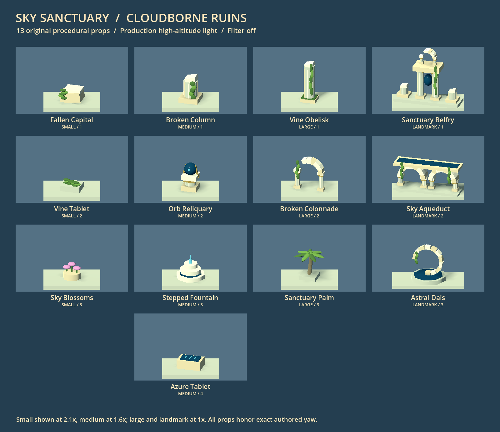
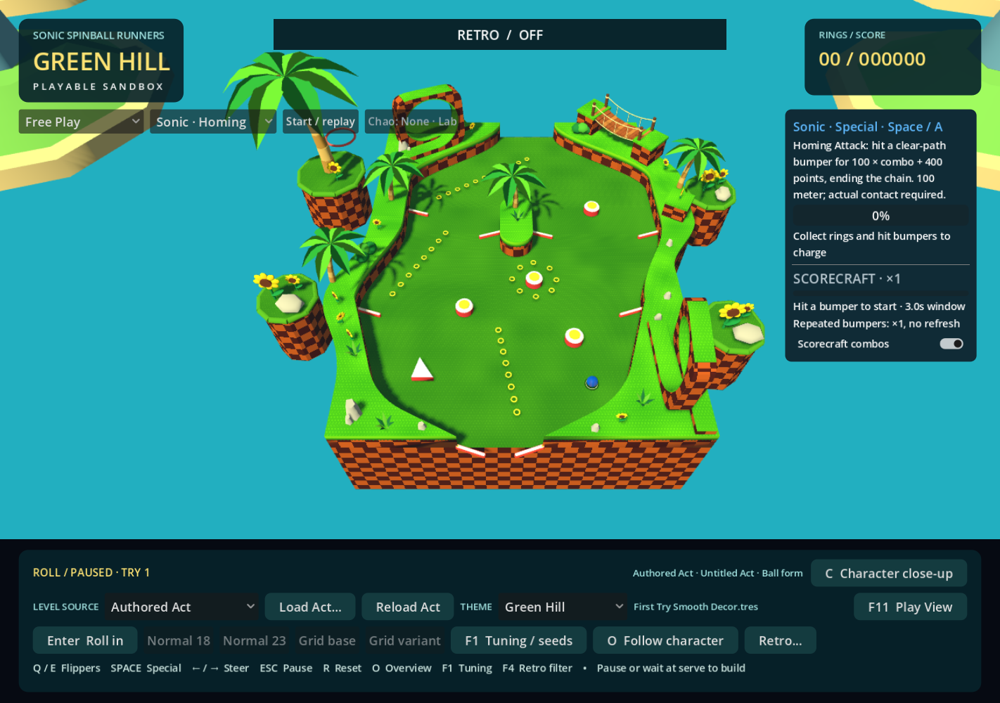
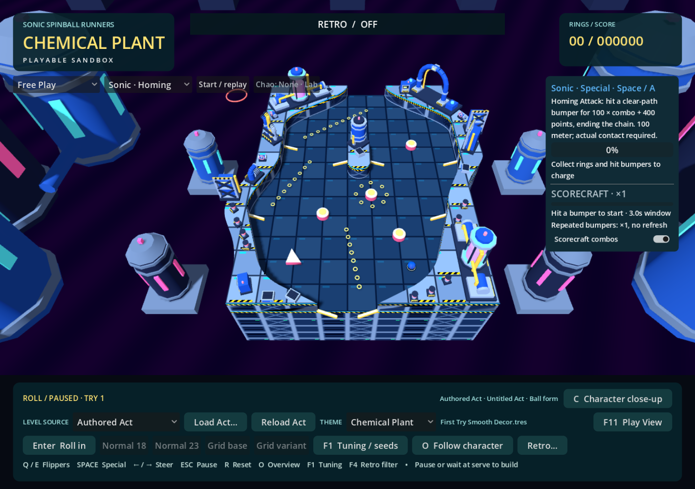
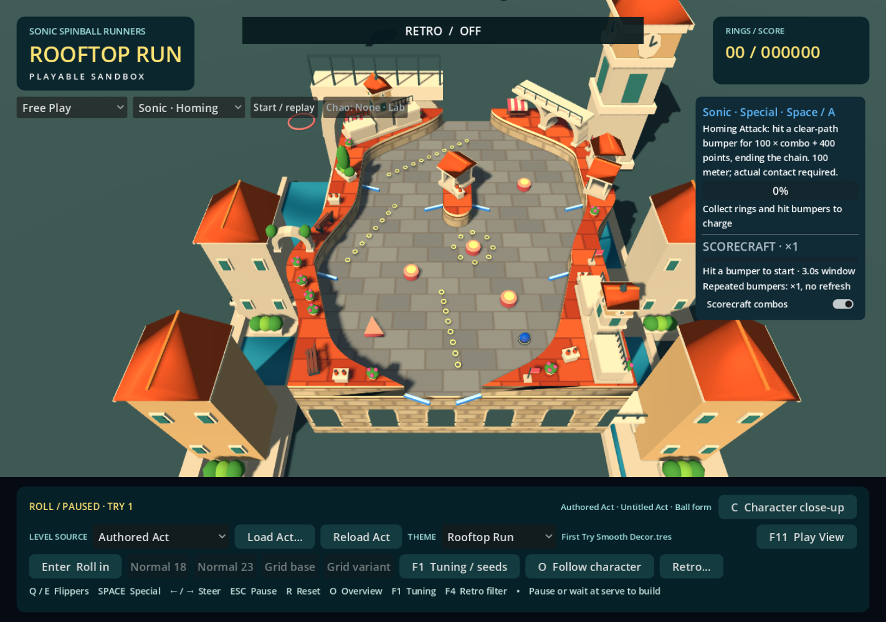
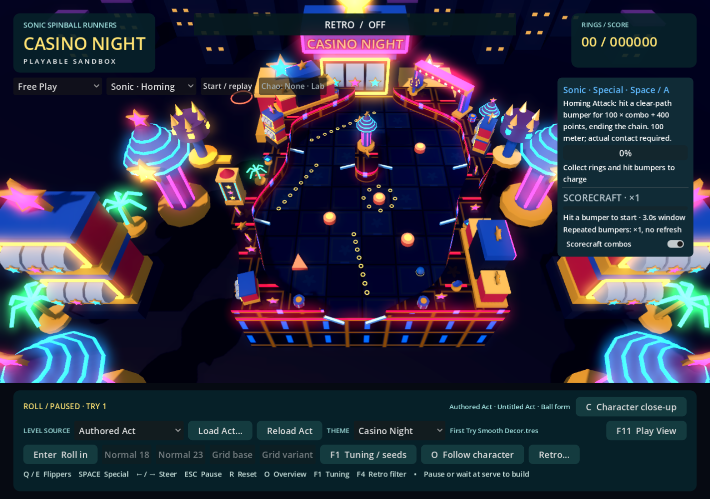
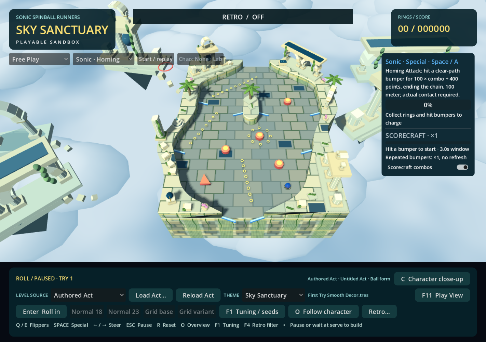
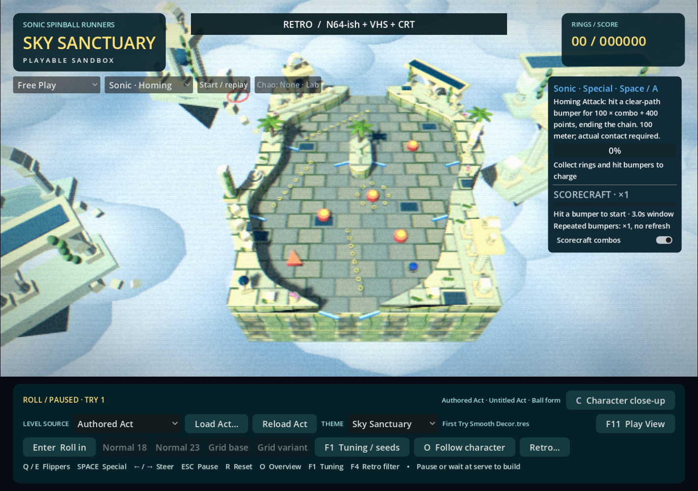
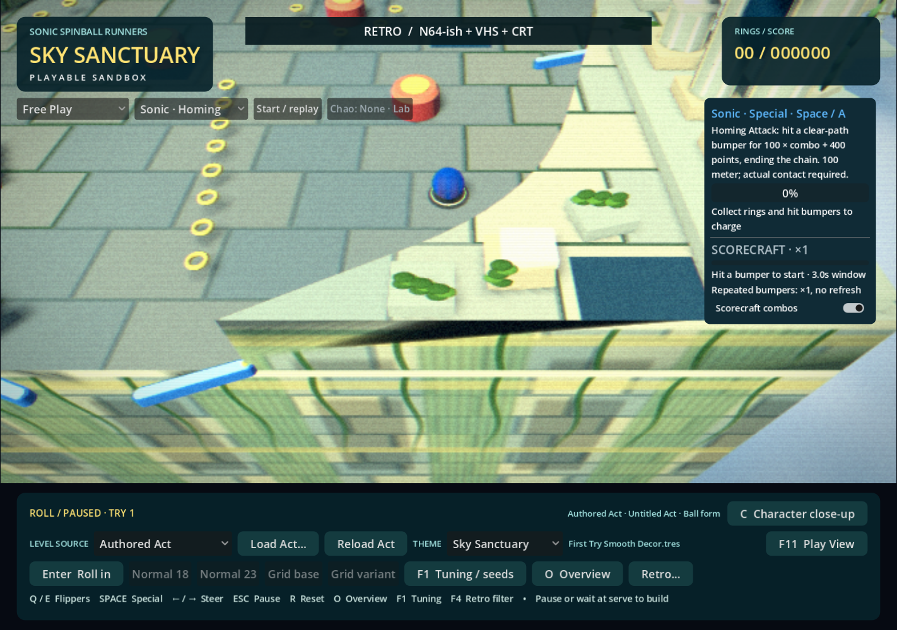
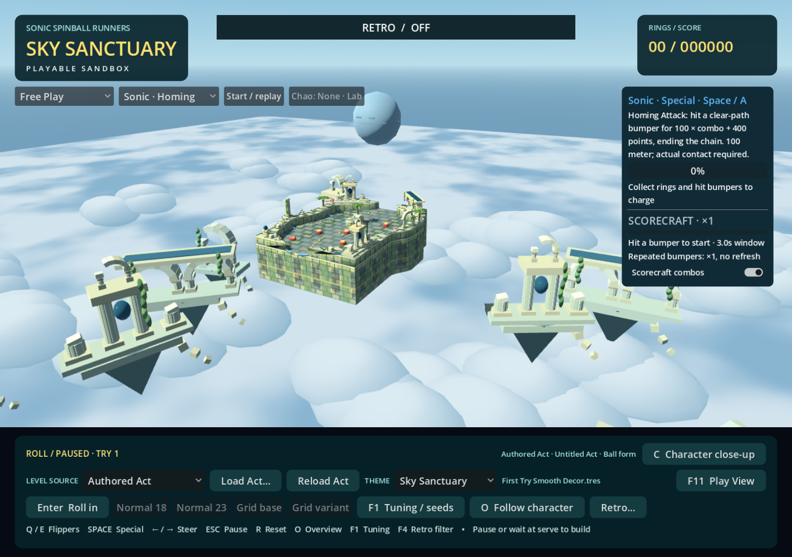

# Sky Sanctuary visual theme

Implemented 2026-10-25. Select **Sky Sanctuary** in the existing Theme dropdown in Play Green Hill. The Act Editor also lists the library through its existing theme preview selector. The same authored Act, collision geometry, rings, gameplay objects, camera settings and decor slots are retained. No external assets are required.

## Visual research

### Sonic & Knuckles / Sonic 3 & Knuckles

The classic visual language is unusually architectural: yellow/lime masonry, green ribbed columns, pale cornices, narrow spans, hanging vines and repeated cloud bands. Negative space beneath the structures matters as much as their shape. The directly inspected [classic screenshot](https://cdn.staticneo.com/w/sonic/SkySanctuaryZone.png) shows the layered blockwork, vegetation crossing the lip, tall posts and cloud silhouettes particularly clearly. [Zone: 0's level guide](https://www.soniczone0.com/games/sonicandknuckles/skysanctuary/) also documents tapering tower bases, fountains, sphere-topped ornaments and the ascending Death Egg.

### Sonic Generations

The remake makes the ruins much larger and deeper: pale stone colonnades, broken arches, layered terraces, palms and hanging vegetation occupy multiple distances. The directly inspected [Modern screenshot](https://www.powersonic.com.br/games/novos/media/generations/skysanct2.jpg) shows dark blue inset paths alongside pale structural borders, with low cloud banks swallowing the lower architecture. The [stage description](https://sonic.fandom.com/wiki/Sky_Sanctuary_%28Sonic_Generations%29) identifies glass bridge floors with technological patterns. The [Classic screenshot record](https://www.mobygames.com/game/54053/sonic-generations/screenshots/windows/559002/) explicitly identifies the distant ascending Death Egg.

Research access limits: the classic tile-sheet host and MobyGames gallery presented verification screens. Full-map access through [The Sonic Center](https://www.soniccenter.org/maps/sonic_%26_knuckles) stalled. Search/index descriptions of those sources informed cross-checks; their full-resolution tile/map pixels were not inspected. No verification screens were bypassed and no Sega textures, sprites, models or reference files were added to the repository.

### Our interpretation

The strongest retained motifs are carved masonry, fluted columns, broken arches, hanging greenery, blue inlays and open air beneath structures. Cool gray-green playable slabs are deliberately darker than cream raised terrain and pale blue clouds. Warm/cool variation is deterministic, with restrained moss in selected joints. The wall shader uses world-space block courses, recessed panels, pilaster ribs, cornices and vine traces on arbitrary authored contours; it does not change geometry or collision.

Clouds use a remote procedural cloud deck plus 180 rounded low-poly lobes batched into a MultiMesh. Soft analytic lighting keeps their highlights bounded without volumetric-fog dependencies. Ten floating ruin groups use tapered undersides, detached rubble, asymmetry and distance-tinted materials. Background stone is also batched by shared mesh/material. There is no ocean, ground terrain or cloud collision. The original orbital relic is a subdued faceted sphere with an equatorial belt and small recessed eyes, most visible from the optional wide study camera.

Fine sculpture, realistic erosion and complex foliage are simplified into broad primitives. New motifs include an orb belfry, a broken astral ring on a blue dais, and a stepped fountain with an abstract cyan spout. Blue technology is opaque and reflective for stable sorting/readability; it suggests glass without transparent gameplay floors. Existing elevated rails receive blue-gray deck panels, pale stone edges/supports and cyan accents. An authored one-way gate does not exist in this revision, so no new gate mechanics or presentation branch was introduced.

## Original decor library

Each number is the user-facing fixed variant index. Surface, edge and either hints share the same ordered library. Auto uses the existing deterministic resolver. Landmark Auto retains the cross-theme upright/span roles; the circular third variant remains explicit.

| Size | Variant | Why it belongs |
| --- | --- | --- |
| Small 1 | Fallen capital | Broken architectural detail without hiding play |
| Small 2 | Vine tablet | Low vegetation with an unmistakable stone base |
| Small 3 | Sky blossoms | Sparse purple color relief inspired by garden-like ruins |
| Medium 1 | Broken column | The simplest readable ancient silhouette |
| Medium 2 | Orb reliquary | Classic sphere-on-pedestal motif, reinterpreted as technology |
| Medium 3 | Stepped fountain | Classic fountain idea expressed as tiered stone |
| Medium 4 | Azure tablet | A compact, restrained blue technological accent |
| Large 1 | Vine obelisk | Vertical fluting, weathered cap and long vegetation |
| Large 2 | Broken colonnade | Open architecture with an incomplete arch |
| Large 3 | Sanctuary palm | Generations vegetation rooted in a masonry planter |
| Landmark 1 | Sanctuary belfry | Tall centerpiece on the shared 3-by-1-cell base |
| Landmark 2 | Sky aqueduct | Two open arches and a blue bridge inset across the shared long footprint |
| Landmark 3 | Astral dais | Broken circular ornament within the shared 1.6-cell round footprint |

## Same-Act comparison and filters

These five captures use the same local **First Try Smooth Decor.tres**, paused ball state, unchanged Act fingerprint and overview camera. That user-owned local Act remains untracked and was not rewritten. The committed `decor_terraces.tres` also has a reproducible comparison set in the local test results.

| Green Hill | Chemical Plant |
| --- | --- |
|  |  |

| Rooftop Run | Casino Night |
| --- | --- |
|  |  |

## Verification

- Godot 4.7.2 headless editor import passed. An earlier attempt caught transient mixed indentation in concurrently edited `game.gd`; the subsequent import and runtime checks passed after that file was corrected.
- `sanctuary_decor_regression.gd`: 95 checks, zero failures. All 13 props, all hint pools, fixed/Auto/fallback resolution, shared primitive resources and exact supported placement.
- `landmark_theme_regression.gd`: 243 checks, zero failures across five themes. Fixed order, deterministic shared roles, centered long/circular bounds and collisionless finite geometry. Its graphical sheet now grows with the registry.
- `theme_runtime_regression.gd`: 522 checks, zero failures, including a separate-process deterministic restart. Authored/generated theme switches retain live engine identities, physics, scoring, ball/ring state, camera and source data; the entire presentation remains collisionless.
- `ramp_height_theme_regression.gd`: 43 checks, zero failures. Sky Sanctuary retains the existing rail route and ball/mechanics identities; clearance validation remains shared.
- Graphical ANGLE production-engine captures: 13 views each for the committed terraces Act and the local smooth decorated Act, plus the 13-prop sheet. Filter OFF and the production N64-ish + VHS + CRT stack were inspected. Capture manifests assert matching camera, ball and fingerprint and verify unchanged source bytes. No shader/runtime errors were emitted by the final capture runs.
- The normal graphical main scene also completed a 180-frame startup smoke run with `--theme=sky_sanctuary --act res://data/acts/decor_terraces.tres` and an empty error log. This is startup verification, not a manual flipper-feel test.
- Local smooth-Act measurements: 1,425 total draw calls in overview, 927 in follow, and three additional calls for the filter stack. These are whole-frame diagnostics on this machine, not an FPS benchmark or Android performance claim.

Reproduce with the installed Godot console executable and `--path . --headless --script res://tests/sanctuary_decor_regression.gd`. For captures, use `--rendering-method gl_compatibility --rendering-driver opengl3_angle --script res://tests/sanctuary_capture.gd -- --act=res://data/acts/decor_terraces.tres --city-study`; the capture script defaults to both committed decorated examples if no Act is specified. `sanctuary_library_capture.gd` produces the library sheet. Logs, full-size images and manifests live in ignored `test-results/sanctuary-review/`.

Human review remains useful for moving-ball readability, wall texture scale and background density during camera travel. No gameplay tuning or feel changes were made.
