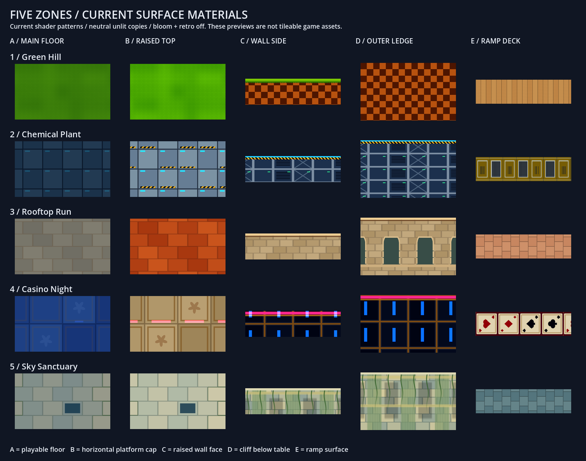

# Surface catalogue — all five zones

These are the current procedural material patterns, not imported texture images. The previews use private unlit copies of the production shaders, with bloom and retro filtering disabled, so lighting does not obscure the patterns. Emission is added to the preview color and clamped so luminous inserts stay visible without halos. Game appearance also depends on zone lighting, shadows, bloom and the retro stack. No production material or geometry changes are made by this catalogue.



## Reference labels

- **A / Main floor:** the horizontal playable table (`floor_material`).
- **B / Raised top:** the horizontal cap of platforms, solid terrain and narrow authored rails (`top_material`). A platform's horizontal ledge surface is also B.
- **C / Wall side:** vertical faces of raised terrain (`side_material`), including the existing upper lip or trim.
- **D / Outer ledge:** the deep cliff/facade below the table perimeter (`cliff_material`).
- **E / Ramp deck:** the independent elevated-rail surface (`ramp_materials().deck`). Included for completeness.

Rows are 1 Green Hill, 2 Chemical Plant, 3 Rooftop Run, 4 Casino Night, 5 Sky Sanctuary. Feedback can use labels such as **4B: less yellow**, **2A: lighter**, or **3C: larger bricks**. Flat samples show pattern detail rather than full in-game geometry; C is a 0.65-unit-high study, D is 1.45 units, and E uses a 0.6-unit-wide straight deck.

## Individual previews

| Zone | A: floor | B: raised top | C: wall side | D: outer ledge | E: ramp |
| --- | --- | --- | --- | --- | --- |
| 1 Green Hill | [Grass](surface-catalog/green_hill-floor.png) | [Brighter turf](surface-catalog/green_hill-top.png) | [Checker soil + grass fringe](surface-catalog/green_hill-wall.png) | [Checker cliff](surface-catalog/green_hill-ledge.png) | [Wood boards](surface-catalog/green_hill-ramp.png) |
| 2 Chemical Plant | [Dark steel plates](surface-catalog/chemical_plant-floor.png) | [Steel + hazard marks](surface-catalog/chemical_plant-top.png) | [Industrial panels + cyan rim](surface-catalog/chemical_plant-wall.png) | [Deep industrial panels](surface-catalog/chemical_plant-ledge.png) | [Yellow/gray service panels](surface-catalog/chemical_plant-ramp.png) |
| 3 Rooftop Run | [Warm paving](surface-catalog/rooftop_run-floor.png) | [Terracotta tiles](surface-catalog/rooftop_run-top.png) | [Sandstone + cornice](surface-catalog/rooftop_run-wall.png) | [Arched facade](surface-catalog/rooftop_run-ledge.png) | [Brick paving](surface-catalog/rooftop_run-ramp.png) |
| 4 Casino Night | [Cobalt inlays](surface-catalog/casino_night-floor.png) | [Ivory/gold inlays](surface-catalog/casino_night-top.png) | [Navy/gold + neon rim](surface-catalog/casino_night-wall.png) | [Deep neon facade](surface-catalog/casino_night-ledge.png) | [Playing cards](surface-catalog/casino_night-ramp.png) |
| 5 Sky Sanctuary | [Limestone + blue tablets](surface-catalog/sky_sanctuary-floor.png) | [Pale limestone](surface-catalog/sky_sanctuary-top.png) | [Carved stone + vines](surface-catalog/sky_sanctuary-wall.png) | [Deep ruin facade](surface-catalog/sky_sanctuary-ledge.png) | [Blue-gray stone paving](surface-catalog/sky_sanctuary-ramp.png) |

## Editable sources

| Zone | Floor and raised top | Wall and outer ledge | Ramp |
| --- | --- | --- | --- |
| Green Hill | [green_hill_theme.gd](../scripts/themes/green_hill_theme.gd): embedded `GRASS_SHADER`; `raised_turf` selects B | Same file: `WALL_SHADER` for C; `CLIFF_SHADER` for D | [ramp_deck.gdshader](../scripts/themes/ramp_deck.gdshader), wood mode; colors in `green_hill_theme.gd::ramp_materials()` |
| Chemical Plant | [chemical_floor.gdshader](../scripts/themes/chemical_floor.gdshader), `raised_surface` selects B | [chemical_wall.gdshader](../scripts/themes/chemical_wall.gdshader), `top_height` locates the rim | [chemical_ramp_panels.gdshader](../scripts/themes/chemical_ramp_panels.gdshader) |
| Rooftop Run | [rooftop_paving.gdshader](../scripts/themes/rooftop_paving.gdshader), `raised_surface` selects B | [rooftop_masonry.gdshader](../scripts/themes/rooftop_masonry.gdshader), `facade` enables D's arches | [ramp_deck.gdshader](../scripts/themes/ramp_deck.gdshader), stone mode; colors in [rooftop_run_theme.gd](../scripts/themes/rooftop_run_theme.gd) |
| Casino Night | [casino_floor.gdshader](../scripts/themes/casino_floor.gdshader), `raised_surface` selects B | [casino_wall.gdshader](../scripts/themes/casino_wall.gdshader), `top_height` locates the rim | [casino_ramp_cards.gdshader](../scripts/themes/casino_ramp_cards.gdshader) |
| Sky Sanctuary | [sanctuary_floor.gdshader](../scripts/themes/sanctuary_floor.gdshader), `raised_surface` selects B | [sanctuary_wall.gdshader](../scripts/themes/sanctuary_wall.gdshader), `top_height` locates the lip | [ramp_deck.gdshader](../scripts/themes/ramp_deck.gdshader), stone mode; colors in [sky_sanctuary_theme.gd](../scripts/themes/sky_sanctuary_theme.gd) |

For each material, useful tuning targets are base/alternate colors, pattern size, seam width/contrast, motif density, roughness and emission. Main and raised surfaces currently share a shader with a boolean branch; changing their common pattern scale affects both. C and D also usually share code, with different height/facade settings. The preview PNGs are references; editing them does not change the game.

## A separate top-edge texture

**Yes, this is feasible.** A narrow border on the horizontal cap can follow the real platform perimeter and meet the existing vertical ledge trim. This is distinct from repeated tile borders: it must follow the authored contour, including curves and concave corners.

Current implementation: C/D contain height-based vertical lips in their shaders. Generated land also has a narrow solid-color edge lip, while authored floor generation disables that generic lip. There is no independently styled horizontal top-border material in the theme contract yet.

Proposed border directions, pending visual selection:

| Zone | Horizontal border idea |
| --- | --- |
| Green Hill | Darker grass fringe with short blades |
| Chemical Plant | Steel rim with sparse yellow/black hazard sections |
| Rooftop Run | Pale sandstone coping around the terracotta cap |
| Casino Night | Gold frame with a thin pink neon inset |
| Sky Sanctuary | Worn pale-stone coping with occasional moss |

Implementation would add an optional per-theme border material and width, then render a narrow inset strip from the same final terrain outlines. Width must shrink or skip where narrow rails or tight corners cannot fit it. It should remain collisionless and leave the exact gameplay boundary, top height and ramp route intact. This catalogue only documents that extension; it does not add the border to the game.

## Reproduce

Run `tests/theme_surface_capture.gd` with the graphical Godot Compatibility renderer. It writes 25 individual swatches and `surface-catalog/all-surfaces.png`. The generated PNGs are checked in for discussion; `.gdignore` prevents importing them as game textures.

Verified with Godot 4.7.2 GL Compatibility/ANGLE: 25 swatches and one sheet saved, zero capture failures, no script/shader errors. The final sheet was visually inspected. No gameplay tests were rerun because this adds only a capture tool and documentation.

```powershell
& 'C:\Program Files\Godot\Godot.exe' --path . --rendering-method gl_compatibility --rendering-driver opengl3_angle --script tests/theme_surface_capture.gd
```
