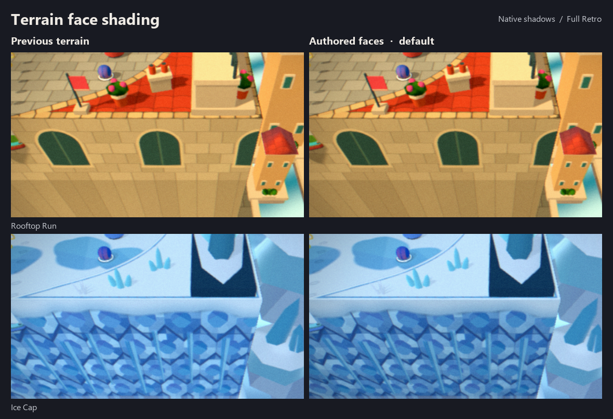

# Terrain face shading

Prototype and Endless use **authored terrain faces, native directional shadows and full Retro** by default. The front of a raised lane gets gradually darker toward its foot. The top stays bright, which keeps the lip readable as the camera moves. The face tone belongs to the geometry and follows it around the course.

Both columns use the same camera, atmosphere, filtered shadows and complete N64-ish, VHS and CRT stack. Each row shows **First Try Smooth Decor** in the actual disk-backed Prototype. [All eight themes at the gameplay camera](terrain-face-shading/eight-themes.jpg)

Watch the thin Ring shadows and the broad masonry as the camera comes down toward the front wall. The left half uses native shadows, the right uses Clean 8. The camera and Ring rotation are matched over 90 frames with simulation held. [Rooftop comparison in motion, 3 seconds](terrain-face-shading/rooftop-pan.mp4)

## Try it

1. Launch **Play Prototype.cmd** or **Play Endless.cmd** for the default look. In a fresh source checkout, run **Bake Prototype.cmd** and **Bake Endless.cmd** to build the current disk recipes.
2. Open **Atmosphere Lab.cmd → Shadows → Device Quality**. Toggle **Authored terrain faces** to inspect the exposed sides of the course. Leave it on for the selected look.
3. Enable **Clean 8 shadow gradient** for eight clean tones across the existing soft directional shadow. The control is available in Forward+. Both preferences save on this device and apply on the next game launch. The Lab preview updates immediately. [Device settings](DEVICE_SHADOW_QUALITY.md)

The Shadow Lab keeps the 8-, 4-, 3- and 2-level studies and ordered dither. The latter is a modern Saturn/Dreamcast-inspired treatment. The AO Lab retains the original unshaded-face reference, native SSAO and authored comparison. [Shadow Lab](RETRO_SHADOW_LAB.md) · [AO Lab](RETRO_AO_LAB.md)

## Rendering

The source presenter and offline baker prepare an opaque terrain material with its local height range. Its shader evaluates the geometric normal and height before normal-map detail, then combines the result with the material's existing ambient occlusion. Strength is 0.62, matching the reviewed Lab setting. Direct light, highlights and emission keep their authored response. Scenery, transparent meshes, characters, Rings and moving objects retain their existing materials.

The default path renders the terrain in its usual opaque pass. The face switch changes a global shader parameter. The optional Clean 8 path uses a separate receiver pass for the key light's diffuse shadow on eligible terrain. Its transition thresholds have no spatial pattern.

Ice Cap, Sky Sanctuary, Lava Reef and Aquarium Park feed a local color into their border shaders. The baker now prepares this form of the trim adjustment as well. Those borders keep their live edge-color controls and reuse their disk programs when an Act opens.

## Verification

Godot 4.7.2, Windows, Vulkan Forward+, RTX 4060. Captures use the Lab's Profile B at 1280 × 900, 85% native 3D scale, 2× MSAA, FXAA, a 4096 atlas and four cascades. Timing samples came from integration runs sharing the machine with local bake and regression work.

- In all eight themes, the default face shading matched the reviewed AO Lab treatment pixel for pixel at the held gameplay pose. Each Act loaded all seven eligible receivers from the shared shader bank. Switching back from Clean 8 restored the native image exactly.
- Enabling the prepared face shading took 0.036–0.048 ms of CPU time across these runs. The material, shader and pipeline counts stayed fixed. Starting the complete Prototype fixture took 4.3–8.6 seconds. These timings include normal loading and depend on existing system caches.
- Clean 8 adds a first-use cost. The first screenshot after enabling it took up to 1.89 seconds in this series, including four frames and a readback. On a Rooftop-to-Chemical Plant tour the overlay tracked the resident Acts through the crossfade, released retired receivers and restored native shadows on request. The course used disk recipes throughout.
- Both 56-variant bake audits passed. The device controls passed 169 Forward+ checks, two fresh-process persistence checks and 167 Compatibility checks. The source Shadow Lab and AO Lab smoke runs also passed with full Retro. Desktop measurements do not establish frame pacing on the UHD 620.
- All 32 supported baseline suites passed including reruns. The ramp suite verifies the prepared version of the original Chemical Plant deck program and its original texture (101 checks). The first authored-gimmick run crashed in native mesh readback during a theme switch. Its unchanged, isolated rerun passed all 93 checks.

Use `tests/terrain_appearance_regression.gd` with `-- --theme=rooftop_run` to reproduce the held comparison. Add `--pan` to capture the two camera passes. `tests/terrain_shadow_streaming_regression.gd` exercises the optional treatment at the Zone boundary.
