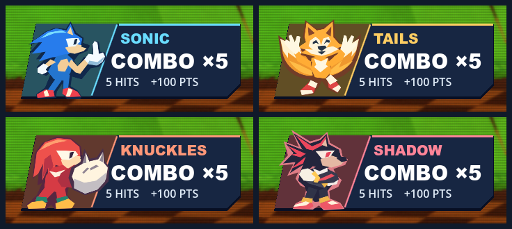
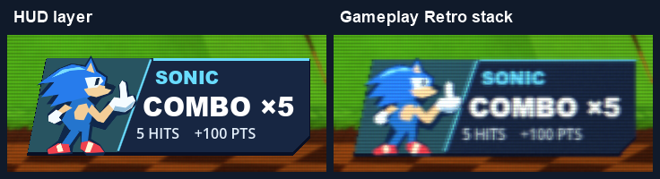

# Combo celebration review

## Sonic at the Ball

At a milestone, Sonic unfolds over 0.12 seconds, holds for 0.62 seconds and returns to the roll over 0.16 seconds. His static pose faces the play camera at the moving Ball, including on a track. The contact marker and the 2D collision body keep following gameplay. The score multiplier moves beside the pose, and the exact hit receipt appears in the lower-right corner. F9 moves the receipt between compositing layers. The world mesh receives the table's lighting and Retro treatment in either mode.

The local bake uses the prepared Sonic Runners rig. The raised sneaker, folded trailing leg and two pointing gloves follow Alex's Sonic Adventure reference. The bake keeps each knee and ankle in a common bend plane. The runtime loads a single static mesh with embedded materials. A clean checkout uses the existing Sonic illustration on a camera-facing quad at the Ball. The other three characters use their corner cards.

To reproduce with the prepared `experiments/visual_lab/local/runtime/sonic.glb` available, run the following from the repository root. The generated mesh sits beside its source. The model, studio renders and gameplay captures containing it stay local. [Asset provenance](../../experiments/visual_lab/ASSETS.md)

```powershell
& 'C:\Program Files\Blender Foundation\Blender 5.2\blender.exe' -b --factory-startup --python-exit-code 1 -P tools/bake_sonic_combo_pose.py
& 'C:\Program Files\Godot\Godot.exe' --path . --position 20,30 --fixed-fps 30 --script res://tests/combo_celebration_review.gd -- --capture-dir=res://test-results/sa1-final --require-sonic-model
```

To use an artist's saved pose, select the rig in the local Blender scene, save it, then run the command below. The exporter reads the visible joint rotations and preserves the scene file. It checks each leg against the torso beyond the hip socket before writing the gameplay mesh.

```powershell
& 'C:\Program Files\Blender Foundation\Blender 5.2\blender.exe' -b 'experiments/visual_lab/local/Sonic SA1 - Foot Study.blend' --python-exit-code 1 -P tools/bake_sonic_combo_pose.py -- --from-rig
```

## Original four-card trial



The 316 × 116 card sits 18 logical pixels from the bottom-right corner. At 1280 × 900 its bounding box occupies 3.2% of the screen. The Ball, live score popups, pause control and Special gauge remain visible in the recorded shot. [Three-second gameplay clip](gameplay.mp4)

## What triggers a pose

Scorecraft counts each fresh builder it accepts during the current combo, including fresh builders that refresh the ×4 tier. A completed Ring Link counts once. Ordinary Rings, repeated builders, support events, spinner ticks and Special cash-outs add no hits. Tier decay preserves the count while the combo is live. A combo reset clears it.

Prototype shows the selected character at 5, 8, 10, 15, 20 and each further multiple of five. The smaller line labels the hit count and displays the triggering award after Buddy contributions. A zero-point builder shows the hits alone. The multiplier beside the Ball and all ledger values retain their Scorecraft meanings.

Entrance takes 0.12 seconds, hold takes 0.62 and exit takes 0.16. A higher milestone updates the same card for the remainder of its original lifetime. Duplicate and lower receipts have no effect, including after the card expires. Pause dismisses the pose. Resume can show the next earned milestone. Combo end, character change, retry, drain, goal, draft, Act or Zone change, Results and run closure clear the old celebration. The card sleeps while hidden. Both layer choices reuse the existing viewports.

## Display treatment in the original trial



Both frames use First Try Smooth Decor in Green Hill, loaded from disk in Prototype. They share a camera, Ball position, five-hit receipt and card age. The upper 740 rows match pixel for pixel. The game runs its production N64, VHS and 480-line CRT effects in both. Routing the card through that stack softens the points line and merges the highlights on Sonic's glove and shoes. The crisp HUD is the play default. Pass `--combo-cut-in-retro` after Godot's `--` separator for the other placement. [Full crisp frame](sonic.webp) · [Full Retro frame](sonic-retro.webp)

## Repeat the review

The deterministic fixture starts a three-Act Prototype using seed 18 and current Green Hill bakes for Clover Scoop, First Try Smooth Decor and RampMania. Use **Bake Prototype** if these local recipes are stale. The commands below use the non-primary display on the project workstation. The fixture also positions the window using Godot's monitor geometry.

```powershell
$godot = 'C:\Program Files\Godot\Godot.exe'
$review = 'res://tests/combo_celebration_review.gd'
& $godot --path . --position 20,30 --script $review -- --interactive
```

| Control | Fixture action |
| --- | --- |
| 1 / 2 / 3 / 4 | Start a five-hit chain for Sonic / Tails / Knuckles / Shadow |
| 5 / 8 / 0 | Reach five / eight / ten hits for the current character. Press quickly to see an in-place upgrade. Repeating a target starts a fresh review chain. |
| Enter | Pause or resume through the real Prototype session |
| 9 | Pay the Act target and touch the goal. Choose a Buddy to inspect the next Act. |
| F9 | Move the same card between the HUD and the gameplay Retro stack |

The interactive fixture parks the Ball for repeated timing trials. The capture fixture releases the real Ball and injects distinct scoring events on fixed frames. The clip records three seconds at 30 fps. The Ball travels 100.5 table pixels during the 27 frames with a visible cut-in. Native PNGs for each character and both treatments use a held camera after the clip. Intermediate frames and fixture settings live under `test-results`.

```powershell
& $godot --path . --position 20,30 --fixed-fps 30 --script $review -- --capture-dir=res://test-results/combo-review-media
ffmpeg -framerate 30 -i test-results/combo-review-media/frames/%03d.jpg -frames:v 90 -c:v libx264 -crf 17 -pix_fmt yuv420p -movflags +faststart gameplay.mp4
```

## Final art handoff

Supply one static, transparent, square pose per character. Each placeholder is 256 × 256 and fits a 127 × 127 logical-pixel slot. Keep the face and gesture legible at display size. Leave the name, hit count, points and card background to the HUD. Replace the texture references in the presentation script if the filenames or format change. [Pose assets](../../assets/ui/combo_poses/) · [Card layout and texture slots](../../scripts/prototype/combo_celebration.gd)

For play review, try a rapid flipper rally and watch a shot into the far lower-right corner with Wide or Top-down selected. The follow-camera clip establishes the center clearance. The card can temporarily cover hardware near that edge.

## Verification

The on-Ball Sonic review passed 139 checks in Forward+/Vulkan with the local mesh required. The rolling mesh gave way to Sonic for 23 of the 27 celebration frames. The Ball traveled 100.5 table pixels. The fixture also exercised the shared-build illustration, natural expiry, pause and checkpoint recovery. The six-session lifecycle review passed 45 checks and observed the Sonic mesh during teardown.

Godot 4.7.2 passed 128 checks in the Forward+/Vulkan capture fixture, 32 in its headless run and 10 in a keyboard-control smoke run. The two-Zone Prototype regression passed 176 checks, including drafts, the Zone seam, Results, replay, restart and menu. Six repeated Vulkan sessions passed 45 lifecycle checks, alternating live cards between the HUD and Retro viewport. All card weak references expired and node/orphan counts returned to baseline.

Scorecraft (29), Economy V1 (44), Buddy scoring (70), Prototype score feedback (25), goal and meter (23), soft retry (62), four-character actions (33), Retro physics (8), pixel quality (71) and the 40-variant Prototype bake audit (443) also passed. The review process emitted the two zero-reference ObjectDB instances at shutdown previously seen with threaded resource loading. [Engine lifecycle investigation](../LIFECYCLE_AUDIT.md)
