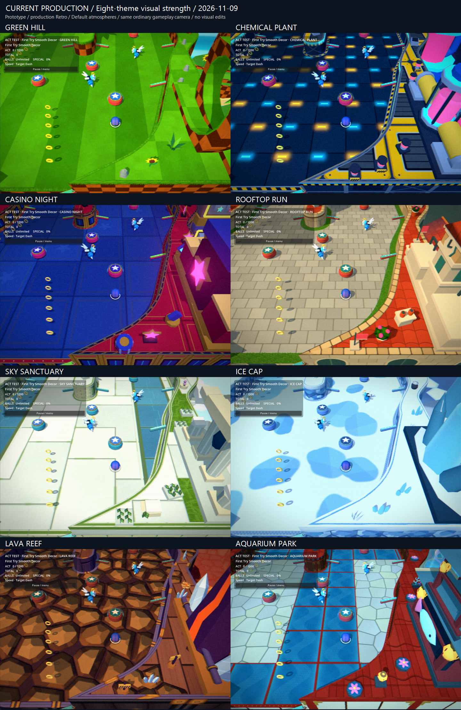
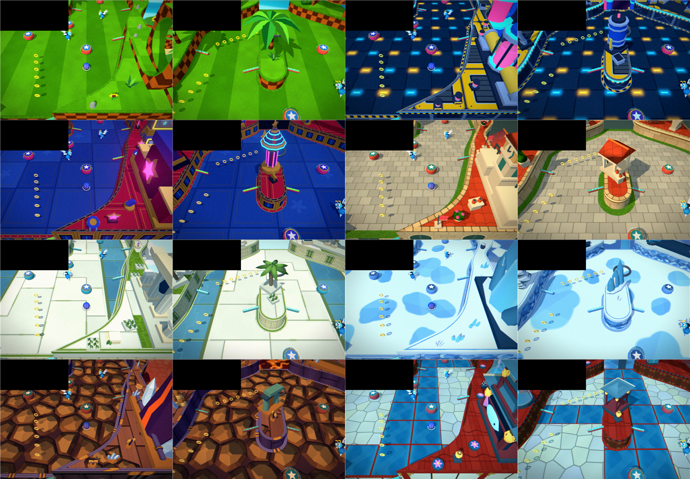

# Fresh production visual-strength audit — 2026-11-09

**Decision: leave all eight Zones unchanged.** The current material, shape and atmosphere combinations establish distinct identities at normal gameplay distance. None of the sixteen reviewed views justifies more scenery, a larger hero or removal of an existing landmark. This is a new assessment of the current appearance, not a continuation of the earlier identity/signature/coverage verdicts.

Starting source: `a1c110781aa4bb7003940060c221575b5a607d0b`, including the approved four-theme material rework and latest published Default atmospheres. The working tree was initially clean. Separate portable-authoring edits appeared during capture; their paths are recorded in provenance and are excluded from this work.

## Review set and authority

Exactly two positions per theme: First Try Smooth Decor's ordinary served-Ball view at `(400,500)`, then the useful central/Goal approach at `(300,250)`. Both use the existing canonical Prototype fixture, validated disk Act/background recipes, Forward+/Vulkan, production Retro, current Default atmosphere, seed 18, 1440×1000 output, 4× MSAA and 100% device render scale. Retro retains its authored internal resolution. No Lab appearance, old screenshot or OFF-render comparison supplies this verdict.

The second position changes only the fixture's camera target, not production camera behavior. The Ball remains served at spawn; time, score and Goal state remain fixed. It is a later-position still, not evidence of human traversal. This pair shows both the edge landmark and the repeated central motif without enlarging objects or changing zoom. Distant scenery is visible only through small openings; these views do not certify every background silhouette or every Act.

Judgment order: broad material/color identity, playable-surface readability, mid-scale shapes, hero silhouette, background, tiny details. Where the first four carry the Zone, limited background exposure is not a reason to add scenery.

## Theme decisions

| Theme | Current strength | Weakness, if any | Change | Why |
| --- | --- | --- | --- | --- |
| Green Hill | Very strong classic baseline: broad grass bands, checker cliffs, loop, sunflower and central palm. | No identity weakness in either view. | None. | Simple terrain pattern and recognizable silhouettes remain the cleanest reference. |
| Chemical Plant | Strong industrial identity: dark blue panels, yellow hazard structure, magenta vessels, heavy collars and central tank. | Yellow floor lamps compete locally with Rings; distant factory is not meaningfully exposed here. | None. | Machinery is recognizable by shape as well as palette. More distant/hero structure would not resolve floor contrast. |
| Casino Night | Strong casino identity: gold-framed red architecture, extruded stars, repeated cabinet-like blue bays and a tiered star-topped pylon. | Blue Sonic relies partly on the contact marker over the blue deck. Reels are not clearly exposed in this pair. | None. | Stars, trim, repeated bays and theatrical shapes carry identity beyond neon hue; no need to claim invisible reels as evidence. |
| Rooftop Run | Strong city identity: terracotta roof bands, cream masonry, facade arches and a central roofed building. | Spawn clock is clipped by the frame. | None. | The later roof/facade view stays unmistakably urban without the clock. More clocks would overcompensate. |
| Sky Sanctuary | Strong ancient-sky identity: pale constructed slabs, green borders/insets, monumental columns, leafy stone tablets and open blue-white gaps. | Bright paving gives gold Rings less value separation; cloud banks are not substantially exposed in this pair. | None. | The approved stone/green material language carries the quieter central view. Sparse space supports the sanctuary; no geometry deficit remains in the reviewed views. |
| Ice Cap | Strong frozen identity: broad snow/ice patches, darker faceted frozen walls, snow caps and substantial crystal blades. | Bright snow reduces separation for pale/cyan hardware; motion still matters. | None. | The material layers and bold crystal shapes read as a stylized frozen Sonic Zone, not generic white terrain. No extra gate or crystal cluster needed. |
| Lava Reef | Strong physical volcanic identity: broad ochre rock facets and dark seams, purple basalt walls, molten cleft, crystals and mining structure. | Warm Rings/bumper bodies compete with warm plates; the dark locked Goal is partly hidden by the central structure. | None. | The ground reads as solid faceted plates even away from the hero. Purple rock and molten openings add structure beyond orange color. More rocks would increase competition. |
| Aquarium Park | Strong constructed aquatic-park identity: red architecture and borders, pale polygonal stone, blue inset panels, tiered pavilion and lanterns. | Blue Sonic over blue panels needs its contact marker; the existing fish is a strong edge accent. | None. | The later view remains identifiable without the large fish. Red architecture organizes the scene, pale stone separates it, blue panels and water supply aquatic context. Do not multiply aquatic symbols. |

The texture rework supplies the missing physical distinction in Sky, Ice and Lava, and strengthens Aquarium's architectural hierarchy. This is a current sufficiency judgment, not a measured before/after claim about which individual edit caused the improvement. Sky and Ice share high brightness but differ immediately in surface organization: constructed paving/green masonry versus snow patches/faceted blue ice. Chemical and Casino share saturated colors but differ in machinery/hazard bands versus red-gold theatrical architecture and stars.

Existing landmarks still provide useful secondary punctuation. Aquarium's fish is no longer required to explain every frame, but its existing edge placement does not justify destructive cleanup. The clipped Rooftop clock is not evidence that the city lacks identity. Neither case earns more objects or a forced removal.

## Final comparisons



[Open the normal sheet](eight-themes.png). Frames are downscaled uniformly to 720×500, with labels outside the image. Full 1440×1000 originals retain the gameplay HUD and unmodified colors.



[Open the label-free sheet](label-free.png). Theme groups follow the same row order as the normal sheet: Green Hill / Chemical; Casino / Rooftop; Sky / Ice; Lava / Aquarium. Within each group, spawn is left and later position is right. Each frame is 360×250. The original HUD rectangle `(0,0,570,255)` is masked identically before scaling so the theme name cannot answer the test. No gameplay crop, color grading or contrast adjustment is applied.

| Theme | Ordinary view | Later position |
| --- | --- | --- |
| Green Hill | [Native](frames/spawn/green_hill.png) | [Native](frames/mid/green_hill.png) |
| Chemical Plant | [Native](frames/spawn/chemical_plant.png) | [Native](frames/mid/chemical_plant.png) |
| Casino Night | [Native](frames/spawn/casino_night.png) | [Native](frames/mid/casino_night.png) |
| Rooftop Run | [Native](frames/spawn/rooftop_run.png) | [Native](frames/mid/rooftop_run.png) |
| Sky Sanctuary | [Native](frames/spawn/sky_sanctuary.png) | [Native](frames/mid/sky_sanctuary.png) |
| Ice Cap | [Native](frames/spawn/ice_cap.png) | [Native](frames/mid/ice_cap.png) |
| Lava Reef | [Native](frames/spawn/lava_reef.png) | [Native](frames/mid/lava_reef.png) |
| Aquarium Park | [Native](frames/spawn/aquarium_park.png) | [Native](frames/mid/aquarium_park.png) |

## Retained work and verification

Retained production changes: **none**. All eight themes are intentionally untouched. This commit records the audit, current evidence and reproduction helper only. No new meshes, materials, lights, shadows, transparency, animation or rendering work. Gameplay, collision, physics, scoring, Acts, camera, selected textures, Default atmospheres and device settings are unchanged by this task. No new bake or performance benchmark is necessary for an evidence-only result.

Both graphical capture batches pass with **8 captures and zero failures each**. Both fresh-process authority/freshness regressions pass **159 checks each: 318 total, zero failures**. Results are retained in [spawn receipts](receipts/spawn/) and [later-position receipts](receipts/mid/). The manifests record actual loaded source-texture pixel matches, scene/library authority, renderer, graphics, atmosphere, source hashes and zero source fallbacks. [Export verification](verification.json) records all sixteen original image hashes and checks identical art, recipes, atmosphere, graphics and gameplay state between positions; only the camera transform differs. Both exported sheets were visually inspected. The final native originals are byte-identical to the sixteen frames inspected individually during the preliminary review; only final successful batches are published.

The initial sandbox runs encountered Windows log/cache and certificate-store access errors and were rejected. Their images are not shipped. The final runs use an isolated review profile with the necessary OS access. Separate portable-authoring changes are preserved and excluded. This is not a full gameplay regression or performance measurement; no runtime code changed.

## Questions requiring Alex in motion

- Can Rings stay easy to follow across Chemical's yellow floor lamps, Sky/Ice highlights and Lava's warm plate faces?
- Does blue Sonic remain easy to track on Casino/Aquarium blue surfaces, with the existing contact marker?
- On the Lava Goal approach, does the existing central structure hide the locked Goal long enough to hinder the shot? The still shows partial occlusion; camera movement determines its practical cost.

No scenery decision is blocked on these questions. Any later readability work should target an observed moving-object problem rather than add decorative identity. Cloud motion and other Acts were not re-certified here; the restricted review set deliberately avoids another coverage matrix.

## Reproduce

From the repository root, with current bakes and a new output root:

```powershell
$review = Join-Path (Get-Location) 'test-results/visual-strength-20261109'
$env:APPDATA = Join-Path $review 'profile'
$env:LOCALAPPDATA = Join-Path $review 'local-profile'
New-Item -ItemType Directory -Force $env:APPDATA,$env:LOCALAPPDATA | Out-Null
./tools/capture_prototype_appearance.ps1 -SkipBake -Retro production -OutputDirectory "$review/final-spawn"
./tools/capture_prototype_appearance.ps1 -SkipBake -Retro production -CameraTarget '300,250' -OutputDirectory "$review/final-mid"
./docs/visual-strength-20261109/export.ps1 -EvidenceRoot $review
```

The capture runner refuses existing output directories and fails closed on stale recipes. The exporter only assembles validated final batches. Use a new root when reproducing; do not overwrite or reinterpret earlier audit images as current.
